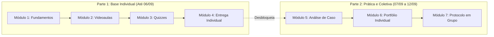

# Quinzena 04 - Introdução e Orientações de Estudo
### Engenharia de Contexto como Metodologia Estruturada de Pensamento

> **Docente Responsável:** Prof. José Avelino Placca  
> **Status:** 🟡 Em andamento  
> **Prazo da Base Individual (Módulos 1 a 4):** **Domingo, 06 de setembro de 2026, às 23h59**  
> 💡 _A conclusão dos Módulos 1 a 4 no prazo desbloqueia o acesso imediato ao Laboratório e Trabalho em Grupo._

---

## 📌 1. Boas-vindas e Visão Geral da Quinzena

> *"Na quinzena passada você decidiu o que delega. Registrou, no seu Plano Pessoal de Uso Consciente, o que entrega para a ferramenta, o que faz com apoio dela e o que mantém integralmente seu. Essa decisão continua valendo. A pergunta desta quinzena é a que vem logo depois: já que você decidiu pedir ajuda numa tarefa, como se pede?"*  
> - **Prof. José Avelino Placca**

A resposta rápida, que quase todo mundo já ouviu, é *"escreva um bom prompt"*. Ela não está errada, mas está incompleta: a diferença entre uma resposta genérica e uma resposta útil quase nunca está na frase que você digitou por último. Está no que você colocou na frente dela:
- O exemplo que você forneceu;
- A fonte que você anexou;
- A conversa que já vinha acontecendo;
- O critério que você deixou claro (ou deixou de fora).

### 🛠️ Os Quatro Instrumentos Práticos da Quinzena

Ao longo dos estudos, você desenvolverá quatro instrumentos permanentes para levar além da disciplina:

1. **Os Quatro Componentes de uma Instrução Completa:** Papel, Objetivo, Restrições e Formato.
2. **O Mecanismo de Estreitamento do Espaço Amostral:** A explicação técnica de por que fornecer mais contexto e restrições estreita o espaço estatístico de respostas possíveis da IA.
3. **Os Três Limites Estruturais:** Limitações intrínsecas que nenhuma instrução - por melhor que seja - resolve sozinha (o que ficou fora da janela de contexto, o que está fora do domínio da ferramenta ou o que ninguém conferiu).
4. **O Ciclo de Iteração em Três Passos:** Um método estruturado para diagnosticar e corrigir uma resposta insatisfatória ou incorreta.

No fechamento, você aplicará esses quatro instrumentos em uma situação real do seu semestre, identificando na prática qual componente você costuma omitir com maior frequência.

---

### 🎯 O Que Você Vai Aprender (Objetivos de Aprendizagem)

Ao final desta quinzena, você será capaz de:

- [ ] **01. Distinguir Prompt de Contexto:** Diferenciar Engenharia de Prompt de Engenharia de Contexto, dominando os quatro componentes de uma instrução completa: **papel**, **objetivo**, **restrições** e **formato**.
- [ ] **02. Decomposição Estruturada de Demandas:** Decompor uma informação bruta (como uma mensagem rápida ou um pedido informal) nesses quatro componentes, identificando lacunas antes de formular a instrução final.
- [ ] **03. Diagnóstico de Limites Estruturais:** Associar falhas nas respostas ao seu respectivo limite estrutural: o que ficou fora da janela, o que extrapola o domínio da ferramenta ou o que carece de verificação humana.
- [ ] **04. Aplicação do Ciclo de Iteração em Três Passos:** Depurar respostas insatisfatórias avaliando o resultado por critérios verificáveis e identificando a causa raiz da falha.
- [ ] **05. Autodiagnóstico e Documentação:** Mapear e documentar o seu próprio processo de construção de instruções, identificando o componente que você mais costuma deixar de fora.

---

## 🗓️ 2. Lembrete de Datas, Prazos e Live

| Etapa | Período / Prazo Limite | O que deve ser feito |
| :--- | :--- | :--- |
| **Parte 1 (Individual: M1 a M4)** | **Domingo, 06/09 às 23h59** | Conclusão dos Módulos 1, 2, 3 e 4. O ritmo é individual, mas o encerramento é comum. Concluir antes libera imediatamente a etapa prática. |
| **Envio no Laboratório de Revisão** | **07/09 a 12/09 (Sábado às 23h59)** | Janela de envio simultâneo do seu **Portfólio Individual** e do **Protocolo de Contexto do Grupo**. |
| **Período de Revisão por Pares** | **13/09 a 15/09 (Terça às 23h59)** | Avaliação mútua: você lê o portfólio de um colega e o seu grupo lê o protocolo de outro grupo, registrando retornos formativos. |

### 🎙️ Participação na Live da Quinzena
> ⚠️ **Atenção à presença na Live:**  
> A quinzena oferece cerca de **dez opções de lives**, em diferentes dias e horários. Participar ao vivo de pelo menos uma delas é requisito que compõe a sua nota de participação na quinzena.  
> *A gravação é disponibilizada para revisão posterior, mas apenas a presença registrada ao vivo é computada no seu percurso.*

---

## 🧭 3. Orientação de Estudo e Dinâmica de Execução

### 🛤️ O Seu Caminho em Duas Partes

- **Parte 1, sozinho (Módulos 1 a 4):** Você estuda no seu ritmo, e cada módulo concluído abre o seguinte.
- **Parte 2, a prática (Módulos 5, 6 e 7):**
  - **Módulo 5:** Análise de uma história real de trabalho.
  - **Módulo 6:** Redação do portfólio individual, consolidando as decisões tomadas nos quatro módulos anteriores.
  - **Módulo 7:** Construção colaborativa do *Protocolo de Contexto* com a sua equipe.

---

### 💡 Recomendações Importantes para o Estudo

> [!IMPORTANT]
> **1. Concluir não é o mesmo que apenas responder:**  
> Clique expressamente no botão de **conclusão** da última tela de cada atividade e envie os quizzes. Antes de sair de um módulo, volte à página dele e confira se todos os itens aparecem marcados. É a principal causa de *"fiz tudo e o módulo seguinte não abriu"*.

> [!TIP]
> **2. Guarde as suas decisões - elas viram o seu portfólio:**  
> Ao longo dos quatro módulos você tomará decisões concretas: qual componente falta numa mensagem, qual limite explica um erro ou o que muda ao corrigir um componente. Anote essas decisões logo que elas aparecerem; no Módulo 6, o portfólio solicita exatamente isso aplicado à sua rotina.

> [!NOTE]
> **3. O retorno que você dá vale tanto quanto o que você recebe:**  
> No Laboratório de Revisão, você lerá o material de um colega ou grupo e fornecerá um retorno construtivo. Revisar o raciocínio alheio apura a sua própria capacidade analítica. Escreva feedbacks que realmente ajudem, destacando pontos fortes e aspectos que precisam de clareza.

> [!IMPORTANT]
> **4. Leia o retorno explicativo das atividades até o fim:**  
> Mesmo quando acertar a questão, leia a justificativa completa. O feedback explica o porquê de cada alternativa (corretas e incorretas), e é essa fundamentação que embasa as provas presenciais.

---

### 📊 Sistema de Pontuação (XP vs. Nota)

* **Pontos de Experiência (XP):** Marcam o caminho percorrido na trilha, mas **não** entram no cálculo da nota. O gatilho que libera a parte prática é a conclusão do Módulo 4.
* **Nota no AVA (Ambiente Virtual):** Reconhece a sua regularidade e participação integral:
  1. Conclusão dos 4 módulos individuais no prazo;
  2. Envio do Portfólio Individual (Módulo 6);
  3. Envio da entrega do Grupo (Módulo 7);
  4. Envio dos dois retornos na revisão por pares;
  5. Presença confirmada ao vivo em uma das lives;
  6. Regularidade de acessos ao longo das semanas.
* **Nota de Conteúdo:** O domínio conceitual e técnico é aferido na **Prova Presencial**.

---

> ❓ **Dúvidas sobre o funcionamento?**  
> O documento de **Perguntas Frequentes (FAQ)**, disponível no início da disciplina no AVA, esclarece prazos, funcionamento dos grupos e regras de envio. Vale consultar antes de acionar a tutoria.