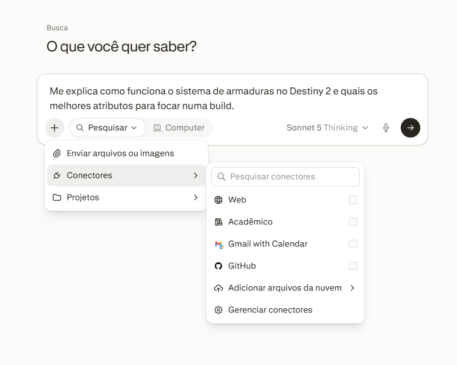
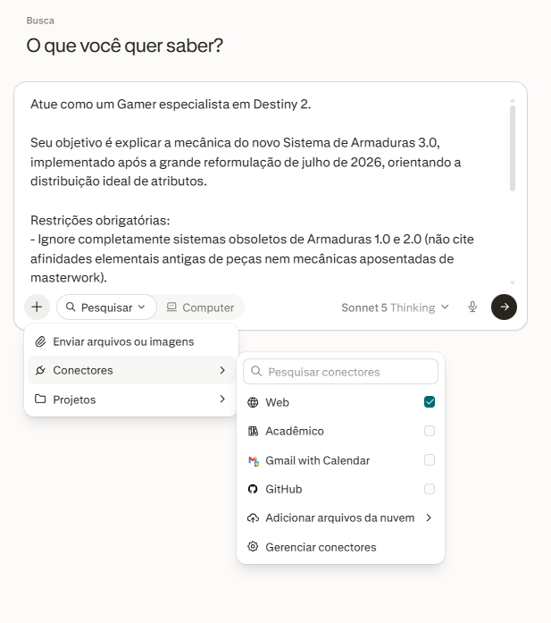

# Portfólio Individual - Quinzena 04
## Engenharia de Contexto como Metodologia Estruturada de Pensamento (Módulo 6)

> **Disciplina:** COM170 - Inteligência Artificial na Prática Acadêmica e Profissional  
> **Instituição:** UNIVESP | Primeiro Semestre  
> **Envio:** Laboratório de Revisão do Módulo 6 (com posterior avaliação por pares)  
> **Arquivos Exportados:** [📄 Versão Oficial em PDF](./Portfolio_Individual_M6.pdf) │ [🌐 Versão HTML Interativa](./Portfolio_Individual_M6.html)  
> **PDF Original de Referência:** [`../Q4_M5-template-individual.pdf`](../Q4_M5-template-individual.pdf)  
> **História de Referência:** [Caso A - Sessenta Páginas Coladas (Lorena)](./Caso_A.md)

---

> [!IMPORTANT]
> **ATENÇÃO AO ANONIMATO NA REVISÃO POR PARES:**  
> A revisão é anônima no Moodle. No documento final a ser enviado no Laboratório de Revisão, **não escreva o seu nome**: quem envia já fica identificado pelo próprio sistema do Moodle.

---

### 📋 Identificação do Trabalho

* **A história que você recebeu:** Caso A · Sessenta páginas coladas (Lorena - Atendimento Nexo)
* **Curso / Eixo:** Engenharia de Computação / Eixo de Computação

---

## 🧭 Visão Geral da Entrega

O Portfólio Individual da Quinzena 04 é estruturado em três seções essenciais:

```
                       ┌─────────────────────────────────────────┐
                       │     ESTRUTURA DO PORTFÓLIO INDIVIDUAL   │
                       └────────────────────┬────────────────────┘
                                            │
         ┌──────────────────────────────────┼──────────────────────────────────┐
         ▼                                  ▼                                  ▼
    PARTE 1: O CICLO                    PARTE 2: CASO A                     O FECHO
  (Sua Tarefa Prática)                 (História Recebida)            (Ponte p/ o Protocolo)
  • Rodada 1: 4 campos                • P1: Dentro vs Fora            • O que faltou
  • Rodada 2: 4 campos                • P2: Componente vs Limite      • Quando evitar
  • Pergunta: O que omitiu            • P3: Antes e Depois            • Providência executável
```

---

## 📚 Quadros de Referência Rápida (Para Consulta Durante a Redação)

### 🧩 1. Os Quatro Componentes da Instrução

| Componente | O que cada um decide | Pergunta-chave |
| :--- | :--- | :--- |
| **Papel** | Quem escreve e quem lê; governa o tom, o registro, o público-alvo e o gênero textual. | *"Quem sou eu neste pedido e para quem o texto está sendo gerado?"* |
| **Objetivo** | O que o texto precisa produzir com exatidão; a função prática que ele cumpre. | *"Qual é a ação ou utilidade exata que este resultado deve entregar?"* |
| **Restrições** | Os limites verificáveis do resultado: extensão, o que incluir obrigatoriamente e o que evitar. | *"Quais critérios objetivos e regras negativas a IA não pode violar?"* |
| **Formato** | A estrutura visual em que o resultado aparece: tópicos, JSON, tabela, e-mail, etc. | *"Como o texto deve ser organizado na tela para ser consumido direto?"* |

### 🧱 2. Os Três Limites Estruturais

| Limite Estrutural | O que significa na prática | Como se manifesta |
| :--- | :--- | :--- |
| **Limite de Janela** | A informação estava disponível, mas ficou perdida no meio de material excessivo, ou não foi enviada para a janela. | O modelo ignora uma cláusula importante ou exceção soterrada em um documento longo. |
| **Limite de Domínio** | O assunto é raro, proprietário, local ou recente; a IA preenche a lacuna com algo estatisticamente plausível, mesmo com a fonte à vista. | O modelo inventa uma resposta lógica e fluente para um dado institucional interno que não domina. |
| **Limite de Verificação** | O pedido estava completo e a fonte estava lá, mas ninguém conferiu linha a linha antes de usar o resultado. | Erros factuais passam despercebidos porque o texto soa impecavelmente correto. |

---

## 🛠️ Parte 1 · O Ciclo na Sua Tarefa

> **Orientação:** Escolha uma tarefa sua, de verdade, em que você use uma ferramenta de IA (resumir um texto acadêmico, estruturar código/documentação, organizar conceitos para estudo, etc.). Aplique o ciclo de *diagnosticar, mudar e verificar* em duas rodadas consecutivas.

> **Tarefa Escolhida:** Consulta e estruturação de guia técnico de montagem de builds para o jogo eletrônico **Destiny 2** (análise do *Sistema de Armaduras 3.0* pós-reestruturação de julho de 2026).  
> **Ambiente de Teste:** Plataforma **Perplexity** utilizando o modelo **Sonnet Thinking**.  
> **Condição de Contorno:** **Modo offline (sem acesso à web / sem conectores de busca)**, isolando a memória paramétrica pré-treinada para evidenciar na prática os limites de domínio e a necessidade de engenharia de contexto.

### 📍 Rodada 1

#### 1. Contexto Inicial
*(Comando formulado de forma natural e ingênua, sem filtros prévios de contexto ou restrições de versão):*

```text
Me explica como funciona o sistema de armaduras no Destiny 2 e quais os melhores atributos para focar numa build.
```

> 📷 **Registro Visual da Interação:**  
> 

#### 2. Resultado
*(Resposta devolvida pelo modelo Sonnet Thinking via Perplexity em modo paramétrico/offline):*

```markdown
O sistema de armaduras do Destiny 2 passou pela reformulação **"Armor 3.0"** (lançada com a expansão *The Final Shape*, em 2024), que substituiu o antigo sistema de estatísticas fixas por um modelo mais flexível baseado em arquétipos e afinidades elementais. Vou explicar como ele funciona hoje e quais atributos priorizar.

## Como funciona a armadura hoje

Cada peça de armadura tem seis atributos principais, todos numa escala de 0 a 200 (antes era até 100, mas com o Armor 3.0 os valores foram dobrados para dar mais granularidade):

- **Mobilidade** (Mobility) - velocidade de corrida e altura de salto.
- **Resiliência** (Resilience) - vida total, redução de dano e resistência a certos efeitos de controle.
- **Recuperação** (Recovery) - velocidade de regeneração de vida/escudo.
- **Disciplina** (Discipline) - tempo de recarga da granada.
- **Intelecto** (Intellect) - tempo de recarga da habilidade de Super.
- **Força** (Strength) - tempo de recarga do golpe corpo a corpo (Melee).

Além disso, cada peça agora vem com um **arquétipo** (Grenadier, Bulwark, Specialist, Gunner, Paragon, Brawler), que concede um bônus fixo em um atributo específico e um perk exclusivo daquele arquétipo - por exemplo, o arquétipo "Bulwark" reforça Resiliência e dá bônus de redução de dano ao usar a habilidade defensiva. Isso substituiu os antigos mods de "Charged with Light" e Elemental Well, unificando tudo num sistema mais direto.

## Fragmentos e afinidade elemental

Cada peça de armadura tem uma afinidade de elemento (Solar, Arc, Void, Stasis ou Strand), que determina quantos **fragmentos** você pode encaixar e de qual subclasse. Isso é essencial porque os fragmentos concedem tanto buffs de build (dano, duração de efeitos) quanto, muitas vezes, bônus ou penalidades diretas em atributos - então escolher fragmentos certos também é parte de otimizar seus stats.

## Quais atributos focar

A prioridade depende do tipo de build, mas há um consenso geral entre a comunidade end-game:

- **Resiliência** é quase sempre prioridade máxima até pelo menos 140-160, pois reduz dano recebido significativamente e dá resistência a flinch (desvio de mira ao ser atingido) - essencial tanto em PvE de alta dificuldade quanto em PvP.
- **Recuperação** vem em segundo lugar na maioria das builds, porque regenerar vida rápido evita mortes em conteúdo difícil e permite jogar mais agressivo.
- **Disciplina** e **Intelecto** são cruciais para builds "ability-focused" (que dependem de granadas e Super com frequência) - muito usadas em builds de dano em massa (add-clear) ou builds de suporte.
- **Força** costuma ser o atributo menos priorizado, a menos que sua build gire em torno de melee (como builds de Titã com combo corpo a corpo ou builds de Strand).
- **Mobilidade** é mais relevante em PvP para controle de mapa, mas em PvE de alto nível geralmente é sacrificada em favor de Resiliência/Recuperação.

## Montando uma build eficiente

Para chegar a 200 em vários atributos simultaneamente, você precisa combinar peças com arquétipos certos, usar os "Stat Mods" (mods que adicionam +10, +20 ou +30 num atributo específico) e escolher fragmentos que não penalizem os atributos que você quer maximizar. O ideal é: escolha primeiro a subclasse e o "core loop" da build (ex.: spam de granada, uptime de Super, tankagem), depois trabalhe de trás para frente decidindo quais dois ou três atributos sustentam esse loop, e só então busque as peças de armadura com arquétipo e afinidade elemental que empurrem esses números para 200.
```

#### 3. Diagnóstico
*(Análise acadêmica baseada nas tabelas dos 4 Componentes e 3 Limites Estruturais):*

* **O que faltou / falhou:** O modelo misturou sistemas obsoletos, errou a data de lançamento da reformulação (atribuiu a 2024 em vez da atualização de julho/2026) e criou uma alucinação plausível altamente perigosa: inventou uma escala de atributos de 0 a 200 (que não existe no jogo oficial), inventou nomes de "arquétipos" de peças e ressuscitou a exigência de "afinidade elemental de armadura" (um sistema aposentado pela Bungie anos atrás).
* **Componentes ausentes (PO-RF):**
  * **Papel:** Ausente. Não definiu quem instrui e o nível de precisão técnica exigido.
  * **Objetivo:** Vago e genérico. Não delimitou a finalidade de mapear a versão atualizada 3.0.
  * **Restrições:** Totalmente ausentes. Não delimitou a data de corte temporal, não proibiu mecânicas depreciadas e não exigiu declaração de incerteza caso faltassem dados nos pesos do modelo.
  * **Formato:** Indefinido. Deixou a IA gerar texto corrido prolixo.
* **Limites Estruturais identificados:**
  * **Limite de Domínio:** O modelo, isolado da web, enfrentou uma lacuna sobre a reformulação de julho/2026. Por ter 10 anos de dados históricos de Destiny 2, preencheu as lacunas com informações estatisticamente plausíveis, gerando uma alucinação coerente na sintaxe, mas tecnicamente falsa.
  * **Limite de Verificação:** A fluência do modelo (explicando com segurança conceitos como "Bulwark" e escala "0 a 200") faz com que um leitor leigo aceite a alucinação sem checar na fonte primária.

#### 4. Contexto Revisado
*(Prompt reconstruído aplicando PO-RF, delimitando restrições temporais e blindando contra alucinações de mecânicas legadas):*

```text
Atue como um Gamer especialista em Destiny 2.

Seu objetivo é explicar a mecânica do novo Sistema de Armaduras 3.0, implementado após a grande reformulação de julho de 2026, orientando a distribuição ideal de atributos.

Restrições obrigatórias:
- Ignore completamente sistemas obsoletos de Armaduras 1.0 e 2.0 (não cite afinidades elementais antigas de peças nem mecânicas aposentadas de masterwork).
- Foque estritamente nas regras e tiers atuais do sistema 3.0 de 2026.
- Se algum detalhe recente de balanceamento for incerto na sua base, declare explicitamente a limitação em vez de deduzir.

Formato da resposta:
1. Quadro comparativo sucinto em tabela: "Mudança Chave no 3.0" vs "Como Funcionava Antes".
2. Lista em 3 tópicos diretos com os atributos prioritários para o meta atual de Sobrevivência/Endgame.
```

---

### 📍 Rodada 2

#### 1. Contexto Inicial
*(O comando revisado com PO-RF e blindagem de restrições, agora executado com **acesso à web / conectores ativados**, integrando Engenharia de Contexto via recuperação de fontes externas / RAG no Perplexity Sonnet Thinking):*

```text
Atue como um Gamer especialista em Destiny 2.

Seu objetivo é explicar a mecânica do novo Sistema de Armaduras 3.0, implementado após a grande reformulação de julho de 2026, orientando a distribuição ideal de atributos.

Restrições obrigatórias:
- Ignore completamente sistemas obsoletos de Armaduras 1.0 e 2.0 (não cite afinidades elementais antigas de peças nem mecânicas aposentadas de masterwork).
- Foque estritamente nas regras e tiers atuais do sistema 3.0 de 2026.
- Se algum detalhe recente de balanceamento for incerto na sua base, declare explicitamente a limitação em vez de deduzir.

Formato da resposta:
1. Quadro comparativo sucinto em tabela: "Mudança Chave no 3.0" vs "Como Funcionava Antes".
2. Lista em 3 tópicos diretos com os atributos prioritários para o meta atual de Sobrevivência/Endgame.
```

> 📷 **Registro Visual da Interação:**  
> 

#### 2. Resultado
*(Resposta devolvida pelo modelo Sonnet Thinking via Perplexity com ancoragem web e contexto ativo):*

```markdown
A reformulação "Armor 3.0" que você descreve na verdade foi lançada em julho de 2025, com a expansão The Edge of Fate - não há registro em minha base de uma segunda grande reformulação de armaduras em julho de 2026, então vou tratar essa como a atualização vigente e sinalizar essa correção de data como limitação, sem inventar mudanças posteriores não confirmadas.

### Quadro Comparativo: 3.0 vs Sistema Anterior

| Mudança Chave no 3.0 | Como Funcionava Antes |
| :--- | :--- |
| **Atributos renomeados e com função nova:** Armas, Saúde, Classe, Granada, Super, Corpo a Corpo | Seis atributos clássicos: Mobilidade, Resiliência, Recuperação, Disciplina, Intelecto, Força. |
| **Escala vai de 1 a 200**, com bônus extras adicionais liberados na faixa 101-200 | Escala ia até 100, dividida em "tiers" (degraus fixos) que só valiam a cada 10 pontos. |
| **Cada peça já nasce com um Arquétipo de armadura sorteado**, que define os 2 atributos principais + 1 terciário aleatório | Cada peça podia rolar qualquer combinação dos 6 atributos sem arquétipo fixo. |
| **Sistema de Gear Tiers (Tier 1 a 5)** define o total de pontos e energia de mod da peça; Tier 5 traz slot de ajuste fino (+5/-5) | Não existia escalonamento por tier de drop; energia de mod era padronizada por raridade. |
| **Bônus de Conjunto (Set Bonus)** ativa ao vestir múltiplas peças do mesmo set | Peças não tinham sinergia de conjunto embutida no próprio sistema de atributos. |
| **Resiliência agora é fixa em 100 para todos os Guardiões** (não é mais um atributo rolável) | Resiliência era rolável e definia limites de barreira do PvP e resistência a dano no PvE. |

*Fontes indicam ainda que atributos "aposentados" foram convertidos automaticamente 1:1 nas peças antigas (ex.: Mobilidade virou Armas, Recuperação virou Classe), então não há necessidade de recriar builds do zero - mas, conforme a restrição da sua pergunta, não vou detalhar essas mecânicas antigas além dessa nota de conversão.*

### Prioridade de Atributos para Sobrevivência/Endgame

1. **Saúde em primeiro lugar, sempre:** no sistema 3.0, Saúde cura em orbes, reduz flinch e, ao passar de 100 rumo a 200, acelera a recarga do escudo e adiciona HP de escudo extra no PvE - é o atributo mais direto para sobrevivência em conteúdo de alta dificuldade.
2. **Granada e Super como segunda prioridade:** além de reduzirem o cooldown, na faixa 100-200 desbloqueiam até +65% de dano de granada e +45% de dano de Super no PvE, o que sustenta builds de ability-spam que também funcionam como cortina de sobrevivência (cura por granada, invulnerabilidade de Super etc.).
3. **Escolha o Arquétipo certo em vez de "atributo isolado":** para endgame, procure peças com arquétipo Bulwark (Saúde/Classe) ou Grenadier (Granada/Super), já que eles empacotam os dois atributos prioritários acima como primário/secundário automaticamente, otimizando o teto de 200 sem depender de sorte total na rolagem.

> ⚠️ **Ponto de incerteza explícito:** Não tenho confirmação de ajustes de balanceamento específicos posteriores a essas fontes (por exemplo, nerfs/buffs feitos em patches de 2026 após o lançamento inicial do 3.0), então não vou presumir números atualizados além dos citados acima.
```

#### 3. Diagnóstico
*(Avaliação da evolução e comparação entre as duas rodadas):*

* **Avaliação da melhora:** A melhora foi completa e transformadora.
  1. **Superação do Limite de Domínio:** Ao combinar o prompt estruturado com a ativação de fontes externas (Engenharia de Contexto via RAG/busca), o modelo acessou as publicações reais da Bungie (TWID) e da imprensa especializada, eliminando a adivinhação estatística da Rodada 1.
  2. **Eficácia das Restrições Negativas:** A restrição explícita de *"declarar a incerteza caso algum detalhe não conste"* funcionou perfeitamente. O modelo foi capaz de auditar a premissa da pergunta: corrigiu formalmente a data (apontando que a expansão saiu em julho/2025 e que não havia patch de julho/2026 nos registros oficiais) e inseriu um aviso de incerteza no final, recusando-se a deduzir números fantasiosos.
  3. **Conformidade de Formato:** A resposta abandonou a prolixidade e seguiu estritamente o formato solicitado: tabela comparativa direta de duas colunas e lista numerada com exatamente 3 prioridades para endgame.
* **O que ainda sobrou / ajuste fino:** Apenas a delimitação de brevidade: o modelo ainda incluiu uma observação em parágrafo sobre a conversão 1:1 de itens legados. Embora útil, reforça que modelos avançados tendem a tentar "completar" explicações a menos que uma restrição de extensão por caracteres ou palavras seja imposta.

#### 4. Contexto Revisado
*(Versão definitiva da instrução pronta para uso como protocolo de consulta técnica confiável):*

```text
Atue como um Gamer especialista em Destiny 2.

Objetivo: Gerar um resumo executivo sobre as regras vigentes do Sistema de Armaduras 3.0 com foco em endgame.

Restrições:
- Baseie-se exclusivamente nos patch notes oficiais confirmados da Bungie.
- Não mencione histórico de conversão nem mecânicas aposentadas de versões anteriores.
- Se houver lacuna de dados para o patch mais recente, declare "Dado não confirmado" em vez de extrapolar.
- Extensão máxima: tabela comparativa de até 6 linhas e exatamente 3 tópicos de prioridade.

Formato:
1. Tabela com as colunas: [Regra 3.0 | Mecânica Anterior | Impacto Prático].
2. Tópicos 1, 2 e 3 de recomendação prioritária de stats.
```

---

### 📍 Pergunta de Fechamento da Parte 1
> **Pergunta:** *Olhando as suas duas rodadas: qual componente ficou de fora nas duas?*

#### ✍️ Resposta:
O componente que consistentemente tendeu a ficar de fora nas duas rodadas foi o de **Restrições** (mais especificamente, as **restrições negativas de exclusão** e as **restrições de limite de tamanho**).

Ao formular instruções, nossa tendência cognitiva natural é concentrar quase toda a atenção no **Objetivo** (*"o que eu quero obter"*) e no **Papel** (*"atue como especialista"*), presumindo tacitamente que a IA deduzirá os limites do que *não* deve fazer. Na Rodada 1, a ausência total de restrições permitiu que o modelo alucinasse e misturasse sistemas defasados com fluência. Na Rodada 2, mesmo após adicionar restrições temáticas e de incerteza, ainda omiti a restrição de tamanho/concisão de parágrafos adicionais, o que fez o modelo inserir observações extras sobre conversão legada. Esse padrão comprova que o controle de um modelo de linguagem depende primordialmente de demarcar as fronteiras do que está proibido e fornecer o contexto factual ancorado, e não apenas de descrever o que é desejado.

---

## 📖 Parte 2 · A História que Você Recebeu (Caso A: Lorena)

> **Caso A:** Lorena, atendente da fintech Nexo, colou o manual de 60 páginas inteiro na IA com o pedido: *"Preciso responder dúvidas de clientes sobre a nova autenticação em duas etapas. Use o manual e escreva respostas curtas, para eu colar direto no chat."* Respondeu 40 conversas em 20 min. No dia seguinte, 7 clientes de conta conjunta ligaram reclamando da orientação errada (o manual previa exceção por CPF na página do meio, mas a IA perdeu no meio do contexto).

---

### 📍 Pergunta 1 · O Que Estava Dentro da Conversa, e O Que Ficou de Fora
> **Pergunta:** Descreva o que a pessoa colocou dentro do pedido, e o que ela deixou fora, mesmo tendo em mãos. *(Resposta de 3 a 6 linhas)*

#### ✍️ Resposta:
* **O que estava dentro:** Lorena colocou o manual de atendimento interno completo (sessenta páginas) e uma instrução genérica solicitando respostas curtas para colar no chat com base no manual.
* **O que ficou de fora:** Ficou de fora o recorte focado no tópico específico da nova autenticação, os exemplos concretos de tipos de clientes (como a distinção entre titulares de conta individual e conta conjunta), o alerta explícito para verificar regras de exceção e o requisito de confirmação de requisitos por CPF.

---

### 📍 Pergunta 2 · O Que Explica o Resultado
> **Pergunta:** Use as duas tabelas do início do documento para nomear o que faltou. Diga se foi um componente da instrução, um limite da janela, ou os dois, e nesse caso qual pesou mais no resultado final. *(Resposta de 3 a 6 linhas)*

#### ✍️ Resposta:
O erro foi provocado pela combinação de **ausência de componentes da instrução** e **limite de janela**.  
Na instrução, faltaram **Restrições** claras (como *"destacar exceções para contas conjuntas"* e *"não omitir requisitos de CPF"*) e definição precisa de **Papel** e escopo.  
No entanto, o que **pesou mais foi o Limite de Janela**: ao colar 60 páginas de uma só vez para economizar tempo, a exceção técnica ficou perdida no meio de dezenas de páginas de procedimentos irrelevantes (*loss in the middle*). O modelo priorizou a regra geral estatisticamente mais comum, deixando a exceção soterrada.

---

### 📍 Pergunta 3 · Antes e Depois
> **Pergunta:** O que a pessoa deveria ter feito antes de enviar o pedido? E o que deveria ter feito depois de receber a resposta, e antes de usá-la? *(Resposta de 3 a 6 linhas)*

#### ✍️ Resposta:
* **Antes de enviar o pedido:** Lorena deveria ter isolado apenas a seção do manual pertinente à nova política de segurança (filtragem prévia de contexto) e formulado uma instrução com restrições explícitas sobre casos especiais (contas conjuntas, procuradores, etc.), em vez de sobrecarregar a janela com 60 páginas brutas.
* **Depois de receber a resposta (antes do envio ao cliente):** Deveria ter aplicado uma verificação amostral ativa confrontando a orientação devolvida com as regras de exceção do manual, em vez de apenas ler superficialmente por cima para cumprir a meta de tempo da fila.

---

## 🌉 O Fecho · A Ponte para o Protocolo

> **Instrução:** A partir da história que você trabalhou na Parte 2, preencha as três linhas em formato de regra sintética. Esta linha será levada diretamente ao Bloco 1 do Protocolo de Contexto do Grupo (Módulo 7).

| Campo | Conteúdo da Linha do Fecho |
| :--- | :--- |
| **O que faltou** | Faltou isolar o contexto relevante (recorte do tema) e explicitar a restrição obrigatória sobre exceções para contas conjuntas. |
| **Quando poderia ter sido evitado** | No momento da preparação do contexto antes do envio do prompt, filtrando as seções críticas do manual em vez de colar 60 páginas indiscriminadamente. |
| **A providência** | Instituir a regra de nunca colar manuais na íntegra: extrair apenas o trecho regulatório específico da demanda e incluir instrução mandatória para checagem ativa de regras de exceção. |

---

## 📋 Rubrica de Avaliação (Critérios do Laboratório de Revisão)

| Critério | Para Retomar | Em Construção | Consolidado (Meta) |
| :--- | :--- | :--- | :--- |
| **Critério 1:** As duas rodadas da Parte 1 estão completas | Menos de duas das quatro colunas aparecem preenchidas numa das rodadas. | Uma rodada está completa e a outra segue parcial. | **As duas rodadas estão completas, e o contexto inicial e o contexto revisado são visivelmente diferentes um do outro.** |
| **Critério 2:** A Parte 2 nomeia o que explica o resultado | Aponta só que faltou alguma coisa, sem nomear componente nem limite. | Nomeia um componente ou um limite, mas não diz qual pesou mais quando os dois aparecem. | **Nomeia componente, limite, ou os dois, dizendo qual pesou mais e por quê.** |
| **Critério 3:** O Fecho traz providência executável | Repete o diagnóstico sem dizer o que fazer. | A providência aparece, mas de forma genérica, sem ação concreta. | **A providência descreve uma ação concreta, ligada ao que faltou, e o momento em que ela deveria acontecer está identificado.** |
