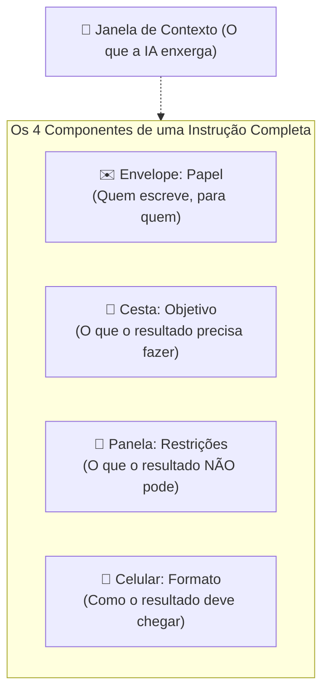

# Q4-M1 - O Que a IA Lê Quando Você Aperta Enviar

> **Disciplina:** COM170 - Inteligência Artificial na Prática Acadêmica e Profissional  
> **Quinzena 04:** Engenharia de Contexto como Metodologia Estruturada de Pensamento  
> **Docente Responsável:** Prof. José Avelino Placca  
> **Foco do Módulo 1:** Distinção entre Prompt e Contexto; a Janela de Contexto; e os Quatro Componentes da Instrução (Papel, Objetivo, Restrições e Formato).

---

## 🧭 1. Visão Geral do Módulo 1

Pense na última vez que você pediu alguma coisa a um colega, por mensagem, sem estar ao lado dele. Você não mandou apenas o pedido; mandou, sem perceber, uma grande quantidade de **contexto** junto:
- Quem é você;
- O que já havia sido combinado previamente;
- O prazo limite;
- O formato que a resposta precisava ter.

Boa parte disso nunca virou uma frase explícita porque ficou **implícito**: a pessoa do outro lado já compartilhava desse conhecimento prévio.

> [!IMPORTANT]
> **A IA não sabe o que você não escreveu**  
> Uma ferramenta de inteligência artificial não possui vivência prévia. Ela tem estritamente o que está escrito dentro da sua **janela de contexto**, e absolutamente nada além disso.

Este módulo separa dois conceitos fundamentais que costumam ser tratados erroneamente como sinônimos:

```
 ┌─────────────────────────────────────────────────────────────────────────┐
 │                           JANELA DE CONTEXTO                            │
 │                                                                         │
 │  • Textos anexados e fontes                                             │
 │  • Histórico acumulado da conversa                                      │
 │  • Instruções de sistema / ordens fixas da plataforma                   │
 │  • Premissas, critérios e restrições fornecidos                         │
 │                                                                         │
 │      ┌───────────────────────────────────────────────────────────┐      │
 │      │                          PROMPT                           │      │
 │      │  (A última instrução digitada antes de apertar "Enviar")  │      │
 │      └───────────────────────────────────────────────────────────┘      │
 └─────────────────────────────────────────────────────────────────────────┘
```

* **Prompt:** É a ponta final - a instrução que você digita por último.
* **Contexto:** É todo o restante reunido na janela, inclusive aquilo que você achou óbvio e deixou de fora.

---

## 🧩 2. Atividade: O Que Entra na Janela Junto com a Sua Mensagem

> 🎯 **Objetivo da Dinâmica:** Analisar uma conversa real com IA e identificar, item por item, o que a ferramenta realmente lê no momento do pedido.

### 🔍 Cenário de Análise
> *Você precisa entregar um texto para uma disciplina. O enunciado está impresso em cima da sua mesa. Você abre uma conversa com a IA, anexa o artigo indicado pelo professor e, há dez minutos, pediu um resumo dele nessa mesma conversa. Agora você escreve:*  
> **"Me ajuda a escrever o trabalho sobre o artigo que eu anexei."**

---

### 📋 Mapeamento: Dentro vs. Fora da Janela

| Item Analisado | Localização no Momento do Pedido | Justificativa Técnica e Pedagógica |
| :--- | :---: | :--- |
| **1. A mensagem que você acabou de digitar** | **Dentro da Janela** | É a sua instrução direta. A única parte do processo que depende 100% de você em tempo real. |
| **2. O artigo que você anexou nesta conversa** | **Dentro da Janela** | O conteúdo bruto do documento é incorporado diretamente ao espaço de leitura da sessão como texto integral. |
| **3. O resumo pedido há 10 min nesta conversa** | **Dentro da Janela** | O histórico da sessão permanece ativo na janela e continua influenciando diretamente o cálculo probabilístico da próxima resposta. |
| **4. Ordens fixas que a empresa deixou na ferramenta** | **Dentro da Janela** | São as instruções de sistema (*system prompt*). Ocupam espaço na janela mesmo em uma conversa recém-aberta e você não consegue visualizá-las. |
| **5. O enunciado do trabalho, impresso na sua mesa** | **Fora da Janela** | Existe no mundo físico para você, mas a ferramenta opera completamente cega a ele. A resposta parecerá pronta, mas ignorará as exigências reais do professor. |
| **6. A conversa de ontem, que você fechou** | **Fora da Janela** | Em geral, uma nova sessão inicia com a janela limpa. *(Nota: algumas plataformas possuem memórias persistentes entre sessões, tema detalhado no Módulo 3).* |
| **7. A página lida no navegador antes de abrir a IA** | **Fora da Janela** | **Ler não é fornecer.** Aquilo que você apenas leu e não colou ou anexou na conversa permanece inacessível ao modelo. |
| **8. O seu curso e o semestre em que você está** | **Fora da Janela** | A IA não deduz sua matrícula nem o seu momento acadêmico; ela conhece apenas o que foi textualmente declarado nesta sessão. |

---

### ⚖️ O Que Muda Quando o Item Crítico Entra na Janela?

Após o comando *"me ajuda a escrever o trabalho sobre o artigo que eu anexei"*, a IA devolveu um texto estruturado, porém puramente genérico:
> *"O artigo apresenta três argumentos centrais e os desenvolve em sequência. O primeiro trata da origem do problema; o segundo, das soluções já testadas; o terceiro, dos resultados obtidos. A conclusão retoma os três e defende que a segunda solução é a mais promissora."*

#### Qual dos 4 itens ausentes provocaria o maior impacto se fosse colado na conversa?
- [x] **O enunciado do trabalho impresso em cima da mesa** *(Selecionado)*
- [ ] A conversa de ontem que você fechou
- [ ] A página que você leu no navegador
- [ ] O seu curso e o seu semestre

#### Comparativo de Impacto Concreto:

```
┌───────────────────────────────────────────────┬───────────────────────────────────────────────┐
│              SEM O ENUNCIADO                  │               COM O ENUNCIADO                 │
│                 (1 Parte)                     │                  (3 Partes)                   │
├───────────────────────────────────────────────┼───────────────────────────────────────────────┤
│ Texto corrido, sem divisão temática.          │ Estrutura orientada às regras do professor:   │
│ Fala do artigo para quem já conhece o texto.  │ 1. O que o artigo afirma (resumo dos pontos); │
│ Não aponta lacunas e não traz a sua opinião.  │ 2. O que ele deixa de fora (custos e escala); │
│                                               │ 3. O que eu faria diferente (posição crítica).│
└───────────────────────────────────────────────┴───────────────────────────────────────────────┘
```

> **Por que os outros 3 não provocam a mesma transformação?**
> * A **conversa de ontem** carrega outro assunto e apenas desperdiçaria tokens da janela sem agregar valor.
> * A **página do navegador** conteria informações úteis, mas enquanto não for colada, não existe para a IA.
> * O **seu curso e semestre** apenas refinariam vocabulário ou sofisticação, sem alterar a espinha dorsal estrutural do trabalho.

---

### 👥 A Mesma Frase Enviada a Três Leitores Diferentes

Você envia a exata mesma instrução: **"Confirma comigo até amanhã."**

1. **Para um colega de grupo que esteve na última reunião:**
   - *O que ele já sabia:* **Quase tudo** *(Selecionado)*.
   - *Por quê:* Há contexto prévio compartilhado. Ele sabe o que deve ser confirmado, com quem e a razão do prazo.
2. **Para um estudante que ingressou no grupo esta semana:**
   - *O que ele já sabia:* **Uma parte** *(Selecionado)*.
   - *Por quê:* Reconhece a existência de um grupo e a urgência da data, mas ignora as decisões de reuniões passadas.
3. **Colada diretamente em uma ferramenta de IA:**
   - *O que ela já sabia:* **Nada** *(Selecionado)*.
   - *Por quê:* A IA não possui histórico implícito. Sem contexto, gera um texto vago que serve para qualquer pessoa e não soluciona caso nenhum.

> [!TIP]
> **Regra de Ouro da Comunicação com IA:**  
> Quanto menos a outra parte sabe, mais precisa estar escrito. Em vez de se perguntar apenas *"o que eu digito?"*, pergunte-se: **"O que precisa estar escrito nesta conversa para que a resposta sirva?"**

---

## 📺 3. Videoaula e Material-Base

### 🎥 Videoaula 1: O Que É Contexto e Por Que o Prompt É Só o Fim
* **Acesso:** [Assistir no YouTube (Prof. José Avelino Placca)](https://www.youtube.com/watch?v=wrPK5EUjOlc)
* **Conceito Central:** O prompt é estritamente a última mensagem de uma interação sequencial. O modelo processa a integralidade da janela; quando o contexto não é explicitamente estruturado, **o modelo preenche as lacunas por plausibilidade estatística** (o que for estatisticamente mais provável), que quase nunca coincide com a necessidade específica do estudante.

### 📚 Material de Apoio Oficial
* **E-book (Versão Visual):** [Q4_M1-E-book.pdf](./Q4_M1-E-book.pdf)
* **Apostila (Versão Acessível):** [COM170_apostila_quinzena4_M1.pdf](./COM170_apostila_quinzena4_M1.pdf)

---

## 🤖 4. Atividade Prática: O Primeiro Dia do Robô

> 📖 **Metáfora Central:** Toda ferramenta de IA opera como um robô doméstico recém-ligado às 7h da manhã. Ele sabe cozinhar, escrever e organizar em qualquer estilo, mas **ignora completamente as regras da sua casa** até que alguém as declare explicitamente na presença dele.



---

### 🍳 Episódio 1 · De Manhã, na Cozinha: O Recado para a Vizinha
*Cenário: Uma encomenda de Dona Cida (amiga da família há 20 anos) foi entregue por engano na sua casa.*

* **Tentativa 1:** *"Robô, manda uma mensagem para a Dona Cida avisando que a encomenda dela está aqui."*  
  ➡️ **Resultado:** *"Prezada Senhora, comunicamos que se encontra sob nossa guarda um volume endereçado a Vossa Senhoria..." (Assinado: Unidade Doméstica 7)*. Cida achou que era golpe. Sem saber o tom da relação, o robô adotou a linguagem de repartição pública.
* **Tentativa 2:** *"Robô, manda uma mensagem bem carinhosa para a Dona Cida sobre a encomenda."*  
  ➡️ **Resultado:** *"Queridíssima Cida, luz que ilumina esta manhã! Meu coração transborda..."*. Cida perguntou quem sequestrou a família. O adjetivo *"carinhoso"* sem parâmetro fez o modelo aplicar o nível máximo de fábrica.
* **Tentativa 3:** *"Robô, resolve aí o assunto da encomenda da vizinha."*  
  ➡️ **Resultado:** A caixa foi posta na calçada com etiqueta *"ENTREGA INDEVIDA - DEVOLVER AO REMETENTE"*. Entre estranhos, pacote errado se devolve.

> 🔑 **Peça Faltante identificada:** **PAPEL (✉️ O Envelope)**  
> *Quem fala, para quem.* Define o tom, a proximidade e o enquadramento da mensagem.

---

### 🧺 Episódio 2 · Meio-Dia, na Porta de Casa: A Compra do Almoço
*Cenário: A geladeira está vazia e 4 pessoas almoçam em casa hoje.*

* **Tentativa 1:** *"Robô, compra comida."*  
  ➡️ **Resultado:** 40 pacotes de arroz. Como faltou função, ele otimizou a métrica que podia medir: quantidade de comida por real gasto.
* **Tentativa 2:** *"Robô, compra algo especial para o almoço."*  
  ➡️ **Resultado:** Velas perfumadas, guardanapos de tecido e um arranjo floral gigante; nada comestível. *"Especial"* virou decoração e festa.
* **Tentativa 3:** *"Robô, compra o que costuma ter num almoço."*  
  ➡️ **Resultado:** O *"almoço médio estatístico"* das famílias: um pouco de tudo, nada suficiente, e ração para gato (a casa não tem animais).

> 🔑 **Peça Faltante identificada:** **OBJETIVO (🧺 A Cesta)**  
> *O que o resultado precisa fazer.* Não basta informar o assunto; é preciso delimitar a função exata que o produto final deve desempenhar.

---

### 🍲 Episódio 3 · Fim de Tarde, na Cozinha: O Jantar da Visita
*Cenário: Dois parentes chegam para jantar às 20h.*

* **Tentativa 1:** *"Robô, faz um jantar caprichado."*  
  ➡️ **Resultado:** Banquete de 7 pratos usando toda a louça, gastando o azeite nobre da despensa e previsão de servir à meia-noite. *"Caprichado"* sem limites vira excesso.
* **Tentativa 2:** *"Robô, faz um macarrão que todo mundo gosta."*  
  ➡️ **Resultado:** Prato único carregado de pimenta. Estatisticamente a maioria gosta, mas na família há quem tenha restrição alimentar.
* **Tentativa 3:** *"Robô, jantar simples e rápido."*  
  ➡️ **Resultado:** Torradas com água servidas às 18h10. Palavras vagas são elásticas; *"pronto às 20h, sem pimenta"* são limites mensuráveis.

> 🔑 **Peça Faltante identificada:** **RESTRIÇÕES (🍲 A Panela)**  
> *O que o resultado NÃO pode conter ou fazer.* As boas restrições são cercas verificáveis: tempo, custo, ingredientes ou proibições estritas.

---

### 📱 Episódio 4 · Começo da Noite, na Sala: O Aviso para a Família
*Cenário: Informar os parentes que o jantar é às 20h e cada um traz uma bebida.*

* **Tentativa 1:** *"Robô, avisa todo mundo do jantar."*  
  ➡️ **Resultado:** Ligações telefônicas narrando minuciosamente todo o histórico do dia desde as 7h. A tia desligou aos 4 minutos.
* **Tentativa 2:** *"Robô, manda as informações do jantar, completas, sem faltar nada."*  
  ➡️ **Resultado:** Relatório em PDF com sumário, 3 páginas e gráficos de consumo de bebidas. Ninguém abriu.
* **Tentativa 3:** *"Robô, deixa um aviso bonito para todos verem."*  
  ➡️ **Resultado:** Um soneto poético fixado na geladeira com a hora do jantar escondida no décimo primeiro verso.

> 🔑 **Peça Faltante identificada:** **FORMATO (📱 O Celular)**  
> *Como o resultado deve chegar.* A forma precisa servir à utilidade da informação (canal, tamanho e destaque aos dados essenciais).

---

### 📊 O Painel de Contexto Acumulado ao Fim do Dia

Ao final das 4 situações, a **janela de contexto** do robô estava preenchida com as premissas explícitas da casa:

```
◲ O que o robô sabe agora (Janela Preenchida):
  ✓ Ligado hoje às 7h.
  ✓ Papel: A Cida é amiga da família há 20 anos; recados saem em nome da casa.
  ✓ Objetivo: Compras devem servir a uma refeição real, com número de pessoas e cardápio definido.
  ✓ Restrições: Há quem não coma pimenta; o jantar é impreterivelmente às 20h; azeite especial requer autorização.
  ✓ Formato: Avisos vão no grupo da família, curtos, com horário e local destacados na primeira linha.
```

---

### ✍️ Montagem Final: O Convite dos 80 Anos da Avó

Com as 4 peças compreendidas, foi formulada a instrução definitiva para o convite:

* **Papel:** *"Escreva como quem organiza a festa, para tios, primos e agregados."* *(Selecionado por Lucas Ferreira)*
* **Objetivo:** *"Cada um precisa confirmar presença até quarta-feira."* *(Selecionado por Lucas Ferreira)*
* **Restrições:** *"Sem parecer cerimônia. No máximo seis linhas."* *(Selecionado por Lucas Ferreira)*
* **Formato:** *"Um cartão curto, para mandar como imagem, com a data em destaque."* *(Selecionado por Lucas Ferreira)*

#### 📨 Output Gerado pela IA:
```text
[Cartão para mandar como imagem]

DOMINGO, DIA 30, AO MEIO-DIA: os oitenta anos da vovó, com almoço lá em casa.
Tios, primos e agregados, confirma com a casa da festa até quarta-feira, para a gente saber quantos lugares pôr na mesa.
Sem cerimônia nenhuma: vem de chinelo.
```

> **Diagnóstico:** O robô não ficou "mais inteligente"; o algoritmo permaneceu idêntico. A qualidade do output decorreu exclusivamente da **estruturação prévia do contexto e da instrução**.

---

## ⚡ 5. Resumo de Ativação para Estudo Espaçado (Active Recall)

Use este roteiro para revisar rapidamente os conceitos fundamentais em menos de 3 minutos:

### 🧠 Cards de Recuperação Rápida

1. **Qual a diferença técnica entre Prompt e Contexto?**
   * *Resposta:* **Prompt** é a instrução específica digitada por último. **Contexto** é a soma de tudo o que está presente na janela de processamento (documentos anexados, histórico da sessão, dados do sistema e critérios). Prompt é a ponta; contexto é o restante.

2. **O que acontece quando você não fornece contexto suficiente à IA?**
   * *Resposta:* O modelo preenche as lacunas por **plausibilidade estatística** (o texto mais provável conforme a sua base de treinamento), gerando respostas genéricas ou alinhadas à média que raramente atendem à necessidade real.

3. **Quais são os 4 componentes estruturais de uma instrução completa?**
   * **Papel (Envelope):** Quem escreve e para quem se escreve (define tom e proximidade).
   * **Objetivo (Cesta):** A função concreta que a resposta precisa cumprir (não apenas o tema).
   * **Restrições (Panela):** Os limites e cercas verificáveis (o que o resultado *não* pode ser ou fazer).
   * **Formato (Celular):** A apresentação visual, canal, tamanho e disposição dos dados.

4. **Qual a regra prática de comunicação ao pedir algo para uma IA?**
   * *Resposta:* *"Quanto menos o outro sabe, mais precisa estar escrito."* Antes de perguntar o que digitar, defina: **o que precisa estar documentado nesta sessão para que a resposta funcione?**
