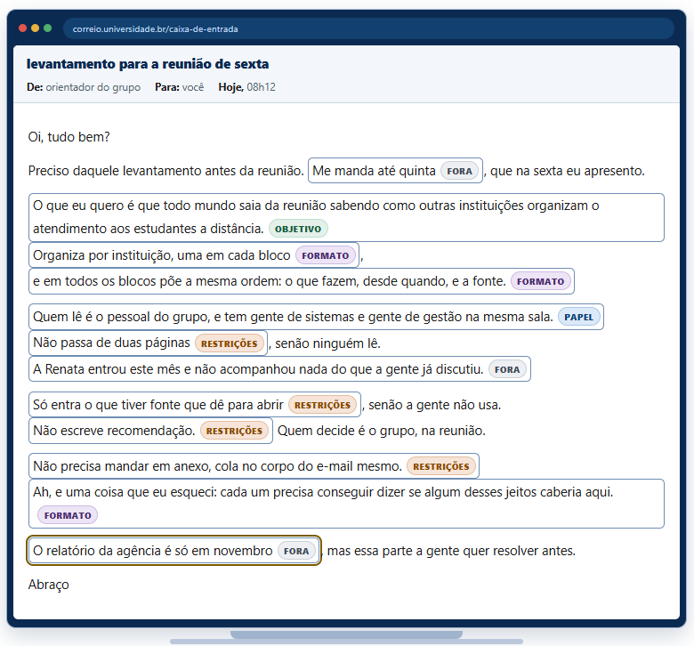
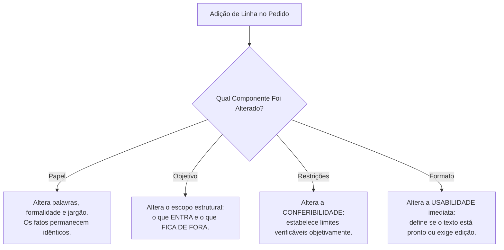

# Q4-M2 - Uma Frase, Quatro Perguntas: Decomposição e Plausibilidade Estatística

> **Disciplina:** COM170 - Inteligência Artificial na Prática Acadêmica e Profissional  
> **Quinzena 04:** Engenharia de Contexto como Metodologia Estruturada de Pensamento  
> **Docente Responsável:** Prof. José Avelino Placca  
> **Foco do Módulo 2:** Metodologia de Decomposição de Informações Brutas nos 4 Componentes (Papel, Objetivo, Restrições, Formato), o Mecanismo Estatístico de Estreitamento do Espaço Amostral e os Limites de Cumprimento Múltiplo de Instruções.

---

## 🧭 1. Visão Geral do Módulo 2

Duas pessoas recebem exatamente as mesmas informações soltas sobre uma tarefa.
- **A primeira pessoa** organiza cada pedaço no lugar certo antes de escrever para a IA.
- **A segunda pessoa** cola tudo junto, na ordem em que lembrou.

O pedido final pode até parecer semelhante na superfície, mas a resposta gerada pela ferramenta raramente será equivalente.

> [!IMPORTANT]
> **Conceito-Chave: Decomposição**  
> Decomposição é o processo cognitivo de pegar uma informação bruta (um pedido informal, um recado transcrito, um e-mail com retalhos) e distribuir criticamente cada fragmento dentro dos quatro componentes: **Papel**, **Objetivo**, **Restrições** e **Formato**.  
> Quase nenhuma demanda chega etiquetada na vida real; cabe a você filtrá-la e estruturá-la.

### 📉 O Mecanismo Estatístico: Estreitamento do Espaço Amostral
Por que a organização prévia muda o resultado?
Existe uma razão puramente probabilística: **quanto mais preciso e restrito for o contexto fornecido, menor é o espaço de respostas possíveis que o modelo pode gerar.** É exatamente esse afunilamento que transforma uma resposta genérica e vaga em um produto técnico sob medida.

---

## 📺 2. Videoaula e Material-Base

### 🎥 Videoaula 2.1: Como Organizar Informação Bruta em Componentes de Contexto
* **Acesso:** [Assistir no YouTube (Prof. José Avelino Placca)](https://www.youtube.com/watch?v=65YhxoBu_c0)
* **Síntese:** Dois estudantes recebem a mesma incumbência. A discrepância na utilidade prática do resultado não se deve à escolha da ferramenta nem a "palavras mágicas" no prompt final, mas sim à **capacidade prévia de decomposição** das premissas recebidas.

### 🎥 Videoaula 2.2: Plausibilidade Estatística
* **Acesso:** [Assistir no YouTube (Plausibilidade Estatística)](https://www.youtube.com/watch?v=P7GLS5ywU6I)
* **Tema central:** Como o modelo opera probabilisticamente estreitando o espaço amostral conforme mais contexto estruturado é fornecido.

### 📚 Material de Apoio Oficial
* **E-book (Versão Visual):** [Q4_M2-E-book.pdf](./Q4_M2-E-book.pdf)
* **Apostila (Versão Acessível):** [COM170_apostila_quinzena4_M2.pdf](./COM170_apostila_quinzena4_M2.pdf)

---

## 📨 3. Atividade: A Mensagem do Orientador

> 🎯 **Objetivo:** Ler um e-mail informal e caótico enviado por um orientador acadêmico, decompor 12 trechos destacados nos quatro componentes estruturais (ou descartá-los) e avaliar o texto gerado.

### 🖼️ Registro Visual do E-mail e Classificação dos Trechos

Abaixo está o mapeamento interativo realizado sobre o e-mail original da caixa de entrada:



---

### 📋 As Quatro Perguntas de Triagem

Diante de cada frase ou dado bruto recebido, faça a pergunta diagnóstica correspondente:

```
  ┌───────────────┬────────────────────────────────────────────────────────┐
  │ COMPONENTE    │ PERGUNTA DIAGNÓSTICA                                   │
  ├───────────────┼────────────────────────────────────────────────────────┤
  │ ✉️ Papel       │ Isso define quem deve responder ou para quem se fala?  │
  │ 🧺 Objetivo    │ Isso define a função real que a resposta deve cumprir? │
  │ 🍲 Restrições  │ Isso define o que a resposta NÃO pode conter ou fazer? │
  │ 📱 Formato     │ Isso define como a resposta deve ser apresentada?      │
  └───────────────┴────────────────────────────────────────────────────────┘
```

---

### 🔍 Mapeamento Analítico dos 12 Trechos da Mensagem

| Trecho Extraído do E-mail | Classificação Selecionada | Destino / Justificativa Pedagógica |
| :--- | :---: | :--- |
| *"Me manda até quinta, que na sexta eu apresento."* | **FORA** | **Não entra no pedido.** Descreve a sua agenda pessoal e prazos humanos de entrega, não características do texto que a IA deve gerar. |
| *"O que eu quero é que todo mundo saia sabendo como outras instituições organizam o atendimento aos estudantes a distância."* | **OBJETIVO** | É a função central do levantamento: trazer casos comparativos em vez de debater atendimento de forma abstrata. |
| *"Organiza por instituição, uma em cada bloco"* | **FORMATO** | Delimita a estrutura visual de apresentação (divisão em blocos individuais). |
| *"e em todos os blocos põe a mesma ordem: o que fazem, desde quando, e a fonte."* | **FORMATO** | Padroniza os campos internos para viabilizar comparação direta linha a linha. |
| *"Quem lê é o pessoal do grupo, e tem gente de sistemas e gente de gestão na mesma sala."* | **PAPEL** | Define o público leitor misto, exigindo vocabulário acessível sem excesso de jargões técnicos isolados. |
| *"Não passa de duas páginas, senão ninguém lê."* | **RESTRIÇÕES** | Fixa uma cerca/limite máximo quantitativo (teto de extensão). |
| *"A Renata entrou este mês e não acompanhou nada do que a gente já discutiu."* | **FORA** *(Marcado)*<br>*(Ideal: PAPEL)* | Descreve o leitor leigo/novato. Como ficou fora do pedido no teste prático, a IA abriu o texto presumindo discussões anteriores que a Renata desconhecia. |
| *"Só entra o que tiver fonte que dê para abrir, senão a gente não usa."* | **RESTRIÇÕES** | Critério estrito de verificação externa: proíbe dados sem link/endereço auditável. |
| *"Não escreve recomendação. Quem decide é o grupo, na reunião."* | **RESTRIÇÕES** | Proibição de emitir parecer prescritivo ou julgar qual modelo a faculdade deve adotar. |
| *"Não precisa mandar em anexo, cola no corpo do e-mail mesmo."* | **RESTRIÇÕES / FORMATO** | Restringe o suporte técnico de envio, evitando tabelas largas que quebram no layout de e-mails. |
| *"Ah, e uma coisa que eu esqueci: cada um precisa conseguir dizer se algum desses jeitos caberia aqui."* | **FORMATO / OBJETIVO** | Gera a seção comparativa *"O que isso exigiria aqui"* ao final de cada bloco. |
| *"O relatório da agência é só em novembro, mas essa parte a gente quer resolver antes."* | **FORA** | **Não entra no pedido.** Calendário administrativo externo que não altera em nada o texto do levantamento. |

---

### ⚖️ As Duas Metades do Papel: Quem Escreve vs. Para Quem se Escreve

Na mensagem do orientador, o campo **"quem escreve"** ficou completamente vazio. Por quê? Porque entre seres humanos esse papel já era implícito (ele estava falando com seu bolsista). Mas a ferramenta de IA não adivinha a relação hierárquica.

#### Linha de Papel Definida por Lucas Ferreira:
> [x] **"Você é um assistente de pesquisa que escreve para leitores de duas áreas diferentes, um deles sem o histórico do projeto."** *(Selecionada)*

#### O Que Essa Definição Muda Concretamente no Texto:
Quando o papel de quem escreve não é declarado, a IA assume o papel de "avaliadora acadêmica" e insere julgamentos de valor não solicitados:
- ❌ **Frases que surgiram sem o Papel definido:**  
  *"É fundamental que as instituições invistam nesse tipo de estrutura."*  
  *"Recomenda-se acompanhar os resultados e revisar o processo periodicamente."*
- ✅ **Frase que entra quando o Papel de assistente é declarado:**  
  *"Os três modelos estão descritos acima para o grupo comparar."*

#### O Impacto de Declarar "Para Quem se Escreve" (Sistemas, Gestão e Renata):
* **Sem o contexto dos leitores:** O texto gerou termos herméticos e jargões corporativos em inglês (*"tiering com SLA de 24h no N1", "handoff", "peer support", "headcount fixo", "deflection de tickets"*).
* **Com o contexto dos leitores:** O texto traduziu os conceitos para linguagem clara (*"atendimento em dois níveis: o primeiro responde dúvidas de matrícula e prazo; o que não resolve vai para a equipe do curso"*).

---

## 🎥 4. Videoaula 2: Plausibilidade Estatística e o Papel do Contexto

* **Link da Aula:** [Assistir no YouTube (Prof. José Avelino Placca)](https://www.youtube.com/watch?v=P7GLS5ywU6I)
* **Conceito Central:** Retoma a discussão de probabilidade estatística. Não mais para justificar "alucinações", mas como **ferramenta de controle**: o estudante molda a curva de probabilidade da IA por meio de restrições explícitas, forçando o modelo a descartar respostas triviais em favor do objetivo pretendido.

---

## 🔮 5. Atividade: Prever o Que Volta (Antecipação dos 4 Componentes)

> 🎯 **Objetivo:** Prever o impacto exato que a adição de uma linha de instrução causará na resposta do modelo, antes de rodar o prompt.



---

### 🧪 Os Quatro Casos de Previsão

#### Caso 1 · Comunicação de Atraso de Entrega
* **Linha adicionada:** *"Você está escrevendo para uma coordenação de curso que não acompanhou o dia a dia do trabalho."*
* **Componente:** **Papel** (✉️)
* **Efeito no Output:** Mudaram as palavras e o grau de formalidade (a sigla interna *"SGE"* foi expandida e explicada), mas os fatos (dia 12, dia 8, 4 dias e dia 19) continuaram rigorosamente os mesmos.

#### Caso 2 · Resumo da Reunião de Ontem
* **Linha adicionada:** *"Escreva só o que quem faltou precisa fazer até sexta."*
* **Componente:** **Objetivo** (🧺)
* **Efeito no Output:** Alterou o que entra e o que sai do texto. A IA filtrou as discussões gerais e listou apenas as três pendências acionáveis de quem esteve ausente.

#### Caso 3 · Aviso de Mudança de Horário de Atendimento
* **Linha alterada:** De *"Seja breve"* para *"No máximo cinco linhas."*
* **Componente:** **Restrições** (🍲)
* **Efeito no Output:** Transforma uma exigência subjetiva em um **critério conferível**.

> [!NOTE]
> **Reflexão Registrada por Lucas Ferreira:**  
> *"Eu entendi que nessa parte, apesar de ter marcado inicialmente a opção de formato, a seleção ideal era a Opção C: 'O que você consegue conferir depois de ler'. Porque 'seja breve' é uma opinião elástica, enquanto 'no máximo 5 linhas' eu posso simplesmente contar as linhas e auditar o resultado de forma indiscutível."*

#### Caso 4 · Registro de Ocorrência da Impressora no Balcão
* **Linha adicionada:** *"Escreva em três blocos: o que aconteceu, o que já foi feito, o que falta decidir."*
* **Componente:** **Formato** (📱)
* **Efeito no Output:** Define a forma do texto, tornando-o pronto para preencher o formulário do setor sem necessidade de reestruturação manual prévia.

---

### ⚖️ Quais Componentes Pesam Mais na Qualidade?

> [!IMPORTANT]
> **A Hierarquia de Impacto:**  
> **Objetivo e Restrições** são os dois componentes que mais impactam a qualidade intrínseca do output.  
> * **Objetivo e Restrições:** criam o **critério de avaliação** (permitem dizer se o texto serve ou não serve).  
> * **Papel e Formato:** atuam no **ajuste fino e usabilidade** (não salvam um pedido que falhou em definir o objetivo).  
> Se você estiver com pouco tempo, estruture primeiro o Objetivo e as Restrições!

---

### ⚠️ O Limite do Modelo: E se Eu Escrever Todas as Exigências Possíveis?

A intuição sugere que adicionar mais e mais regras garante um resultado perfeito. Um teste empírico rigoroso com **13 modelos de ponta de IA** demonstrou a realidade:

```
  Taxa de Sucesso em Cumprimento Integral de Instruções:
  
  [1 Exigência no Pedido]  ████████████████████ 84,7% de acerto
  [5 Exigências no Pedido] ██████████████       61,9% de acerto
```

> [!CAUTION]
> **Conclusão Prática e Reflexão de Lucas Ferreira:**  
> *"Achei que a maioria dos modelos seguiriam as instruções à risca, mas pelo visto me enganei."*  
> Conforme a lista de exigências cresce, **a probabilidade estatística de que o modelo cumpra todas simultaneamente cai significativamente**.  
> **Diretriz de Engenharia:** Não sobrecarregue a instrução com exigências supérfluas. Escreva apenas as restrições estritamente indispensáveis para a tarefa, e audite-as ativamente após a geração.

---

## 📊 6. Matriz de Síntese dos Quatro Componentes

| Componente | O Que Ele Modifica na Resposta | Como Auditar / Conferir |
| :--- | :--- | :--- |
| **Papel** | O vocabulário, a formalidade e o nível de jargão (fatos permanecem os mesmos). | Perguntar se o destinatário real compreenderia o vocabulário sem esforço adicional. |
| **Objetivo** | O filtro temático central: o que entra no texto e o que é descartado. | Verificar se o texto atende à função prática encomendada. |
| **Restrições** | A conferibilidade do texto (regras duras, limites e proibições). | Contar linhas/palavras, auditar links/fontes e checar lista de termos proibidos. |
| **Formato** | A usabilidade imediata (blocos, listas, tabelas, canal de saída). | Verificar se o layout permite uso direto ou exige edição manual. |

---

## ⚡ 7. Resumo de Ativação para Estudo Espaçado (Active Recall)

Utilize estes pontos-chave para consolidar os fundamentos do Módulo 2 em menos de 3 minutos:

### 🧠 Cards de Recuperação Rápida

1. **O que é o processo de Decomposição na Engenharia de Contexto?**
   * *Resposta:* É o trabalho prévio de separar uma demanda bruta, informal ou desestruturada nos quatro componentes essenciais (**Papel**, **Objetivo**, **Restrições** e **Formato**), descartando dados de agenda pessoal que não alteram o output.

2. **Qual a explicação estatística para o contexto melhorar as respostas da IA?**
   * *Resposta:* O contexto atua como um filtro probabilístico que **estreita o espaço amostral de respostas possíveis**. Menos respostas plausíveis no espaço estatístico forçam o modelo a convergir para uma resposta específica e útil.

3. **Quais são os dois componentes que mais afetam a qualidade do resultado final?**
   * *Resposta:* **Objetivo e Restrições**. Eles criam o critério lógico de verificação do trabalho. Papel e Formato cuidam do acabamento estilístico e da diagramação.

4. **Por que você não deve sobrecarregar o prompt com dezenas de exigências?**
   * *Resposta:* Testes com LLMs provam que a taxa de cumprimento simultâneo cai de **84,7%** (1 exigência) para **61,9%** (5 exigências). O modelo tende a esquecer ou violar regras em listas longas; logo, defina apenas o essencial e confira o restante.

5. **Como transformar uma restrição vaga em uma restrição conferível?**
   * *Resposta:* Substitua adjetivos subjetivos (*"seja breve"*, *"texto amigável"*) por métricas auditáveis (*"máximo de 5 linhas"*, *"sem as palavras X e Y"*, *"compreensível para um aluno do 1º semestre"*).
