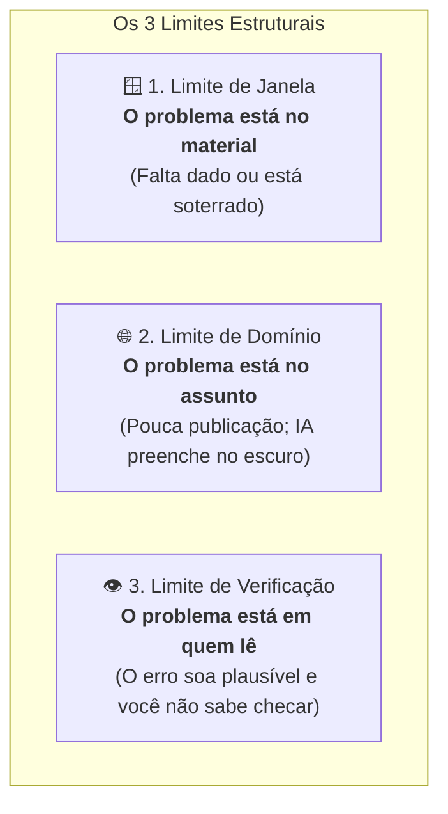

# Q4-M3 - A Janela Inteira e os Três Limites que Ela Não Resolve

> **Disciplina:** COM170 - Inteligência Artificial na Prática Acadêmica e Profissional  
> **Quinzena 04:** Engenharia de Contexto como Metodologia Estruturada de Pensamento  
> **Docente Responsável:** Prof. José Avelino Placca  
> **Foco do Módulo 3:** Diagnóstico e Mitigação dos Três Limites Estruturais de LLMs: Limite de Janela (o material), Limite de Domínio (o assunto) e Limite de Verificação (quem lê).

---

## 🧭 1. Visão Geral do Módulo 3

Você já escreveu uma instrução impecável com os quatro componentes estruturados (Papel, Objetivo, Restrições e Formato) e, ainda assim, recebeu uma resposta com erros?

Quando isso acontece, você tropeçou naquilo que a engenharia de prompt não consegue resolver sozinha: **os limites estruturais intrínsecos da ferramenta de IA**.



Reconhecer qual limite está em jogo define a sua reação:
1. **Limite de Janela:** Resolve-se reorganizando a conversa (anexando o que falta ou enxugando o excesso).
2. **Limite de Domínio:** Resolve-se fornecendo o documento oficial e conferindo cada dado na origem antes de usar.
3. **Limite de Verificação:** Não se resolve escrevendo melhor - resolve-se estabelecendo critérios auditáveis e recorrendo a fontes externas ou especialistas.

---

## 🎥 2. Videoaula: Os Três Limites Estruturais do Contexto

* **Link da Aula:** [Assistir no YouTube (Prof. José Avelino Placca)](https://www.youtube.com/watch?v=wrPK5EUjOlc) *(Tema abordado na videoaula de fundamentos estruturais)*
* **Síntese:** Um modelo de linguagem opera exclusivamente sobre duas fontes:
  1. O que foi apreendido durante o treinamento estatístico prévio;
  2. O que está presente na janela de contexto da sessão ativa.  
  A engenharia de contexto organiza a conversa, mas não transforma o modelo em uma entidade onisciente nem elimina esses limites.

---

## 🧩 3. Atividade: O Que Você Faz Agora? (Os Cinco Casos)

> 🎯 **Objetivo:** Analisar cinco cenários reais onde pedidos bem formulados geraram respostas problemáticas, identificando a providência necessária e o limite estrutural em ação.

### 📋 As Três Providências Básicas

1. **Mexo no que está dentro da conversa:** Adiciono o que faltou, retiro o que distrai e coloco em destaque no topo o que é decisivo.
2. **Confiro na origem antes de usar:** Busco a página, artigo ou documento oficial para auditar os fatos.
3. **Escrevo um critério que qualquer pessoa consiga conferir e procuro quem entenda do assunto.**

---

### 🔍 Análise dos 5 Casos Práticos

| Caso Analisado | Providência Adotada | Limite Identificado | Diagnóstico Pedagógico |
| :--- | :---: | :---: | :--- |
| **1. Ana e o Edital no meio de 6 arquivos** | Mexer na conversa | **Limite de Janela** | O edital foi o 4º arquivo colado. Em pilhas longas, o meio tende a ser ignorado (*lost in the middle*). Solução: retirar atas/resumos desnecessários e colocar os editais no topo. |
| **2. Bruno e as 5 Referências Inexistentes** | Conferir na origem | **Limite de Domínio** | O formato acadêmico das referências estava perfeito, mas as publicações não existiam. Em temas de nicho, a IA inventa referências com base na convenção da ABNT. |
| **3. Carla e o Aumento Percentual Errado** | Critério conferível + especialista | **Limite de Verificação** | Passar de 4% para 6% é um salto de 2 pontos percentuais e um aumento de 50%, mas a IA chamou de "aumento de 2%". O texto parece certo, mas o leitor leigo não percebe o erro. |
| **4. Túlio e o Regulamento Reenviado** | Conferir na origem *(Tentou mexer na janela)* | **Limite de Domínio** | Reduzir de 18 para 4 páginas não adiantou: a IA continuou inventando regras. Quando enxugar a janela não resolve, o problema está no tema pouco publicado. |
| **5. Elisa e o Curso Novo (Os 3 Juntos)** | As 3 providências simultâneas | **Janela + Domínio + Verificação** | O regulamento não foi colado (Janela); o curso é novo e quase não há dados (Domínio); e Elisa não domina as regras para auditar sozinha (Verificação). |

> [!NOTE]
> **Reflexões Pessoais Registradas por Lucas Ferreira:**  
> * **No Caso 4 (Túlio):** *"Nesse caso eu errei ao marcar Janela e Domínio juntos; deveria ter selecionado apenas Limite de Domínio, mas essas atividades não são validadas como certas ou erradas punitivas, e sim como aprendizado prático de que enxugar a janela é a tentativa inicial, mas se persistir a invenção, é Domínio."*  
> * **No Caso 5 (Elisa):** *"Veja que aqui minha resposta foi Janela e Verificação e faltou marcar Janela na primeira providência, mas o aprendizado foi garantido: nas tarefas reais os três limites frequentemente aparecem combinados."*

---

### ⏳ A Ordem em que Vale Fazer as Três Perguntas

As perguntas diagnósticas possuem custos de tempo e esforço muito diferentes:

```
┌─────────────────────────────────────────────────────────────────────────────┐
│ 1ª PERGUNTA (Custo: 1 minuto | Rápida)                                      │
│ "Se a informação que falta fosse colada, ou o que está lá mudasse de        │
│ lugar, isso resolveria?"                                                    │
│ ➔ Se SIM: Limite de Janela (resolva de imediato mexendo no material).       │
└─────────────────────────────────────────────────────────────────────────────┘
                                      │ (Se NÃO)
                                      ▼
┌─────────────────────────────────────────────────────────────────────────────┐
│ 2ª PERGUNTA (Custo: Médio | Exige busca externa)                             │
│ "Existe muita coisa publicada publicamente sobre este assunto?"             │
│ ➔ Se NÃO: Limite de Domínio (audite cada dado na fonte oficial).            │
└─────────────────────────────────────────────────────────────────────────────┘
                                      │
                                      ▼
┌─────────────────────────────────────────────────────────────────────────────┐
│ 3ª PERGUNTA (Custo: Alto | Exige validação técnica)                         │
│ "Eu saberia dizer com certeza absoluta se o resultado está errado?"         │
│ ➔ Se NÃO: Limite de Verificação (crie critérios auditáveis e valide com     │
│    um especialista antes de assinar o trabalho).                            │
└─────────────────────────────────────────────────────────────────────────────┘
```

---

## ⚖️ 4. Atividade: O Que Resolve e o Que Não Resolve (Apostas)

> 🎯 **Objetivo:** Diante de uma resposta com problema, apostar se mexer no material (acrescentar ou destacar) resolve a falha, ou se a causa raiz é outra.

| Caso / Estudante | Cenário e Tentativa 1 | Aposta Selecionada | Resultado da Tentativa 2 | Limite Real |
| :--- | :--- | :---: | :--- | :---: |
| **Vitória** *(Contrato de estágio)* | Não colou o próprio contrato; IA inventou 30h e R$ transporte padrão. | **Sim, acrescentando o que falta** | Colou o contrato: números corrigiram para 20h e R$ 700,00. | **Janela** *(Informação ausente)* |
| **Rafael** *(Manual de 40 páginas)* | Colou 40 páginas; a regra de citação da página 26 sumiu no meio do texto. | **Sim, deixando em primeiro plano** | Colou só as 2 páginas do capítulo: a regra de 4 cm e fonte 10 apareceu. | **Janela** *(Informação soterrada)* |
| **Otávio** *(Programa novo da faculdade)* | Edital novo; IA inventou exigência de tempo de curso e histórico escolar. | **Sim, acrescentando** *(Aposta)*<br>*(Realidade: Não)* | Colou o edital de 6 páginas e depois 1 página: a IA **manteve** as regras inventadas. | **Domínio** *(Assunto de nicho)* |
| **Sílvia** *(Margem de lucro do semestre)* | Receita de R$ 80k e custos de R$ 62k; IA disse margem de 29% (dividiu pelo custo, não pela receita: 18k/80k = 22,5%). | **Não, mexer no material não resolve** | Colou a planilha inteira mês a mês: a IA repetiu o exato mesmo cálculo de 29%. | **Verificação** *(Erro matemático plausível)* |
| **Nádia** *(Mobilidade acadêmica)* | Não colou o regulamento e nunca participou; texto parecia perfeito. | **Sim, acrescentando** *(Resolveu em parte)* | Colou o regulamento: corrigiu 30% da carga, mas inventou limite de 2 matérias por semestre. | **Os Três Limites Juntos** |

---

## 🔍 5. Atividade: O Que Você Deixaria Passar?

> 🎯 **Objetivo:** Avaliar criticamente quatro textos aparentemente impecáveis gerados por IA e decidir se você os entregaria ou não.

### 🏆 Placar de Lucas Ferreira: **0 de 4 Entregues** (100% de Precisão Crítica)
*Você barrou todos os 4 textos porque todos continham inconsistências graves:*

---

### 🔬 Auditoria dos Quatro Textos

#### Texto 1 · Nota de Divulgação (Monitoria)
* **Texto gerado:** Inscrições encerradas com **128 estudantes**: 54 manhã, 39 tarde e 45 noite.
* **Decisão de Lucas:** **Não entregaria.**
* **Trecho marcado e justificativa:** *"O programa de monitoria encerrou as inscrições com 128 estudantes, porque se somarmos tudo vai dar 138 (54 + 39 + 45 = 138). Alguma coisa está errada."*
* **Tipo de Conferência:** Somar os dados internos no próprio texto.

#### Texto 2 · Parágrafo de Apresentação (Laboratório)
* **Texto gerado:** Inaugurado em **março de 2019**; nos dois primeiros anos de funcionamento, **entre 2021 e 2023**, formou 212 alunos.
* **Decisão de Lucas:** **Não entregaria.**
* **Trecho marcado e justificativa:** *"Nos dois primeiros anos de funcionamento, entre 2021 e 2023... porque as datas não batem: se inaugurou em 2019, os dois primeiros anos foram 2019 e 2020."*
* **Tipo de Conferência:** Comparar a coerência cronológica interna entre as frases.

#### Texto 3 · Citação Acadêmica com Referência
* **Texto gerado:** Citação de Santos e Ribeiro (2023) com o identificador: `DOI 24.1093/rbet.2023.182`.
* **Decisão de Lucas:** **Não entregaria.**
* **Trecho marcado e justificativa:** *"Marquei o trecho (SANTOS; RIBEIRO, 2023) porque a citação da fonte parece errada."*
* **Tipo de Conferência:** Convenção técnica externa.
  > 💡 *Nota Técnica sobre o DOI:* Todo identificador DOI válido no mundo acadêmico inicia obrigatoriamente pelo prefixo **"10."**. O número 24.xxx era uma alucinação completa e o artigo não existe em bases científicas.

#### Texto 4 · Conclusão de Levantamento Amostral
* **Texto gerado:** 84 dos 300 matriculados responderam. Como 75% deles avaliaram o programa como bom ou ótimo, a conclusão é que a maioria dos estudantes do curso aprova o programa.
* **Decisão de Lucas:** **Não entregaria.**
* **Trecho marcado e justificativa:** *"Esses valores não batem: apenas 84 de 300 responderam (28% do total). Desses 84, 75% são 63 estudantes, o que representa somente 21% do curso todo. Concluir que a maioria do curso aprova é uma falácia amostral grave."*
* **Tipo de Conferência:** Desconfiar criticamente da premissa lógica e calcular a proporção real.

---

### 📊 A Ilusão de Plausibilidade na Literatura Científica

A distância entre **o que parece certo** e **o que é verdadeiro** foi mensurada no estudo empírico de **Krupp et al. (2024)** com estudantes de física:

```
  Avaliação de Respostas de IA em Problemas de Física:
  
  [Julgamento dos Estudantes] ████████████████████ 47% julgaram corretas
  [Julgamento dos Físicos]    █████████            22% eram realmente corretas
```

> [!WARNING]
> **Alerta Epistemológico:**  
> A IA escreve com a mesma fluência e convicção sintática quando está certa e quando está alucinando. O problema não é a resposta: **é quem lê e confia cegamente sem auditar**.

---

## ⚡ 6. Resumo de Ativação para Estudo Espaçado (Active Recall)

Utilize estes 5 cards para revisar os fundamentos do Módulo 3 em menos de 3 minutos:

### 🧠 Cards de Recuperação Rápida

1. **Quais são os 3 Limites Estruturais que a Engenharia de Contexto não elimina?**
   * **Janela:** A informação ausente ou soterrada no meio de arquivos longos (*problema no material*).
   * **Domínio:** Assuntos de nicho ou pouco documentados (*problema no tema*).
   * **Verificação:** Respostas erradas com verniz de verdade (*problema em quem audita*).

2. **O que é o fenômeno *Lost in the Middle* na Janela de Contexto?**
   * *Resposta:* Quando colamos documentos volumosos, a atenção do modelo prioriza o início e o fim da mensagem. Dados vitais no meio da pilha têm probabilidade de acerto reduzida (de ~75% para ~53%). Solução: enxugar o material e colocar o que decide no topo.

3. **Como a IA se comporta diante de um Limite de Domínio?**
   * *Resposta:* Ela preenche a lacuna por plausibilidade estatística com base em outros casos comuns, usando um tom seguro e assertivo. Não adianta colar mais texto; deve-se **conferir cada prazo, número e regra na fonte original**.

4. **Qual a falha típica associada ao Limite de Verificação?**
   * *Resposta:* Erros conceituais, matemáticos ou falácias amostrais (ex.: confundir porcentagem com pontos percentuais, ou extrapolar 21% de respondentes como "maioria"). O texto soa perfeito e passa batido por quem não domina o tema.

5. **Qual é a regra prática para citações com DOI?**
   * *Resposta:* Todo identificador DOI padronizado começa obrigatoriamente com o prefixo **`10.`**. Referências geradas por IA com prefixos diferentes (como `24.xxx`) são alucinações fabricadas.