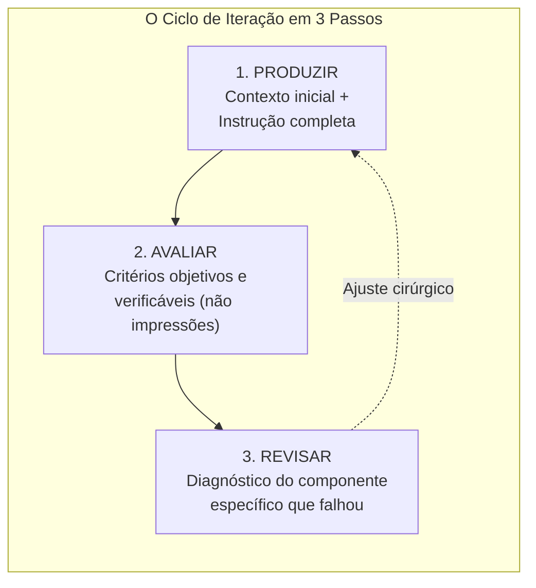

# Q4-M4 — O Que Mudar Quando o Resultado Volta Errado: O Ciclo de Iteração Estruturada

> **Disciplina:** COM170 — Inteligência Artificial na Prática Acadêmica e Profissional  
> **Quinzena 04:** Engenharia de Contexto como Metodologia Estruturada de Pensamento  
> **Docente Responsável:** Prof. José Avelino Placca  
> **Foco do Módulo 4:** O Ciclo de Iteração Estruturada em Três Passos; Diagnóstico Cirúrgico de Falhas; Miniquiz de Síntese da Quinzena (Peça-Fechadura para Liberação da Parte Prática e Grupo).

---

## 🧭 1. Visão Geral do Módulo 4

A primeira versão gerada por uma ferramenta de IA raramente será a versão final pronta para uso — e isso é absolutamente normal no trabalho com modelos generativos.

A questão decisiva não é o erro em si, mas o método adotado para corrigi-lo:
> *"Diante de uma resposta com problema, o erro está no que você pediu, no que a ferramenta não tinha como saber, ou em algo que ninguém conferiu?"*



### 🎯 Trocar a "Torcida" por Diagnóstico Técnico
O comportamento mais comum diante de uma resposta insatisfatória é apagar tudo e reescrever o pedido do zero, torcendo para que a próxima tentativa seja estatisticamente melhor.

O **Ciclo Estruturado** substitui a tentativa e erro aleatória pelo diagnóstico preciso:
1. **Produzir:** Estruturar a instrução e a janela de contexto antes do envio.
2. **Avaliar:** Confrontar o resultado contra **regras verificáveis** (contar linhas, buscar termos, validar números, checar datas na fonte externa).
3. **Revisar:** Identificar qual componente causou a falha (Papel, Objetivo, Restrições, Formato ou um dos 3 Limites Estruturais) e **alterar exclusivamente esse ponto**.

---

## 🎥 2. Videoaula: O Ciclo de Iteração Estruturada

* **Link da Aula:** [Assistir no YouTube (Prof. José Avelino Placca)](https://www.youtube.com/watch?v=Dh5vPyvbZMs)
* **Síntese:** Apresenta o fluxo metódico de refinamento em três etapas. Em vez de regenerar o texto cegamente, o estudante atua como auditor, identificando a causa raiz da inconsistência e aplicando correções incrementais e localizadas.

---

## 🏆 3. Miniquiz Final da Quinzena 4 (Peça-Fechadura)

> 🚨 **Importância Operacional:** A conclusão integral deste miniquiz marca o término da Semana 1 e **destrava imediatamente o acesso à Parte 2 (Laboratório de Revisão, Portfólio Individual e Trabalho em Grupo - Módulo 7)**.

### 📊 Desempenho de Lucas Ferreira: **5 de 5 Acertos de Primeira (100%)**

```
  Placar Final do Miniquiz:
  Questão 1: [Alternativa D]  ✅ Acerto de 1ª tentativa
  Questão 2: [Alternativa E]  ✅ Acerto de 1ª tentativa
  Questão 3: [Alternativa B]  ✅ Acerto de 1ª tentativa
  Questão 4: [Alternativa C]  ✅ Acerto de 1ª tentativa
  Questão 5: [Alternativa A]  ✅ Acerto de 1ª tentativa
```

---

### 🔬 Análise Detalhada das Cinco Questões

#### Questão 1 · A Secretaria Acadêmica e os Prazos Inventados
* **Cenário:** Secretaria com 40 pedidos/semana. Uma servidora redigiu um pedido minucioso (Papel, Objetivo, Restrição de 10 linhas e Formato). Reescreveu 3 vezes com mais detalhes, mas a IA persistiu inventando prazos que não constam no regulamento interno (que está salvo apenas em PDF no servidor).
* **Alternativa Escolhida por Lucas:** **D — O documento que fixa os prazos não chegou à conversa, e detalhar o pedido não o coloca ali.** *(Mais adequada)*
* **Fundamentação Pedagógica:** Detalhar a redação da instrução resolve o que você sabe e não havia escrito. Não resolve o que nunca entrou na janela de contexto. A providência imediata é anexar o trecho do regulamento que contém os prazos. *(Conexão: Módulos 1 e 3)*.

---

#### Questão 2 · Classificação de Exigências nos Laudos do Laboratório
* **Cenário:** O resumo semanal de laudos exige: lido por médicos (conduta); distribuído em 4 campos fixos na ordem do sistema; teto de 800 caracteres; e proibição de mencionar hipóteses não confirmadas.
* **Alternativa Escolhida por Lucas:** **E — Os quatro campos descrevem a forma do resumo, e o teto e a proibição marcam limites ao texto.** *(Mais adequada)*
* **Fundamentação Pedagógica:** 
  - **Formato:** Os 4 campos na ordem do sistema definem a *forma* e arquitetura visual do resumo.
  - **Restrições:** O teto de 800 caracteres (tamanho) e a proibição de hipóteses (conteúdo vedado) são *limites conferíveis* que podem ser auditados objetivamente. *(Conexão: Módulo 2)*.

---

#### Questão 3 · O Pressuposto Oculto dos 4 Regulamentos Anexados
* **Cenário:** Coordenação colou 180 páginas de 4 regulamentos de uma vez na conversa e declarou: *"Anexamos tudo, então daqui em diante as respostas sobre normas sairão corretas."*
* **Alternativa Escolhida por Lucas:** **B — Que o conteúdo colado será aproveitado por inteiro, qualquer que seja a posição de cada trecho.** *(Mais adequada)*
* **Fundamentação Pedagógica:** O pressuposto é falso devido ao fenômeno estatístico do **Lost in the Middle**: dados no meio de pilhas extensas têm probabilidade de acerto reduzida (53,8%, abaixo do índice sem documento de 56,1%). Anexar 180 páginas na ordem da pasta não garante o aproveitamento do trecho correto. *(Conexão: Módulo 3)*.

---

#### Questão 4 · A Ilusão da Auto-Revisão pela Mesma Ferramenta
* **Cenário:** Equipe de comunicação publica 200 avisos/mês e pede à própria IA que escreveu o texto para revisá-lo. O texto cumpriu tamanho e vocabulário, mas dois avisos foram publicados com datas que não constavam no calendário oficial.
* **Alternativa Escolhida por Lucas:** **C — A conferência ficou a cargo da mesma origem do texto, e as datas seguiram sem confronto com o calendário.** *(Mais adequada)*
* **Fundamentação Pedagógica:** A IA consegue auditar critérios formais internos (contar caracteres, banir palavras proibidas), mas é estruturalmente cega a dados factuais que exigem checagem contra fontes externas. Critérios de forma se conferem no texto; **exatidão de dados se confere na fonte oficial externa**. *(Conexão: Módulos 3 e 4)*.

---

#### Questão 5 · O Parecer Técnico do Laboratório
* **Cenário:** Técnico tem 2 dias para elaborar parecer assinado baseado em procedimento interno revisado no mês passado. Tem o PDF, 3 pareceres antigos e a lista da chefia.
* **Alternativa Escolhida por Lucas:** **A — Escrever de uma vez o que a chefia pediu, colar o trecho do procedimento, fixar critérios conferíveis e checar o prazo.** *(Mais adequada)*
* **Fundamentação Pedagógica:** É o protocolo completo da Engenharia de Contexto:
  1. *Organizar o pedido:* estruturar Papel, Objetivo, Restrições e Formato de primeira;
  2. *Suprir a janela:* anexar o trecho do procedimento recente (inexistente no treinamento da IA);
  3. *Critérios conferíveis:* definir métricas objetivas de entrega;
  4. *Conferência humana:* auditar o prazo na fonte antes de assinar. *(Síntese dos 4 Módulos)*.

---

### 📋 Matriz de Consolidação dos Quatro Módulos

| Módulo | Eixo Temático Central | O Que Ficou Provado nas Atividades |
| :---: | :--- | :--- |
| **M1** | **Prompt vs. Contexto** | Detalhar a instrução resolve o que você omitiu; não resolve o que nunca entrou na janela. |
| **M2** | **Decomposição** | Formato descreve a disposição visual do texto; Restrições estabelecem limites e cercas conferíveis. |
| **M3** | **Limites Estruturais** | Enviar material e a ferramenta aproveitá-lo são coisas distintas (*Lost in the Middle*). |
| **M4** | **Ciclo de Iteração** | Conferência de formato se faz no texto; exatidão de fatos se confere exclusivamente na fonte externa. |

---

## ⚡ 4. Resumo de Ativação para Estudo Espaçado (Active Recall)

Utilize estes 4 cards rápidos para consolidar o Módulo 4 em menos de 2 minutos:

### 🧠 Cards de Recuperação Rápida

1. **Quais são os 3 passos do Ciclo de Iteração Estruturada?**
   * **1. Produzir:** Construir contexto e instrução prévia;
   * **2. Avaliar:** Auditar o output contra regras e critérios objetivos (não por impressões);
   * **3. Revisar:** Diagnosticar o componente causal exato (Papel, Objetivo, Restrições, Formato ou Limites) e corrigir cirurgicamente.

2. **Por que pedir à própria IA para revisar o texto que ela gerou é uma prática de risco?**
   * *Resposta:* A IA é excelente para auditar regras de formato (tamanho e termos proibidos), mas repete alucinações e erros factuais com convicção. **A exatidão de datas, prazos e regras exige confronto com a fonte oficial externa.**

3. **Qual o perigo de colar pilhas volumosas de documentos (ex.: 180 páginas) de uma só vez?**
   * *Resposta:* A atenção dos LLMs decai no centro do texto (*Lost in the Middle*). A ferramenta ignora trechos vitais no meio da pilha. A melhor prática é enviar apenas os capítulos ou trechos diretamente relevantes.

4. **Qual a síntese da Engenharia de Contexto para a prática profissional?**
   * *Resposta:* **Decidir antes** o que vai para a máquina, **enviar o que ela não tem**, fixar **critérios conferíveis** e **auditar na fonte** o que depende de precisão factual. O nome que assina o trabalho continua sendo o seu.
