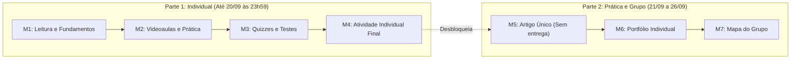

# Quinzena 05 - Introdução e Orientações de Estudo
### Leitura Crítica, Auditoria de Fontes e o Protocolo Manual Antes da IA

> **Disciplina:** COM170 - Inteligência Artificial na Prática Acadêmica e Profissional  
> **Docente Responsável:** Prof. José Avelino Placca  
> **Período da Quinzena:** De 14 a 27 de setembro de 2026  
> **Prazo da Base Individual (Módulos 1 a 4):** **Domingo, 20 de setembro de 2026, às 23h59**  
> 💡 _A conclusão dos Módulos 1 a 4 no prazo abre a parte prática na hora e garante a participação no mapa do grupo._

---

## 📌 1. Boas-vindas e Visão Geral da Quinzena

> *"Até aqui você aprendeu a pedir.*  
> *Já divide uma tarefa em partes, já decidiu o que delega e o que mantém seu, e já monta um pedido com os quatro componentes. A pergunta desta quinzena vem depois de tudo isso, e é mais incômoda: quando a resposta chega, como você sabe se ela está certa?*  
> *Vamos fazer essa pergunta no lugar em que ela mais pesa para você neste momento: o trabalho da faculdade. Aquele que pede fontes, que exige ler um texto difícil e que termina com uma lista de referências assinada por você. Em cada etapa dele existe uma ferramenta pronta para fazer o serviço. O serviço sai bem feito, bem escrito e, com alguma frequência, errado de um jeito que ninguém vê de fora.*  
> *Esta quinzena entrega três instrumentos para enxergar de dentro: um jeito de mostrar de onde veio cada frase que você escreveu; um protocolo com ordem fixa para ler com a ferramenta sem entregar a leitura a ela; e um critério para decidir, quando o prazo aperta, o que conferir primeiro.*  
> *Uma sugestão antes de começar: nos próximos dias, repare na ordem em que tudo acontece quando você estuda com uma ferramenta: o que chega primeiro, o texto ou a resposta sobre o texto? Guarde essa observação. Ela vai ser útil quando a parte prática da quinzena chegar."*  
> - **Prof. José Avelino Placca**

---

### 🎯 O Que Você Vai Aprender (Objetivos de Aprendizagem)

Ao final desta quinzena, você vai conseguir:

- [ ] **01. Rastreabilidade de Leitura:** Distinguir, numa situação concreta, a leitura que você fez com apoio da ferramenta da leitura que a ferramenta fez por você, apontando a frase do texto que sustenta o que você escreveu.
- [ ] **02. Protocolo Manual Antes da IA:** Aplicar o protocolo Manual antes da IA a um artigo: ler e registrar primeiro, montar o pedido de auditoria com papel, objetivo, restrições e formato, e julgar o que a ferramenta devolve.
- [ ] **03. Auditoria de Citações e Referências:** Reconhecer os quatro erros que aparecem em referências e citações geradas por IA como formas dos cinco tipos de erro da Quinzena 2, sabendo em qual passo da conferência cada um cai.
- [ ] **04. Identificação de Omissões Críticas:** Identificar o que uma síntese por IA omite mesmo estando correta: o subtexto, o contexto da publicação e a disputa entre autores.
- [ ] **05. Triagem por Consequência:** Decidir, com prazo curto, qual afirmação conferir primeiro, escolhendo pela consequência, e registrar o caminho percorrido de modo que outra pessoa consiga segui-lo.

---

## 🗓️ 2. Calendário, Prazos e Operação

A quinzena vai de 14 a 27 de setembro de 2026, com dois prazos centrais:

| Etapa | Período / Data Limite | O que acontece nesta etapa |
| :--- | :--- | :--- |
| **Estudo Individual (M1 a M4)** | 14 a 19 de setembro | Estudo dos módulos teóricos individuais e realização das atividades guiadas. |
| **Prazo Módulos 1 a 4** | **Domingo, 20 de setembro às 23h59** | Prazo limite para concluir os Módulos 1 a 4. A conclusão abre a parte prática na hora: quem termina antes ganha mais dias para ler o artigo. |
| **Janela de Entrega (M6 e M7)** | **21 a 26 de setembro (Sábado às 23h59)** | Janela de envio simultâneo do seu Portfólio Individual (Módulo 6) e do Mapa das Leituras do grupo (Módulo 7). |
| **Revisão Entre Colegas** | **27 a 29 de setembro (Terça às 23h59)** | Período de avaliação cega: você lê o portfólio de um colega e o seu grupo lê o mapa de outro grupo (já nos primeiros dias da Quinzena 6). |

> [!IMPORTANT]
> **Se você concluir os módulos depois do dia 20:**  
> No dia seguinte você recebe o artigo e o guia do portfólio, e entrega dentro da mesma janela. Esse trabalho vale por inteiro. O mapa do grupo fica com quem concluiu até domingo, porque ele nasce da comparação entre fichas prontas. A próxima rodada de trabalho em grupo chega na quinzena seguinte.

---

## 🔍 3. O Que Muda na Parte Prática Desta Quinzena

O desenho da Quinzena 5 difere das anteriores em três pontos fundamentais:

1. **Toda a turma lê o mesmo artigo:**  
   Não são situações diferentes distribuídas entre vocês. É um único artigo, o mesmo para todos, e é sobre ele que você executa o protocolo do começo ao fim.

2. **O Módulo 5 não tem entrega:**  
   Ele é onde você conhece o artigo e escolhe a ferramenta que vai usar. Prepare-se ali com calma: o trabalho avaliativo começa no Módulo 6.

3. **O trabalho do grupo é um mapa, montado a partir das fichas:**  
   Cada integrante chega com a ficha que preencheu sozinho. Comecem compartilhando as fichas, sem discutir. Se duas pessoas anotaram a mesma ideia de formas diferentes, registrem as duas versões: a diferença é a parte mais interessante do mapa.

### 📦 O Que Você Entrega (Janela de 21 a 26 de setembro)

* **Individual - O Seu Portfólio (Módulo 6):**  
  Enviado no *Laboratório de Revisão do Módulo 6*. Você segue os cinco passos do guia e envia o documento com a sua ficha de resultados.
* **Do Grupo - O Mapa das Leituras (Módulo 7):**  
  Enviado no *Laboratório de Revisão do Módulo 7*, postado pelo representante do grupo.
* **Revisão por Pares (27 a 29 de setembro):**  
  Você lê o portfólio de um colega e o seu grupo lê o mapa de outro grupo. Aponte o que está registrado e o que ficou pouco claro: ver como outra pessoa leu o mesmo artigo mostra o que a sua leitura deixou passar.

---

## 📢 4. Avisos Importantes de Operação

### 🎙️ 1. Escolha a Sua Live da Quinzena
A quinzena oferece opções de lives em dias e horários diferentes, e participar ao vivo de uma delas compõe a sua nota de participação. A gravação fica disponível depois para estudo, mas o que entra no percurso oficial é a presença ao vivo:

| Facilitadores | Data | Horário |
| :--- | :---: | :---: |
| **Cauê e Andréia** | 15/09/2026 | 10h |
| **Vittoria e Nicolle** | 16/09/2026 | 16h |
| **Lyon e Victor** | 16/09/2026 | 18h |
| **Livia e Hanna** | 17/09/2026 | 10h |
| **Gabrieli e Uebert** | 17/09/2026 | 14h |
| **Cassia e Vittoria** | 19/09/2026 | 10h |

### 🌐 2. Atividades que Abrem Abas Externas
Numa das atividades desta quinzena você pesquisa em duas bases de busca acadêmica reais, o Google Acadêmico e o SciELO, e em outra abre um artigo publicado. Os links abrem em aba nova e a atividade continua salva no AVA. Se um endereço demorar, cada passo tem um botão que mostra o resultado na própria tela: nenhum passo trava.

### 📋 3. Guarde os Dois Modelos que as Atividades Entregam
Duas atividades oferecem modelos em branco para cópia:
- **A ficha de rastreamento**;
- **O roteiro dos quatro passos da conferência**.  
Guarde os dois num arquivo seu. Eles servem para qualquer trabalho acadêmico futuro e você voltará a eles na parte prática desta quinzena.

---

## 🧭 5. Dinâmica de Estudo e Critérios de Conclusão

> [!IMPORTANT]
> **Concluir não é o mesmo que apenas responder:**  
> Clique no botão de conclusão da última tela de cada atividade. Antes de sair de um módulo, volte à página dele e confira se todos os itens aparecem marcados. É a causa número um do *"fiz tudo e não abriu"*.

> [!NOTE]
> **Leia o retorno explicativo das atividades até o fim:**  
> Leia inclusive quando você acertar. Nas atividades desta quinzena cada alternativa tem um retorno próprio, e as alternativas erradas são caminhos que muita gente toma. É ali que aparece o raciocínio que a prova presencial vai cobrar.

> [!TIP]
> **XP e Avaliação:**  
> - **Pontos de Experiência (XP):** Marcam o caminho percorrido e não entram na nota. O que abre a parte prática é a conclusão do Módulo 4.  
> - **Nota do Ambiente (AVA):** Reconhece a sua participação: os quatro módulos concluídos, a entrega do portfólio, a entrega do grupo, os dois retornos da revisão, a presença ao vivo em uma live e a regularidade dos seus acessos.  
> - **Nota de Conteúdo:** O domínio conceitual é avaliado na prova presencial.

---

> ❓ **Dúvidas de funcionamento?**  
> Dúvidas sobre prazos, grupos, envios e conclusão de atividades estão detalhadas no FAQ da disciplina no início do AVA. Para questões pedagógicas e sobre o seu grupo, consulte o seu facilitador.