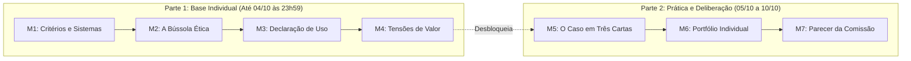

# Quinzena 06 - Introdução e Orientações de Estudo
### Ética como Estrutura: Critérios, a Bússola e Sistemas que Decidem sobre Pessoas

> **Disciplina:** COM170 - Inteligência Artificial na Prática Acadêmica e Profissional  
> **Docente Responsável:** Prof. José Avelino Placca  
> **Período da Quinzena:** De 28 de setembro a 13 de outubro de 2026  
> **Prazo da Base Individual (Módulos 1 a 4):** **Domingo, 4 de outubro de 2026, às 23h59**  
> 💡 _A conclusão dos Módulos 1 a 4 no prazo abre a parte prática na hora e garante a participação no parecer do grupo._

---

## 📌 1. Boas-vindas e Visão Geral da Quinzena

> *"Na quinzena passada, a pergunta era se a resposta estava certa, e a consequência de errar ficava com você. Agora a escala muda. Todos os dias, sistemas decidem sobre você sem que você perceba: o que aparece primeiro na sua tela, qual pedido chega antes, se uma inscrição segue ou para. A decisão chega pronta. Quase nunca você fica sabendo qual foi o critério, e quase nunca há alguém para perguntar.*  
>  
> *Esta quinzena convida você a trocar de posição. Em vez de conferir o que a máquina devolveu, você vai olhar o sistema pelo lado de quem o opera e pelo lado de quem recebe a decisão, e vai descobrir que os dois lados raramente enxergam o mesmo. Para isso, você leva uma bússola com quatro perguntas e aprende a declarar, no fim de um trabalho seu, o que uma ferramenta fez nele. E aprende a reconhecer a situação mais difícil de todas: quando dois valores legítimos cabem na mesma decisão só pela metade.*  
>  
> *Esta quinzena trabalha com critérios, que servem justamente quando a situação é nova e a regra ainda não existe. E termina com um caso em que esses critérios vão ser postos à prova: o seu grupo será a comissão que dá o parecer sobre um sistema que decide sobre estudantes.*  
>  
> *Uma sugestão antes de começar. Nos próximos dias, repare em uma decisão que chegou a você por um sistema, sem uma pessoa do outro lado. Guarde o exemplo. Ele vai ser útil no fórum e na parte prática da quinzena."*  
> - **Prof. José Avelino Placca**

---

### 🎯 O Que Você Vai Aprender (Objetivos de Aprendizagem)

Ao final desta quinzena, você vai conseguir:

- [ ] **01. Julgamento com Critérios:** Separar a reação imediata do julgamento com critérios, distinguindo quem opera um sistema de quem recebe a decisão gerada por ele.
- [ ] **02. As Quatro Perguntas da Bússola:** Fazer a um sistema decisório automatizado que impacta pessoas as perguntas fundamentais: **Quem**, **Sabe**, **Responde** e **Custa**.
- [ ] **03. Declaração Transparente de Uso de Inteligência Artificial (IA):** Declarar tecnicamente o uso de ferramentas de IA num trabalho próprio, especificando com clareza o que a ferramenta realizou e o que foi auditado humanamente.
- [ ] **04. Reconhecimento de Tensões de Valor:** Identificar dilemas e tensões éticas reais entre dois valores legítimos concorrentes, sem reducionismos, vilões ou soluções simplistas.
- [ ] **05. Fundamentação e Falseabilidade de Pareceres:** Fundamentar uma recomendação decisória formal, evidenciando o custo do que ficou de fora e explicitando quais evidências fariam a comissão mudar de ideia.

---

## 🗓️ 2. Calendário, Prazos e Operação

A Quinzena 6 decorre de 28 de setembro a 13 de outubro de 2026, organizada nos seguintes marcos temporais:

| Etapa | Período / Data Limite | O que acontece nesta etapa |
| :--- | :--- | :--- |
| **Estudo Individual (M1 a M4)** | 28 de setembro a 3 de outubro | Estudo teórico autônomo no seu ritmo (Módulos 1, 2, 3 e 4). Cada módulo concluído destrava o seguinte. |
| **Prazo Módulos 1 a 4** | **Domingo, 4 de outubro às 23h59** | Prazo limite fixo para concluir a base individual. A conclusão libera a parte prática na hora, garantindo acesso ao caso e vaga no parecer do grupo. |
| **Janela de Entrega (M6 e M7)** | **5 a 10 de outubro (Sábado às 23h59)** | Janela de envio simultâneo do seu Portfólio Individual (Módulo 6) e do Parecer da Comissão do grupo (Módulo 7). |
| **Revisão Entre Colegas** | **11 a 13 de outubro (Terça às 23h59)** | Período de avaliação por pares às cegas: você avalia o portfólio de um colega e seu grupo avalia o parecer de outro grupo. |

> [!IMPORTANT]
> **Se você concluir os módulos depois do dia 4:**  
> No dia seguinte você recebe o caso e o guia do portfólio, e realiza a entrega individual dentro da mesma janela (até 10 de outubro). Esse trabalho individual vale nota por inteiro. O parecer do grupo fica restrito a quem concluiu até domingo (dia 4), pois a construção coletiva nasce do confronto direto entre recomendações já previamente elaboradas.

> [!NOTE]
> **Atenção ao feriado de 12 de outubro:**  
> O feriado nacional de 12 de outubro (segunda-feira) recai no período de revisão por pares. Se você costuma concentrar seus estudos nas segundas-feiras, antecipe as leituras avaliativas para o domingo (11/10) ou conclua na terça-feira (13/10).

---

## 🔍 3. O Que Muda na Parte Prática Desta Quinzena

O portfólio e a dinâmica da Quinzena 6 apresentam inovações estruturais centrais:

1. **A resposta da ferramenta entra colada inteira:**  
   Na terceira etapa do portfólio, você pedirá expressamente à ferramenta de Inteligência Artificial (IA) que defenda a tese contrária à sua própria decisão. O retorno do sistema deve ser colado integralmente no documento, sem edições ou supressões, para que sua análise crítica subsequente mostre o embate real de argumentos.

2. **Anonimato rigoroso (sem nomes):**  
   O documento do portfólio individual e o parecer do grupo devem ser enviados **sem nome de integrantes e sem número de grupo**. Toda a revisão por pares é anônima e baseada puramente na qualidade textual e na fundamentação técnica.

3. **Rubrica avaliativa alocada no guia:**  
   Os critérios de correção não ficam ocultos no Ambiente Virtual de Aprendizagem (AVA); eles estão explícitos diretamente no guia. Mantenha o guia aberto lado a lado durante toda a produção e avaliação do trabalho.

---

### 📦 O Que Você Entrega (Janela de 5 a 10 de outubro)

* **Individual - O Seu Portfólio (Módulo 6):**  
  Enviado no *Laboratório de Revisão do Módulo 6*. Você percorre as quatro perguntas da Bússola aplicadas ao sistema, redige sua recomendação técnica fundamentada, contrapõe a defesa da ferramenta e anexa a sua Ficha de Resultados.
* **Do Grupo - O Parecer da Comissão (Módulo 7):**  
  Enviado no *Laboratório de Revisão do Módulo 7*, postado pelo representante da quinzena. Documenta a posição colegiada diante do caso ético institucional.
* **Revisão por Pares (11 a 13 de outubro):**  
  Individualmente, você avalia o portfólio de um colega. Como equipe, seu grupo avalia o parecer formulado por outro grupo. Contrastar perspectivas diferentes sobre o mesmo dilema evidencia concessões e impactos que sua própria recomendação inicial pode não ter contabilizado.

---

### 🤝 Como o Grupo Constrói o Parecer Colegiado

O parecer institucional não é uma mera média aritmética, colcha de retalhos ou simples votação de maioria. Ele resulta de uma deliberação estruturada em três etapas:

1. **Publicação prévia das fichas individuais:**  
   No ponto de encontro do grupo, antes do início do debate, cada integrante disponibiliza a ficha síntese do seu próprio portfólio (decisão tomada, valores que cederam e condições para mudança de postura).
2. **Identificação de assimetrias e pontos cegos:**  
   O grupo examina onde os integrantes divergiram: o que um integrante enxergou que o outro desconsiderou? É desse atrito argumentativo que emergem as garantias essenciais do parecer.
3. **Pactuação pelo argumento mais consistente:**  
   O grupo consolida o parecer formal registrando a recomendação final, salvaguardas mínimas para ambas as partes e o critério de falseabilidade (o que faria a comissão rever seu posicionamento).

> [!TIP]
> **Trabalho Individual no Grupo (Participação Solo):**  
> Se você estiver executando a quinzena individualmente por ausência de equipe ativa, o procedimento é preservado: você executa as três rodadas de contraposição analítica confrontando as alternativas e os apontamentos da ferramenta com suas próprias notas. Ninguém sofre prejuízo acadêmico pela composição do grupo.

---

## 📢 4. Avisos Importantes e Programação das Lives

Participar ao vivo de uma das transmissões é parte da nota de engajamento no AVA. Caso não consiga comparecer no horário síncrono, as gravações permanecem arquivadas para consulta técnica:

| Facilitadores | Data | Horário | Acesso |
| :--- | :---: | :---: | :---: |
| **Gabrieli e Uebert** | 29/09/2026 | 14h | Link no AVA |
| **Cauê e Andréia** | 30/09/2026 | 11h | Link no AVA |
| **Vittoria e Nicolle** | 30/09/2026 | 16h | Link no AVA |
| **Lyon e Victor** | 30/09/2026 | 18h | Link no AVA |
| **Livia e Hanna** | 01/10/2026 | 10h | Link no AVA |
| **Cassia e Vittoria** | 03/10/2026 | 10h | Link no AVA |

---

## 🧭 5. Dinâmica de Estudo e Critérios de Conclusão

> [!IMPORTANT]
> **Confirmação Obrigatória de Conclusão:**  
> Lembre-se de clicar no botão formal de conclusão na última tela de cada atividade individual. Antes de avançar para o próximo módulo, confirme se o indicador de progresso no AVA exibe o status de 100% concluído.

> [!NOTE]
> **Exploração Pedagógica dos Feedbacks:**  
> Dedique tempo à leitura integral dos comentários explicativos em cada alternativa do AVA, mesmo naquelas em que você acertar de primeira. Os distratores ilustram raciocínios e armadilhas conceituais frequentes que serão avaliados na prova presencial.

> [!TIP]
> **Composição da Avaliação:**  
> - **Pontos de Experiência (XP):** Mapeiam o ritmo de estudo e engajamento no AVA, sem impacto punitivo na média final. O que libera o Módulo 5 é a conclusão tempestiva do Módulo 4.  
> - **Nota do AVA:** Avalia o cumprimento das etapas (conclusão dos 4 módulos iniciais, postagem do portfólio M6, envio do parecer M7, realização dos dois feedbacks de revisão por pares e presença síncrona na live).  
> - **Nota de Conteúdo:** O domínio teórico e a capacidade de aplicação crítica serão aferidos na avaliação presencial regular.

---

> ❓ **Dúvidas Operacionais?**  
> Dúvidas sobre cronogramas, critérios de agrupamento e envio de arquivos devem ser verificadas prioritariamente no arquivo de Perguntas Frequentes (FAQ - *Frequently Asked Questions*) da disciplina. Para orientações pedagógicas específicas sobre o caso, contate seu facilitador no AVA.
