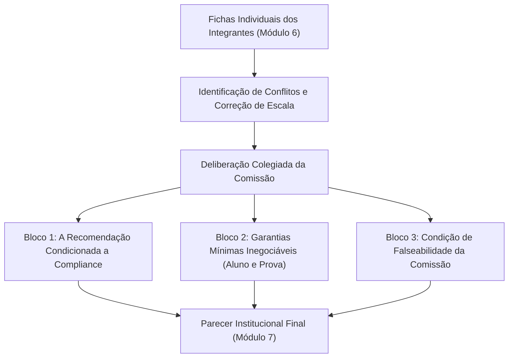

# Parecer da Comissão Multidisciplinar: Quinzena 06
## Parecer Institucional sobre a Adoção do Sistema ProvaSegura na Faculdade Horizonte (Módulo 7)

> **Disciplina:** COM170: Inteligência Artificial na Prática Acadêmica e Profissional  
> **Instituição:** Universidade Virtual do Estado de São Paulo (UNIVESP) │ Primeiro Semestre  
> **Envio Oficial:** Laboratório de Revisão do Módulo 7 (postado pelo representante do grupo)  
> **Caso Deliberado:** [O Caso em Três Cartas (A Prova em Casa)](../conteudo_q6_m5.md)  
> **Material de Apoio e Roteiro:** [Portfólio Individual M6](./Portfolio_Individual_Q6_M6.md) │ [Índice Geral da Quinzena](../quinzena-06.md)  
> **Guia Oficial de Referência:** [Q6_M5-template-grupo.pdf](../Q6_M5-template-grupo.pdf)

---

> [!IMPORTANT]
> **REGRA DE OURO DO ANONIMATO INSTITUCIONAL:**  
> O envio deste parecer é submetido à revisão cega entre grupos no Ambiente Virtual de Aprendizagem (AVA). Não informe nomes dos integrantes, Registros de Alunos (RAs) ou número de equipe. O documento é assinado exclusivamente como *"A Comissão Multidisciplinar da Faculdade Horizonte"*.

---

## 🏛️ 1. Síntese do Mandato Institucional e do Trabalho Colegiado

A Direção da Faculdade Horizonte solicitou a esta Comissão Multidisciplinar a avaliação do sistema automatizado de monitoramento e supervisão remota (*proctoring*) **ProvaSegura**, após a realização de teste-piloto no semestre anterior. Com base no cotejamento dos documentos apresentados (o folheto comercial do fornecedor na Carta 1, o e-mail da estudante Priscila na Carta 2 e o ofício da Direção na Carta 3), bem como na conciliação das fichas individuais dos membros desta comissão ([Módulo 6](./Portfolio_Individual_Q6_M6.md)), apresenta-se este parecer conclusivo.



---

## 📋 2. Quadro de Confronto das Fichas Individuais da Comissão

| Integrante (Anônimo) | Recomendação Preliminar | Valor Priorizado | O que Cedeu na Análise | Ponto Cego Descoberto e Corrigido |
| :---: | :---: | :---: | :---: | :---: |
| **Membro A** | **Não Adotar** | Equidade social, não discriminação e acolhimento discente | Cedeu a vigilância automatizada contínua contra fraudes | Alertado sobre o risco de desvalorização pública do diploma perante o MEC e mercado, concordou em dialogar se houver compliance estrito. |
| **Membro B** | **Adotar com Condições** | Segurança institucional e ampla defesa procedimental | Cedeu a automação cega padronizada (exigiu canais humanos de recurso) | Havia proposto tolerância ingênua de até 20% de falsos positivos em alto risco; após o debate de escala, reconheceu que em milhares de alunos isso é inaceitável e rebaixou a métrica de falsos positivos para menos de 0,5% para qualquer nível de marcação. |

> **Síntese das Divergências e Resolução Colegiada:**  
> A divergência inicial entre a recusa total (**Membro A**) e a adoção condicionada (**Membro B**) foi resolvida através do princípio de **Governança e Compliance Prévia**. A comissão concluiu que o mero fornecimento de explicações pela empresa não é um "cheque em branco" para contratação automática. A expansão só ocorrerá após auditoria pericial independente do algoritmo comprovando ausência de vieses de treinamento, taxa de falsos positivos estruturais **inferior a 0,5% para qualquer nível de marcação** (pois 20% em escala de milhares de discentes geraria milhares de inocentes penalizados e colapsaria a coordenação), transferência da custódia com infraestrutura absorvida pela contratada nos termos da Lei Geral de Proteção de Dados Pessoais (LGPD) e garantia de polos físicos estruturados.

---

## ⚖️ 3. PARECER DA COMISSÃO MULTIDISCIPLINAR (TEMPLATE OFICIAL UNIVESP)

### Bloco 1. A Recomendação da Comissão (em até 8 linhas)

A Comissão Multidisciplinar recomenda **Adotar com Condições Rigorosas**, condicionando qualquer implementação futura à aprovação prévia em auditoria de *compliance* ético e técnico. A razão de considerar a ferramenta é resguardar a validade pública do diploma perante o Ministério da Educação (MEC) e o mercado de trabalho; a razão das condições rigorosas é impedir a punição algorítmica de estudantes vulneráveis por condições materiais de moradia e conectividade. Cedeu-se a agilidade da contratação e a vigilância automatizada imediata no próximo semestre, pois a faculdade assume o encargo institucional de auditar os algoritmos antes de qualquer uso. A comissão superou a divergência inicial entre "Não Adotar" e "Adotar com Condições" ao fixar que a entrega de relatórios pelo fornecedor não garante adoção automática, subordinando o contrato ao cumprimento estrito dos parâmetros da instituição.

---

### Bloco 2. As Garantias Mínimas, uma para Cada Lado

* **Garantia ao Estudante:** A faculdade garante ao estudante notificado o acesso integral ao trecho audiovisual que motivou a suspeita e o direito a recurso analisado por comissão humana com resposta vinculante em até 48 horas úteis, aplicando regras formais de tolerância para oscilações involuntárias de internet e ruídos domésticos (*nascida da resposta "Quem Responde" da Bússola Ética e do e-mail da aluna Priscila na Carta 2*).
* **Garantia à Validade da Prova:** A faculdade garante a realização de auditoria técnica independente sobre o algoritmo do ProvaSegura para mensurar a taxa real de falsos positivos, identificar e mitigar vieses de modelos e verificar o processo de treinamento, além de disponibilizar polos presenciais equipados com conexão estável para atendimento de estudantes que não disponham de ambiente silencioso em casa (*nascida das respostas "O que Sabem" e "Quanto Custa" da Bússola Ética e do ofício da Direção na Carta 3*).

---

### Bloco 3. O que Faria a Comissão Mudar de Parecer (em até 5 linhas)

A comissão mudaria de parecer e decretaria a **Não Adoção definitiva** se a auditoria pericial dos registros do teste-piloto detectar a presença de vieses de treinamento no modelo, se comprovar que a taxa de falsos positivos para qualquer marcação decorrente de fatores estruturais fora do controle do estudante (como quedas transitórias de conexão ou ruídos no cômodo) for igual ou superior a **0,5%** dos exames, ou caso a fornecedora recuse a transferência de governança e a absorção integral dos custos de custódia sob a Lei Geral de Proteção de Dados Pessoais (LGPD), dados que a comissão técnica da própria faculdade apurará na fase de homologação contratual.

---

## ✍️ 4. Declaração Coletiva de Uso de Ferramentas de IA (Duas Metades)

```text
DECLARAÇÃO COLETIVA DE USO DE FERRAMENTAS DE INTELIGÊNCIA ARTIFICIAL:
Na elaboração deste parecer colegiado, a comissão utilizou as ferramentas Google Gemini (modelos Gemini 3.8 Flash e Gemini 3.1 PRO Estendido) para apoiar a simulação de oponentes dialéticos e a síntese técnica dos argumentos divergentes entre os membros, e a ferramenta Antigravity (Google) para a diagramação estrutural do relatório técnico nos padrões da UNIVESP; e os integrantes da comissão conferiram criticamente todos os argumentos formulados, confrontaram cada apontamento com o texto literal dos documentos do caso (o folheto do fornecedor, o e-mail da estudante e o ofício da Direção), auditaram a redação dos três blocos deliberativos para eliminar eventuais alucinações conceituais e asseguraram que a fundamentação ética e a tomada de decisão decorrem exclusivamente do julgamento humano dos membros da comissão.
```
