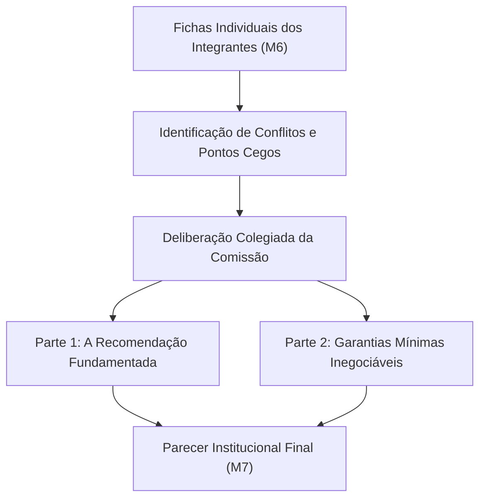

# Parecer da Comissão Multidisciplinar - Quinzena 06
## Parecer Institucional sobre a Adoção do Sistema ProvaSegura na Faculdade Horizonte (Módulo 7)

> **Disciplina:** COM170 - Inteligência Artificial na Prática Acadêmica e Profissional  
> **Instituição:** Universidade Virtual do Estado de São Paulo (UNIVESP) │ Primeiro Semestre  
> **Envio Oficial:** Laboratório de Revisão do Módulo 7 (postado pelo representante do grupo)  
> **Caso Deliberado:** [O Caso em Três Cartas (A Prova em Casa)](../conteudo_q6_m5.md)  
> **Material de Apoio e Roteiro:** [Portfólio Individual M6](./Portfolio_Individual.md) │ [Índice Geral da Quinzena](../quinzena-06.md)  
> **Guia Oficial de Referência:** [Q6_M5-template-grupo.pdf](../Q6_M5-template-grupo.pdf)


---

> [!IMPORTANT]
> **REGRA DE OURO DO ANONIMATO INSTITUCIONAL:**  
> O envio deste parecer é submetido à revisão cega entre grupos no Ambiente Virtual de Aprendizagem (AVA). **Não informe nomes dos integrantes, Registros de Alunos (RAs) ou o número de identificação da equipe**. O documento deve ser assinado exclusivamente como *"A Comissão Multidisciplinar da Faculdade Horizonte"*.

---

## 🏛️ 1. Síntese do Mandato Institucional e do Trabalho Colegiado

A Direção da Faculdade Horizonte solicitou a esta Comissão Multidisciplinar a avaliação do sistema automatizado de proctoring **ProvaSegura** após a realização de teste-piloto no semestre anterior. Com base no cotejamento dos documentos apresentados (o folheto comercial do fornecedor, a manifestação da estudante Priscila e a convocação da Direção), bem como na conciliação das fichas individuais dos membros desta comissão ([Módulo 6](./Portfolio_Individual.md)), apresenta-se este parecer conclusivo.



---

## 📋 2. Quadro de Confronto das Fichas Individuais da Comissão

| Integrante (Anônimo) | Recomendação Preliminar | Valor Priorizado | O que Cedeu na Análise | Ponto Cego Descoberto |
| :---: | :---: | :---: | :---: | :---: |
| **Membro A** | [A preencher] | [A preencher] | [A preencher] | [A preencher] |
| **Membro B** | [A preencher] | [A preencher] | [A preencher] | [A preencher] |
| **Membro C** | [A preencher] | [A preencher] | [A preencher] | [A preencher] |

> **Síntese das Divergências e Consensos:**  
> [Registrar de forma reflexiva como o grupo resolveu os atritos conceituais entre a vigilância técnica de fraudes e a equidade socioespacial dos estudantes.]

---

## ⚖️ 3. PARTE 1: A Recomendação Oficial da Comissão

### 3.1. Posicionamento Deliberado
> **Decisão da Comissão:** [ ] Adotar integralmente │ [ ] Adotar com condições rigorosas │ [ ] Não adotar

### 3.2. As Razões Determinantes
* **Fundamentação Técnica e Ética:** [Justificar detalhadamente os motivos da escolha à luz da Bússola Ética e dos fatos do caso];
* **O que Cedeu no Parecer Coletivo:** [Uso expresso do verbo **CEDER** para assumir o custo deliberado assumido pela faculdade];
* **Condição de Falseabilidade da Comissão:** [Qual dado empírico ou evidência futura documentada nos registros acadêmicos faria a comissão reverter este parecer].

---

## 🛡️ 4. PARTE 2: As Garantias Mínimas Institucionais

Qualquer que seja a postura adotada frente ao software ProvaSegura, a Faculdade Horizonte assume formalmente perante a comunidade acadêmica as seguintes salvaguardas:

### 4.1. O que a Faculdade Passa a Garantir ao Estudante
1. **Garantia de Não Exclusão por Infraestrutura:** [Definir o suporte da faculdade para alunos que não dispõem de ambiente isolado ou conexão estável, como polos presenciais];
2. **Direito à Ampla Defesa e Acesso aos Dados:** [Garantia de acesso ao trecho exato de vídeo/áudio que gerou eventual suspeita, conforme a Lei Geral de Proteção de Dados Pessoais (LGPD)];
3. **Vedação de Punição Algorítmica Automática:** [Obrigatoriedade de análise por comitê humano antes de qualquer penalidade];
4. **Canal Direto de Interlocução com Prazo Vinculante:** [Canal acessível de ouvidoria com resposta em até 48 horas úteis].

### 4.2. O que a Faculdade Passa a Garantir à Validade da Prova
1. **Integridade e Não Repúdio dos Resultados:** [Mecanismos alternativos de aferição que assegurem que foi o aluno quem realizou a avaliação];
2. **Formatos Avaliativos Diversificados:** [Incorporação de questões discursivas, defesas orais amostrais ou avaliações formativas baseadas em projetos];
3. **Auditoria Amostral de Qualidade:** [Inspeção periódica dos índices de aprovação e dos relatórios de risco para detectar falsos positivos].

---

## ✍️ 5. Declaração Coletiva de Uso de Ferramentas de IA

```text
DECLARAÇÃO DE USO DE FERRAMENTAS DE INTELIGÊNCIA ARTIFICIAL:
Na elaboração deste parecer colegiado, a comissão utilizou [nome da ferramenta e modelo] exclusivamente para [apoiar a revisão textual / sintetizar argumentos divergentes], tendo os integrantes conferido criticamente [a fidelidade ao caso da Faculdade Horizonte e a manutenção autônoma das decisões do grupo], assegurando que toda a deliberação ética e as salvaguardas propostas decorrem do julgamento humano dos membros da comissão.
```
