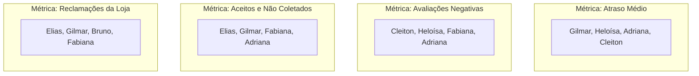

# Q6-M1 - De Onde Vem a Decisão que Parece Óbvia

> **Disciplina:** COM170 - Inteligência Artificial na Prática Acadêmica e Profissional  
> **Quinzena 06:** Ética como Estrutura: Critérios, a Bússola e Sistemas que Decidem sobre Pessoas  
> **Docente Responsável:** Prof. José Avelino Placca  
> **Foco do Módulo 1:** Julgamento com critérios vs. reação imediata; medidas indiretas (*proxies*); quem opera o sistema e quem recebe a decisão.

---

## 🧭 1. Visão Geral do Módulo 1

Quando um aplicativo mostra um preço para você e outro diferente para a pessoa sentada ao seu lado, qual é a sua reação imediata? Em geral, uma única palavra: **injusto**. Essa palavra surge instantaneamente, antes de qualquer pergunta ou ponderação racional.

Este módulo parte dessa reação instintiva para desvendar o que opera oculto nos bastidores. Todo sistema automatizado que decide sobre seres humanos precisou aprender a medir algo, e **o que ele mede raramente corresponde com exatidão ao que ele alega medir**. 

Alguém definiu esse critério, e essa escolha técnica carrega consequências profundas. Neste módulo, aprendemos a:
1. **Separar a reação impulsiva do julgamento técnico baseado em critérios claros;**
2. **Identificar medidas indiretas (*proxies*) e reconhecer quem fica de fora ou é penalizado pela métrica;**
3. **Fazer a pergunta basilar que guia toda a quinzena:** *Quem usa e opera esse sistema, e quem recebe o impacto da decisão gerada por ele?*

---

## 📺 2. Videoaula e Material-Base

### 🎥 Videoaula 1: Quando o critério é de outra pessoa
* **Acesso:** [Assistir no YouTube (10 min)](https://www.youtube.com/watch?v=5fF6wuQewxY)
* **Tema central:** O caso de uma plataforma de streaming/vídeo que alterou subitamente o critério do algoritmo de recomendação, e a investigação subsequente: *qual era o critério de fato e quem foi impactado?*

### 📚 Material de Apoio Oficial
* **E-book (Versão Visual):** [Q6_M1-E-book.pdf](./Q6_M1-E-book.pdf) *(Produzido com Inteligência Artificial - ChatGPT 5.5)*
* **Apostila (Versão Acessível):** [COM170_apostila_quinzena6_M1.pdf](./COM170_apostila_quinzena6_M1.pdf)

---

## 🔍 3. Atividade Prática: O Que Esse Número Mediu?

> 🎯 **Objetivo:** Ocupar a posição de quem formula o critério em uma plataforma de entregas por aplicativo, desconstruir indicadores reais de desempenho e vivenciar como a escolha de uma medida indireta altera radicalmente quem é punido ou beneficiado.

---

### 🛵 Parte 1: O Que Cada Indicador Mede de Fato (Estudo de Caso Score iFood)

No portal público do iFood voltado aos entregadores, a empresa apresenta a composição do *Score* (pontuação de 1 a 3 que define a prioridade de recebimento de pedidos e agendamento prévio). A pontuação baseia-se em cinco indicadores consolidados ao longo de quatro semanas:

| Indicador Oficial | Definição Declarada pela Plataforma | O que Mede de Fato (Realidade Operacional) | Feedback da Escolha |
| :--- | :--- | :--- | :--- |
| **1. Pedidos Coletados** | Percentual de pedidos retirados na loja após o aceite na tela. | **De tudo o que a pessoa aceitou, quanto ela chegou a retirar na loja.** | Mede a distância entre aceitar e retirar. Registra a desistência bruta, mas ignora o motivo (loja sem pedido pronto, rua perigosa, divergência de endereço). |
| **2. Pedidos Entregues** | Taxa de entregas concluídas até o cliente final. | **De tudo o que a pessoa retirou na loja, quanto chegou ao cliente.** | Analisa o trecho final do percurso com a refeição na mochila. É onde o entregador menos depende de terceiros, logo a maioria tem índices altos. |
| **3. Pontualidade** | Média em minutos de atrasos ao chegar à loja e ao entregar. | **A média de minutos de atraso em dois momentos: a chegada à loja e a entrega.** | Metade do cálculo ocorre antes de o entregador ter a comida na mão. A demora da cozinha do restaurante e os congestionamentos entram na conta do entregador. |
| **4. Avaliações** | Média das avaliações positivas de lojas e clientes. | **A média das notas dadas por terceiros (quem preparou e quem recebeu).** | Mede a percepção alheia, não o esforço. Prédios sem elevador, demoras da portaria ou comida fria por atraso do restaurante deságuam na nota de quem toca a campainha. |
| **5. Comparecimento ao Agendamento** | Cumprimento das faixas de horário previamente reservadas. | **Se a pessoa trabalhou nos horários que ela própria reservou.** | Favorece quem tem disponibilidade de agenda rígida e previsível. Quem estuda ou tem outros empregos atua nas brechas, não consegue reservar e fica sem essa pontuação. |

#### ⚠️ A Regra que Não É Indicador (Piso de Elegibilidade)
> *"Para que a gente possa ser justo na hora de calcular o seu Score, a gente só atualiza ele se você tiver ficado online no app pelo menos 28 horas nesse período [4 semanas]."*
* **Efeito prático:** Deixa quem trabalha menos de 7 horas por semana (ex.: 2 noites de 3 horas = 24 horas no mês) **completamente fora do cálculo e sem possibilidade de subir de nível**. 
* **Conclusão:** Não mede desempenho, qualidade ou pontualidade; mede estritamente **disponibilidade**.

---

### 📊 Parte 2: O Sistema Preditivo e as Quatro Medidas Indiretas

#### O Cenário e a Demanda
> *"Os restaurantes mais movimentados estão reclamando de atraso. Preciso de uma lista com quem tem mais risco de atrasar na semana que vem, para a gente não mandar pedido desses restaurantes para essas pessoas."*

Como desenvolvedor/gestor do sistema, você precisa selecionar **quatro entregadores para a Lista de Restrição**. A tabela a seguir expõe os dados brutos dos dez entregadores e o contexto real que **nenhum número registra**:

| Entregador | Atraso Médio | Avaliações Negativas | Aceitos e Não Coletados | Reclamações da Loja | Horas Online | Situação no Cálculo | O que Nenhum Número Registra (Contexto Real) |
| :--- | :---: | :---: | :---: | :---: | :---: | :---: | :--- |
| **Adriana** | 11 min | 4 | 3% | 0 | 62 h | No cálculo | Cobre um trecho da zona leste que trava diariamente entre 18h e 20h. |
| **Bruno** | 4 min | 2 | 1% | 2 | 55 h | No cálculo | Ciclista ágil no centro; as lojas da sua região demoram excessivamente a montar os pedidos. |
| **Cleiton** | 9 min | 12 | 2% | 0 | 70 h | No cálculo | Atende condomínios verticais com portarias lentas, aguarda na guarita e sobe a pé. |
| **Daiane** | 5 min | 1 | 0% | 0 | 48 h | No cálculo | Rota fixa em shopping center privilegiado: vagas na porta e elevadores de serviço rápidos. |
| **Elias** | 6 min | 3 | 14% | 5 | 58 h | No cálculo | Cancela e desiste da coleta quando o trajeto direciona para zonas de alto risco de assalto. |
| **Fabiana** | 7 min | 5 | 4% | 1 | 44 h | No cálculo | Trabalha o turno vespertino e encerra impreterivelmente às 17h30 para buscar os filhos na escola. |
| **Gilmar** | 13 min | 2 | 6% | 3 | 31 h | No cálculo | Atua na madrugada; metade dos estabelecimentos abre os portões de entrega com atraso. |
| **Heloísa** | 12 min | 9 | 2% | 0 | 66 h | No cálculo | Opera em bairro recém-loteado onde os sistemas de navegação por Sistema de Posicionamento Global (GPS) erram a numeração. |
| **Ivan** | 8 min | 6 | 5% | 2 | 26 h | **Fora do cálculo** | Trabalhador com emprego fixo regular; entrega apenas 3 manhãs por semana antes do expediente. |
| **Vanderson** | 3 min | 0 | 1% | 0 | 24 h | **Fora do cálculo** | Estudante de 20 anos; roda apenas duas noites por semana após as aulas da faculdade. |

---

### ⚖️ O Impacto das Quatro Medidas Indiretas

Ao ordenar os entregadores elegíveis por diferentes métricas, a composição da lista de restrição (os 4 primeiros) altera-se completamente:



#### Perguntas de Análise do Painel Comparativo:
1. **Quem aparece nas quatro listas simultaneamente?**
   - **Resposta:** **Nenhum deles.** Três pessoas aparecem em três listas, mas ninguém nas quatro. Trocar a medida indireta troca quase todos os punidos.
2. **Por que Ivan e Vanderson não figuram em nenhuma lista de restrição?**
   - **Resposta:** **Ambos cumpriram menos de 28 horas online no período (26h e 24h).** Não foram avaliados nem punidos, mas também não sobem de nível e recebem menos chamadas. A regra mede apenas disponibilidade.
3. **Por que Daiane possui métricas excelentes e nunca entra em lista alguma?**
   - **Resposta:** **Estrutura de rota privilegiada.** Trabalha em shopping com elevador de serviço e estacionamento exclusivo. A métrica captura o ambiente favorável, não necessariamente um mérito individual superior.

---

## 📋 4. A Ficha da Medida Escolhida

Quando o fenômeno real que queremos avaliar (*"quem tem risco real de atrasar"* por desídia) não pode ser mensurado diretamente, adota-se um substituto numérico: uma **medida indireta (*proxy*)**. Toda medida indireta gera distorções sistemáticas.

### Ficha Registrada pelo Estudante

| Campo | Conteúdo Registrado |
| :--- | :--- |
| **1. O que eu queria saber:** | A lista era para saber quais entregadores deveriam ser ignorados ou terem pedidos reduzidos de acordo com uma métrica de atraso. |
| **2. O que escolhi medir:** | **Pedidos aceitos e não coletados.** |
| **3. Quem isso deixou de fora / distorceu:** | Elias, porque ele aceitava o pedido, mas quando verificava o endereço cancelava pois considera alguns lugares inseguros e rotas perigosas. |
| **4. O que eu faria com a lista:** | Analisaria para encontrar padrões inconsistentes a fim de melhorar e encontrar maneiras mais justas para lidar com essa situação. |

> 💡 **Reflexão Crítica sobre a Medida Escolhida (Pedidos Aceitos e Não Coletados):**  
> Essa métrica parece a mais justa à primeira vista porque descreve a conduta direta do próprio entregador (sem depender de trânsito ou opinião de clientes). No entanto, é a que mais engana: ela penaliza duramente quem prioriza a própria integridade física ao recusar áreas de risco iminente. A máquina registra a desistência numérica fria, sem compreender o motivo ou a sensatez da decisão.

---

## 📄 5. Modelo em Branco para Guardar

Este modelo estruturado deve ser preservado para orientar auditorias de algoritmos e sistemas decisórios automatizados ao longo da vida profissional:

```text
FICHA DA MEDIDA ESCOLHIDA
1. O que eu queria saber:
2. O que escolhi medir:
3. Quem isso deixou de fora:
4. O que eu faria com a lista:
```

---

> ✅ **Status da Atividade:** Concluída com registro formal no Ambiente Virtual de Aprendizagem (AVA).
