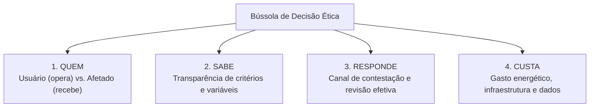

# Q6-M2 - Quatro Perguntas a um Sistema que Decide sobre Pessoas

> **Disciplina:** COM170 - Inteligência Artificial na Prática Acadêmica e Profissional  
> **Quinzena 06:** Ética como Estrutura: Critérios, a Bússola e Sistemas que Decidem sobre Pessoas  
> **Docente Responsável:** Prof. José Avelino Placca  
> **Foco do Módulo 2:** A Bússola de Decisão Ética; as quatro perguntas estruturantes (**Quem**, **Sabe**, **Responde**, **Custa**); aplicação no caso real de crédito imobiliário da Tainá; análise jurídica com a Lei Geral de Proteção de Dados Pessoais (LGPD).

---

## 🧭 1. Visão Geral do Módulo 2

Você já recebeu um "não" sem explicação? Uma conta bloqueada por *"atividade incomum"*, um anúncio rejeitado, uma corrida cancelada em série, ou um crédito recusado instantaneamente. A recusa chega pronta, e a reação imediata costuma ser a pergunta errada: *"O que eu fiz de errado?"*.

Este módulo substitui essa culpa individual por **quatro perguntas direcionadas ao sistema decisório**, e não à pessoa:
1. **Quem é afetado por esse sistema?**
2. **As pessoas afetadas sabem que há um algoritmo decidindo sobre elas?**
3. **Quando o sistema erra, quem responde?**
4. **Quanto custa manter isso em operação, e quem paga a conta?**

Essas quatro perguntas formam a **Bússola de Decisão Ética**. A bússola não toma a decisão por você: ela aponta com precisão técnica a direção para onde olhar, identificando onde a informação pública termina e onde ela deveria estar.



---

## 📺 2. Videoaula e Material-Base

### 🎥 Videoaula 2: Quem recebeu a decisão
* **Acesso:** [Assistir no YouTube (11 min)](https://www.youtube.com/watch?v=ghtwIqVLDNI)
* **Tema central:** A análise de uma recusa automatizada e o erro conceitual mais frequente: confundir quem opera o sistema (*usuário*) com quem recebe as consequências da decisão (*afetado*).

### 📚 Material de Apoio Oficial
* **E-book (Versão Visual):** [Q6_M2-E-book.pdf](./Q6_M2-E-book.pdf) *(Produzido com Inteligência Artificial - ChatGPT 5.5)*
* **Apostila (Versão Acessível):** [COM170_apostila_quinzena6_M2.pdf](./COM170_apostila_quinzena6_M2.pdf)

---

## 🔍 3. Atividade Prática: A Resposta que a Tainá Pediu

> 🎯 **Contexto:** Tainá, estudante universitária que mora sozinha, encontra um apartamento perto do trabalho pela plataforma imobiliária QuintoAndar. Ao preencher nome, Cadastro de Pessoas Físicas (CPF) e renda, recebe dois minutos depois uma tela com um "X" vermelho: **avaliação de crédito não aprovada**, sem nenhuma justificativa. No polo, ela pergunta: *"Quem decidiu isso? Dá para pedir para alguém olhar de novo?"*.

---

### 🏢 Passo a Passo da Investigação da Plataforma

#### Etapa 1: Distinção entre Usuário e Afetado (Pergunta: QUEM?)
* **Texto da Plataforma:**
  > *"Mesmo que você não tenha a pré-aprovação, pode continuar o processo e enviar uma proposta. No entanto, só é possível avançar no processo de aluguel com a avaliação pré-aprovada, mesmo que o proprietário aprove a sua proposta."* (Trecho A)  
  > *"Você pode incluir até 4 pessoas para compor a renda e/ou o score necessários. Elas serão as responsáveis financeiras pelo contrato, mas não precisam morar no imóvel nem na mesma cidade."* (Trecho B)
* **Quem usa o resultado para decidir o próximo passo?**  
  **A plataforma QuintoAndar.** Nem o proprietário do imóvel (a outra parte humana interessada) tem poder de passar por cima do bloqueio do algoritmo.
* **Quem é a pessoa afetada por este sistema específico?**  
  **Quem foi recusado e não tem rede de apoio com boa renda para compor a avaliação.** O sistema cria dois grupos desiguais: quem tem familiares com renda para assinar como fiadores/responsáveis e quem mora sozinho e depende exclusivamente do próprio salário (caso da Tainá).

---

#### Etapa 2: A Opacidade dos Critérios (Pergunta: SABE?)
* **Texto da Plataforma:**
  > *"Comprometimento de renda: no mínimo 2,5 vezes o pacote de locação (aluguel + Imposto Predial e Territorial Urbano (IPTU) + condomínio). Score de crédito: Serasa e SCPC Boa Vista. Risco financeiro: probabilidade de inadimplência calculada com base nos outros dois pontos. Nossa análise é 100% automatizada. Por questões de segurança, não conseguimos dar detalhes específicos sobre a recusa."* (Trecho D)
* **O que a Tainá fica sabendo?**  
  Ela descobre que a decisão foi 100% automatizada e quais foram as três variáveis gerais, **mas não fica sabendo qual critério específico determinou a sua reprovação**. A empresa utiliza o argumento genérico de *"segurança"* como escudo para não fornecer transparência explicativa.

---

#### Etapa 3: A Ausência de Revisão Humana Garantida (Pergunta: RESPONDE?)
* **Texto da Plataforma:**
  > *"Você pode refazer a avaliação de crédito inicial para tentar um novo resultado."* (Trecho E)  
  > *"Precisa de ajuda? Entre em contato com o nosso suporte no chat em 'Ajuda e Atendimento' do seu aplicativo."* (Trecho F)
* **"Refazer a avaliação" garante que alguém olhe o caso?**  
  **Não.** Refazer significa apenas reenviar os dados para o mesmo modelo automatizado processar novamente.
* **O chat de suporte resolve a responsabilização?**  
  O chat aponta um canal de atendimento básico, mas a plataforma **não informa se existe algum atendente humano com autoridade real para reverter uma recusa gerada pelo algoritmo**.

---

### ⚖️ Passo 4: O Confronto com a Lei Geral de Proteção de Dados Pessoais (LGPD)

A análise técnica ganha solidez quando colocamos a alegação da empresa lado a lado com a legislação brasileira:

| Plataforma QuintoAndar | Legislação Brasileira: LGPD (Lei nº 13.709/2018, Art. 20) | Análise Técnica e Consequências Práticas |
| :--- | :--- | :--- |
| *"Nossa análise é 100% automatizada. Por questões de segurança, não conseguimos dar detalhes específicos sobre a recusa."* | **Art. 20, caput:** O titular tem direito a solicitar a revisão de decisões tomadas unicamente com base em tratamento automatizado.<br><br>**§ 1º:** O controlador deve fornecer informações claras e adequadas a respeito dos critérios e procedimentos, observados os **segredos comercial e industrial**.<br><br>**§ 2º:** Se a informação for negada por segredo, a Autoridade Nacional de Proteção de Dados (ANPD) pode realizar auditoria.<br><br>**§ 3º:** *(VETADO)* Exigia revisão por pessoa natural (ser humano). | 1. **O que a Tainá pode fazer:** Ela tem o direito legal de solicitar formalmente os critérios e a revisão (Art. 20, § 1º), mas a empresa pode se esquivar alegando segredo comercial.<br><br>2. **Quem faz a revisão:** A lei **não garante revisão humana**, pois o § 3º foi vetado pela Presidência em 2019 e mantido pelo Congresso. A revisão pode ser executada por outro algoritmo. |

---

## 📋 4. A Ficha da Bússola Preenchida

Uma auditoria ética rigorosa não precisa ter respostas perfeitas para tudo: **seu maior valor reside em explicitar onde a informação termina e onde ela deveria estar**.

### Ficha da Bússola: Avaliação de Crédito da Tainá

| Pergunta da Bússola | Resposta Técnica Situada | Onde a Informação Acabou e Onde Deveria Estar |
| :--- | :--- | :--- |
| **1. QUEM é afetado?** | Quem foi recusado e não tem ninguém com boa renda/score para incluir na avaliação (composição de renda). A Tainá está exatamente nesse grupo vulnerável. | Resposta completa com base nas regras de negócio publicadas pela plataforma. |
| **2. O que SABE?** | Ela sabe que a análise foi automatizada e utilizou comprometimento de renda, score e risco financeiro. Não sabe qual critério pesou no caso dela. Tem o direito de requisitar os critérios via Art. 20, § 1º da LGPD, sujeita à barreira do segredo comercial. | A informação pública acaba na alegação de *"segurança"*. Deveria constar em relatório explicativo transparente de recusa ao titular dos dados. |
| **3. Quem RESPONDE?** | Há um chat de atendimento e a opção de reprocessar os dados. A página não informa se qualquer funcionário tem autonomia para revisar ou alterar uma recusa automatizada. | A informação acaba no canal de suporte genérico. Deveria estar explícito nos Termos de Uso e na página de ajuda se há ou não instância humana de recurso. |
| **4. Quanto CUSTA e quem paga?** | A página não divulga onde a infraestrutura computacional opera, quanta energia e água os servidores consomem, nem quem rotulou ou preparou a base de dados de treinamento. | A conta ambiental e social fica oculta. Essa informação deveria constar em Relatório Anual de Sustentabilidade e Transparência Algorítmica da empresa. |

---

### 💬 Mensagem de Orientação Entregue à Colega (Campo Autoral do Estudante)

> *"Será muito difícil reverter a situação, talvez com esforço jurídico isso seja possível, mas os custos processuais, o tempo de espera, e a burocracia possam ser barreiras muito altas de transpor, pois esses sistemas são criados justamente dessa forma para se isentarem de responsabilidades."*

---

## 📄 5. Modelo em Branco da Ficha da Bússola

Guarde esta estrutura para auditar qualquer sistema automatizado com impacto sobre pessoas:

```text
FICHA DA BÚSSOLA
Sistema examinado:
1. Quem é afetado:
2. O que as pessoas afetadas sabem:
3. Quem responde quando o sistema erra:
4. Quanto custa, e quem paga:
Onde a informação acabou, e onde ela deveria estar:
```

---

> ✅ **Status da Atividade:** Concluída com registro formal no Ambiente Virtual de Aprendizagem (AVA).
