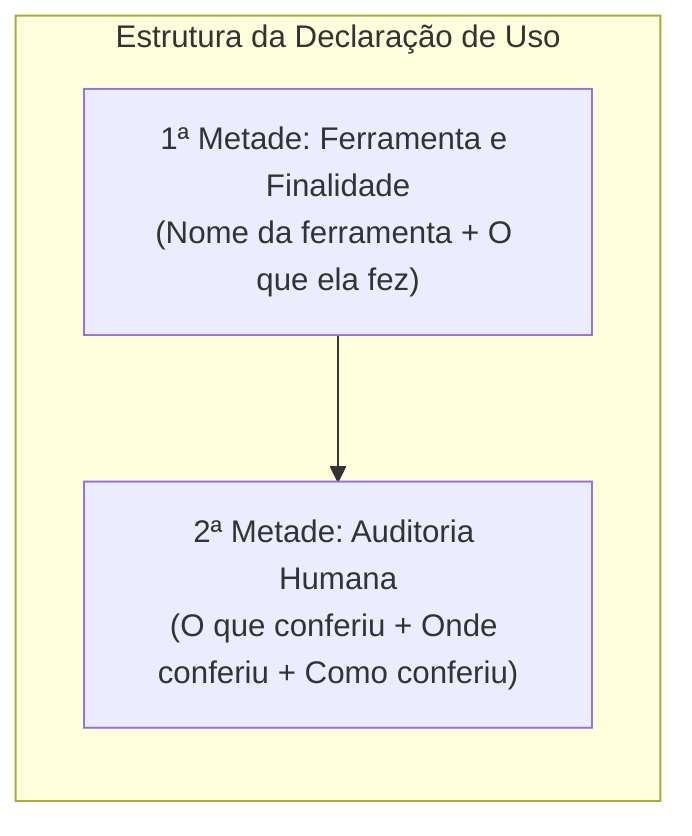

# Q6-M3 - A Linha que Você Escreve no Fim do Trabalho

> **Disciplina:** COM170 - Inteligência Artificial na Prática Acadêmica e Profissional  
> **Quinzena 06:** Ética como Estrutura: Critérios, a Bússola e Sistemas que Decidem sobre Pessoas  
> **Docente Responsável:** Prof. José Avelino Placca  
> **Foco do Módulo 3:** Declaração de uso de ferramentas de Inteligência Artificial (IA); distinção entre forma e conteúdo; a estrutura da declaração em duas metades (ferramenta utilizada + método de auditoria humana); responsabilidade inalienável de autoria.

---

## 🧭 1. Visão Geral do Módulo 3

Imagine que um trabalho acadêmico ou técnico assinado por você há dois anos seja aberto hoje por um avaliador, colega ou cliente que deseja auditar como ele foi produzido. O que essa pessoa encontra? Na esmagadora maioria dos casos, o texto final está exposto, mas **todo o caminho metodológico desapareceu**.

Este módulo formaliza a **Declaração de Uso de IA**: a especificação técnica, localizada ao término do trabalho, que documenta a participação da ferramenta e o que ela realizou. 

Instituições de pesquisa e agências de fomento - como o Conselho Nacional de Desenvolvimento Científico e Tecnológico (CNPq) - passaram a exigir essa transparência. Contudo, uma declaração sólida possui **duas metades complementares**:
1. **A primeira metade:** Declara qual ferramenta foi usada e qual tarefa ela executou (o que a máquina fez);
2. **A segunda metade:** Declara exatamente o que foi conferido, em qual seção e por qual método de checagem (o que o humano auditou).

> 📌 **Regra de Ouro da Autoria:** A declaração informa de onde o texto veio. Quem assina o trabalho continua sendo o único responsável técnico e ético por tudo o que está afirmado nele.

---

## 📺 2. Videoaula e Material-Base

### 🎥 Videoaula 3: A linha que fica com você
* **Acesso:** [Assistir no YouTube (10 min)](https://www.youtube.com/watch?v=tuLJmsCTfTs)
* **Tema central:** A análise de um artigo científico retratado por periódico acadêmico de renome e a constatação do que a declaração de uso resolve (rastreabilidade) e do que permanece sob responsabilidade exclusiva de quem assina (a veracidade do conteúdo).

### 📚 Material de Apoio Oficial
* **E-book (Versão Visual):** [Q6_M3-E-book.pdf](./Q6_M3-E-book.pdf) *(Produzido com Inteligência Artificial - ChatGPT 5.5)*
* **Apostila (Versão Acessível):** [COM170_apostila_quinzena6_M3.pdf](./COM170_apostila_quinzena6_M3.pdf)

---

## 🔍 3. Atividade Prática: A Linha que Você Assina

> 🎯 **Contexto:** Domingo à noite. Você conclui um relatório baseado em um levantamento empírico feito com 12 colegas de turma sobre leitura acadêmica no smartphone. Como a redação final da conclusão parecia truncada, você recorreu a uma ferramenta de IA com o seguinte prompt:  
> *"Revise a redação da conclusão abaixo. Corrija a gramática e deixe as frases mais claras, sem mudar o conteúdo."*

### ⚖️ O Par Conceitual: Forma vs. Conteúdo
* **Forma:** A maneira de expressar o texto (sintaxe, gramática, pontuação, vocabulário e coesão).
* **Conteúdo:** O compromisso factual da afirmação (sujeitos envolvidos, dados quantitativos, causalidades e grau de certeza epistêmica).

---

### 🔬 Passo 1: Auditoria Frase a Frase (Confronto Lado a Lado)

A ferramenta reescreveu as seis frases da conclusão. A auditoria humana compara cada par para verificar se a intervenção preservou o conteúdo ou se cometeu distorções:

| Frase | Versão Original do Autor | Versão Reescrita pela IA | Diagnóstico da Auditoria | Decisão do Autor |
| :---: | :--- | :--- | :--- | :--- |
| **1** | *Este trabalho apresentou o resultado de um levantamento que eu fiz com 12 colegas da minha turma sobre leitura no celular.* | *Este trabalho apresentou os resultados de um levantamento realizado com 12 colegas da minha turma sobre leitura no celular.* | **Continua dizendo o que eu quis dizer.** Correção puramente gramatical e estilística. | Mantém a versão revisada pela ferramenta. |
| **2** | *9 dos 12 colegas disse que lê os textos da faculdade no celular pelo menos três vezes por semana.* | *A maioria dos estudantes (75%) lê os textos da faculdade no celular pelo menos três vezes por semana.* | **Passou a afirmar o que não foi dito.** O cálculo de 75% está exato, mas a IA trocou a amostra (*"12 colegas da turma"*) por uma generalização indevida (*"a maioria dos estudantes"*). | **Volta para a versão original** (preservando o escopo real da amostra). |
| **3** | *Esse resultado pode indicar que o material da faculdade precisa ser pensado para tela pequena.* | *Esse resultado comprova que o material da faculdade precisa ser pensado para tela pequena.* | **Passou a afirmar o que não foi dito.** A IA substituiu uma hipótese prudente (*"pode indicar"*) por uma certeza categórica (*"comprova"*), prometendo mais do que a amostra permite. | **Volta para a versão original** (mantendo a cautela científica). |
| **4** | *Os 3 que lê no computador falou que o motivo é o tamanho da tela.* | *Os três que leem no computador apontaram o tamanho da tela como motivo.* | **Continua dizendo o que eu quis dizer.** Ajuste formal de concordância verbal sem adulteração de sentido. | Mantém a versão revisada pela ferramenta. |
| **5** | *O levantamento foi pequeno e feito só na minha turma, então ele não serve para falar de outros cursos.* | *O levantamento foi pequeno e restrito à minha turma, o que limita a generalização para outros cursos.* | **Continua dizendo o que eu quis dizer.** Elevação do registro formal de linguagem preservando a restrição metodológica. | Mantém a versão revisada pela ferramenta. |
| **6** | *Como próximo passo, seria interessante repetir a pergunta com mais pessoas.* | *Como próximo passo, seria interessante repetir a pergunta com mais pessoas, já que estudos recentes confirmam a preferência dos jovens pela leitura em tela (SILVA; PEREIRA, 2023).* | **Passou a afirmar o que não foi dito.** A IA alucinou e enxertou uma citação bibliográfica externa não consultada pelo autor. | **Confere fora do texto antes de decidir** (audita se a fonte existe antes de incluir ou expurgar). |

> [!IMPORTANT]
> **A Verdade da Linha de Declaração:**  
> A declaração genérica *"Neste trabalho usei IA para revisar a redação"* permanece formalmente verdadeira para todas as 6 frases, pois ela relata a ferramenta utilizada. No entanto, ela **não atesta a exatidão do conteúdo**. Se uma citação inventada permanecer no texto final, a infração acadêmica será imputada exclusivamente a quem assina o documento.

---

### 📑 Passo 2: O que o Edital / Enunciado Oficial Exige

Ao analisar as instruções de entrega do trabalho acadêmico, três checagens normativas se impõem:

1. **O uso da ferramenta é autorizado?**  
   $\rightarrow$ **Sim**, estritamente delimitado para *revisar a redação* e *organizar as ideias*.
2. **O que é obrigatório declarar?**  
   $\rightarrow$ **Qual ferramenta específica foi empregada e exatamente o que ela realizou** (alinhado às diretrizes de integridade acadêmica do CNPq).
3. **Em qual local do texto a declaração deve ser posicionada?**  
   $\rightarrow$ Quando as normas regimentais não especificarem a página, a prática acadêmica padrão e mais transparente é posicioná-la **ao final do documento, imediatamente após as Referências Bibliográficas**.

---

## 📋 4. A Declaração Construída em Duas Metades

A formulação técnica não deve recorrer a fórmulas evasivas ou genéricas (como *"revisei com atenção"* ou *"o conteúdo é todo meu"*). Ela deve descrever ações concretas e auditáveis.



### Declaração Registrada pelo Estudante

> *"Neste trabalho usei o Chat Web com modelo Gemini 3.8 Flash - Pensamento Estendido para revisar a redação da conclusão, e li as seis frases da conclusão ao lado da minha versão, e devolvi três ao original."*

#### Decomposição dos Elementos da Declaração:
* **Ferramenta e Versão:** `o Chat Web com modelo Gemini 3.8 Flash - Pensamento Estendido`
* **Finalidade declarada:** `revisar a redação da conclusão`
* **O que foi conferido:** `as seis frases`
* **Em que parte do trabalho:** `da conclusão`
* **Como foi conferido:** `ao lado da minha versão`
* **Resultado da auditoria humana:** `e devolvi três ao original` (rejeição das generalizações indevidas e da citação espúria)

---

## 📄 5. Modelo em Branco para Guardar

Este modelo estruturado deve ser adotado ao término de qualquer artigo, relatório técnico, portfólio ou projeto acadêmico:

```text
DECLARAÇÃO DE USO DE FERRAMENTAS DE IA
Neste trabalho usei [nome da ferramenta e modelo] para [o que ela fez], e [o que eu conferi], [em que parte do trabalho], [como conferi].
```

---

> ✅ **Status da Atividade:** Concluída com registro formal no Ambiente Virtual de Aprendizagem (AVA).