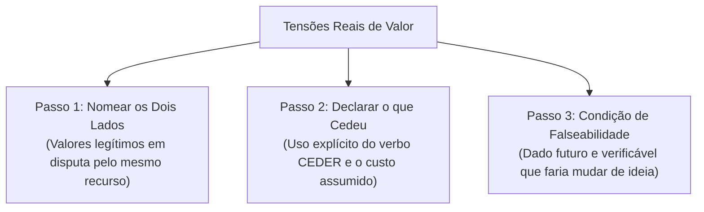

# Q6-M4 - Quando Não Dá para Ter as Duas: Tensões Reais de Valor

> **Disciplina:** COM170 - Inteligência Artificial na Prática Acadêmica e Profissional  
> **Quinzena 06:** Ética como Estrutura: Critérios, a Bússola e Sistemas que Decidem sobre Pessoas  
> **Docente Responsável:** Prof. José Avelino Placca  
> **Foco do Módulo 4:** Tensões éticas de valor; o teste da solução que custa; as três lentes de deliberação; formulação técnica de recomendações em três passos (nomear os lados, explicitar o que cedeu e definir a condição de falseabilidade).

---

## 🧭 1. Visão Geral do Módulo 4

Dois valores éticos legítimos, cada um respaldado por excelentes argumentos, e uma decisão corporativa ou institucional que precisa ser deliberada impreterivelmente até o final da semana. 

* O que beneficia a maioria versus o que protege a minoria vulnerável na ponta;
* O que maximiza a velocidade operacional versus o que garante o devido cuidado e a escuta individual.

Quando surge uma proposta aparentemente mágica que promete *"agradar a todos sem sacrifício nenhum"*, desconfie: quase sempre **alguém deixou de contabilizar um custo real**.

Este módulo conceitua essa situação como uma **tensão de valor** e estabelece a metodologia para:
1. **Diferenciar uma tensão real de um mero problema de implementação** (que se resolve com ajustes técnicos);
2. **Reconhecer que toda escolha decisória acarreta um custo humano ou financeiro**, identificando claramente *quem paga a conta*;
3. **Redigir uma recomendação formal fundamentada em três passos**, estabelecendo critérios objetivos que permitiriam mudar de ideia caso novos fatos venham à tona.



---

## 📺 2. Videoaula e Material-Base

### 🎥 Videoaula 4: A mesma jarra não enche os dois copos
* **Acesso:** [Assistir no YouTube (12 min)](https://www.youtube.com/watch?v=9Ecd3Xmciew)
* **Tema central:** Uma central de atendimento ao cliente tornou-se estatisticamente mais rápida, mas a investigação revela o custo oculto: o abandono sistemático dos casos complexos e das pessoas mais vulneráveis.

### 📚 Material de Apoio Oficial
* **E-book (Versão Visual):** [Q6_M4-E-book.pdf](./Q6_M4-E-book.pdf) *(Produzido com Inteligência Artificial - ChatGPT 5.5)*
* **Apostila (Versão Acessível):** [COM170_apostila_quinzena6_M4.pdf](./COM170_apostila_quinzena6_M4.pdf)

---

## 🔍 3. Miniquiz: Quem Paga o Desconto? (A Semana de Estágio de Letícia)

> 🎯 **Contexto Integrador:** A estagiária Letícia atua no escritório central de uma rede de academias com cinco unidades. Na segunda-feira, a gerência implementa um sistema automatizado para conceder descontos e conter cancelamentos. Ao longo da semana, Letícia enfrenta seis dilemas decisórios que articulam todo o conhecimento da Quinzena 06.

---

### 🏋️ As Seis Situações Decisórias e os Feedbacks Pedagógicos

| Dia da Semana | Dilema Ético e Operacional | Alternativa Selecionada | Fundamentação Conceitual do Feedback |
| :---: | :--- | :--- | :--- |
| **Segunda-feira**<br>*(O que a nota mede?)* | A rede contrata um modelo de aprendizado de máquina que gera uma nota de risco de cancelamento (0 a 100), treinada com 2 anos de histórico das 5 unidades. A gerência quer dar desconto de 2 meses para notas acima de 70. **O que a nota de um aluno mede de fato?** | **b) O quanto a ficha dele se parece com as fichas de quem cancelou nos dois anos anteriores.** | **O sistema mede semelhança estatística de padrões passados, não a intenção real.** O modelo não conhece o motivo subjetivo: quem reduziu a frequência por motivo de lesão temporária e quem parou por insatisfação recebem a mesma pontuação. |
| **Terça-feira**<br>*(Quem é afetado?)* | O desconto é concedido a 212 alunos. A gerência solicita um parágrafo para o relatório respondendo à pergunta da Bússola: *Quem é afetado por esse sistema?* **Qual é a resposta situada?** | **c) Os 1.340 alunos de nota baixa, que treinam há mais tempo, pagam tudo e não sabem que a lista existe.** | **A resposta situada nomeia o grupo específico que só existe sob as regras deste sistema.** Os alunos fiéis e pontuais pagam a mensalidade integral para financiar o desconto direcionado a quem ameaça sair, sem qualquer transparência de que a lista existe. |
| **Quarta-feira**<br>*(Quem responde?)* | Um aluno fiel descobre o desconto concedido ao colega e exige revisão na recepção. **Qual procedimento cumpre as duas metades da pergunta *Responde*?** | **d) A mensagem do desconto diz que a gerente pode rever a lista, e a recepção encaminha o pedido a ela.** | **Garante as duas metades da responsabilização:** o aluno tem um canal claro para onde ir e existe um agente humano com poder real para reavaliar e alterar o resultado da lista automatizada. |
| **Quinta-feira**<br>*(O relatório e a linha de IA)* | Letícia pede à IA que organize o relatório. O texto volta mais claro, mas com uma frase inventada: *"Estudos mostram que descontos reduzem cancelamentos em até 30%"*. Ela declara no rodapé o uso de IA. **O que a linha resolveu e o que ficou em aberto?** | **a) A linha respondeu de onde veio o texto. A frase dos 30% continua sendo dela, e precisa de fonte ou precisa sair.** | **A declaração atesta a procedência, mas a responsabilidade pelo conteúdo é inalienável de quem assina.** Como a IA não pesquisou a base real daquela rede, se Letícia não dispõe de comprovação empírica idônea, a frase deve ser sumariamente expurgada. |
| **Sexta-feira**<br>*(Isso é um erro do sistema?)* | Alunos antigos exigem o desconto. Dar desconto geral custa fechar a menor unidade; retirar o desconto traz cancelamentos; manter o desconto perpetua injustiça com os fiéis. A gerente pergunta: *Isso é um erro do sistema?* | **d) É uma tensão: manter a rede aberta e tratar igual quem paga igual disputam o mesmo dinheiro, e um cede.** | **Não se trata de bug de software, mas de dilema ético estrutural.** O recurso financeiro é finito. Os dois valores são legítimos e defensáveis, mas inconciliáveis em sua totalidade: um lado terá de ceder para que o outro seja preservado. |
| **Sexta-feira**<br>*(O que faria mudar de ideia?)* | Letícia redige sua recomendação formal e precisa completar o terceiro passo da metodologia de falseabilidade. **Qual formulação cumpre rigorosamente esse critério?** | **b) Mudaria de ideia se os registros de três meses mostrassem que saíram mais alunos antigos, sem desconto, do que o desconto segurou.** | **Cumpre as três condições da falseabilidade:** a informação ainda não existe no presente; é auditável empiricamente no futuro nos registros da empresa; e, caso ocorra, inverte o balanço de custo/benefício da recomendação. |

---

## 📋 4. A Metodologia de Recomendação em Três Passos

A síntese pedagógica do Módulo 4 consolida o protocolo de deliberação ética que fundamentará a produção do Portfólio Individual (Módulo 6) e o Parecer da Comissão (Módulo 7):

```text
ROTEIRO PARA REDAÇÃO DE RECOMENDAÇÕES ÉTICAS
1. Dê nome aos dois lados: Identifique com precisão os valores legítimos em disputa.
2. Diga qual deles cedeu: Utilize expressamente o verbo CEDER, assumindo o custo deliberado da renúncia parcial.
3. Diga o que faria você mudar de ideia: Defina qual evidência futura e verificável invalidaria a recomendação atual.
```

### A Recomendação Oficial de Letícia (Caso de Referência)

> *"Os dois lados em tensão são **manter as cinco unidades abertas** e **tratar igual quem paga o mesmo plano**. Recomendo manter o desconto só para quem tem nota alta, e avisar todos os alunos de que o desconto existe e como é calculado. **Estou cedendo o tratamento igual entre alunos do mesmo plano para preservar a receita que mantém a unidade menor aberta**.*  
>  
> *Mudaria de ideia se os registros de três meses mostrassem que saíram mais alunos antigos, sem desconto, do que o desconto segurou."*

---

## 📌 5. Conclusão da Base Individual (Módulos 1 a 4)

Com a resolução do miniquiz de fechamento:
* ✅ **Módulo 1:** Critérios operacionais, medidas indiretas (*proxies*) e contexto invisível;
* ✅ **Módulo 2:** A Bússola Ética (**Quem**, **Sabe**, **Responde**, **Custa**) aplicada à decisão de crédito;
* ✅ **Módulo 3:** Declaração técnica de uso de Inteligência Artificial em duas metades e integridade autoral;
* ✅ **Módulo 4:** Tensões reais de valor e formulação de recomendações falseáveis.

> 🔓 **Status Acadêmico:** Base individual finalizada com 100% de conclusão registrada no Ambiente Virtual de Aprendizagem (AVA). Acesso destravado para a Parte 2 da Quinzena (O Caso em Três Cartas e a Fase Coletiva).
