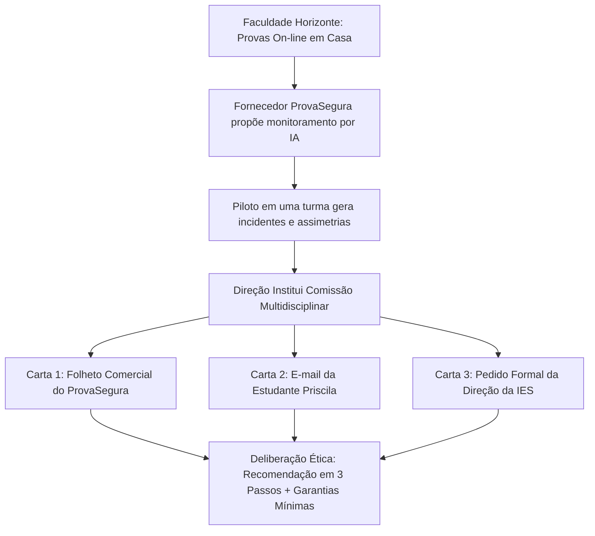

# Q6-M5 - O Trabalho da Quinzena: O Caso em Três Cartas (A Prova em Casa)

> **Disciplina:** COM170 - Inteligência Artificial na Prática Acadêmica e Profissional  
> **Quinzena 06:** Ética como Estrutura: Critérios, a Bússola e Sistemas que Decidem sobre Pessoas  
> **Docente Responsável:** Prof. José Avelino Placca  
> **Foco do Módulo 5:** Apresentação do caso institucional da Faculdade Horizonte; estudo analítico das Três Cartas da comissão; preparação técnica para a deliberação do Portfólio Individual no [Módulo 6](./atividades_quinzenal/Portfolio_Individual.md) e do Parecer da Comissão no [Módulo 7](./atividades_quinzenal/atividade_quinzenal.md).

---

## 🧭 1. Visão Geral do Módulo 5

Nos quatro primeiros módulos da Quinzena 06, você investigou a fundo os mecanismos de tomada de decisão algorítmica:
1. No [Módulo 1](./conteudo_q6_m1.md), compreendeu como critérios operacionais e medidas indiretas (*proxies*) substituem o fenômeno real e criam pontos cegos;
2. No [Módulo 2](./conteudo_q6_m2.md), aplicou as quatro perguntas da Bússola Ética (**Quem**, **Sabe**, **Responde**, **Custa**) para desarmar a opacidade decisória;
3. No [Módulo 3](./conteudo_q6_m3.md), auditou afirmações de Inteligência Artificial (IA) linha a linha e estruturou a Declaração de Uso em duas metades inalienáveis;
4. No [Módulo 4](./conteudo_q6_m4.md), enfrentou dilemas de valor onde não existe solução mágica e formulou recomendações falseáveis assumindo explicitamente o que cedeu.

Agora, na **Semana 2**, você deixa a posição de mero observador e assume a responsabilidade de quem decide.



> 🎯 **O Caso em Síntese:**  
> A **Faculdade Horizonte** é uma Instituição de Ensino Superior (IES) na modalidade de Educação a Distância (EaD), com cursos nos dois eixos da disciplina e polos distribuídos em várias cidades. As provas da instituição são realizadas em casa, pelo computador, com hora marcada e tempo limitado. Historicamente, ninguém assiste ao estudante durante a realização da prova: o sistema registra apenas o início, o fim e as respostas submetidas.  
>  
> No semestre passado, a coordenação de provas recebeu a visita de uma empresa que comercializa o **ProvaSegura**, um software de monitoramento automatizado que acompanha o estudante pela câmera, pelo microfone e pela tela, utilizando Inteligência Artificial (IA) para sinalizar de forma autônoma comportamentos considerados suspeitos. A coordenação autorizou um teste-piloto em uma turma. Ao término do período letivo, a empresa formalizou proposta comercial para estender o sistema a todas as provas on-line da instituição a partir do semestre seguinte.  
>  
> A direção da faculdade não tomou a decisão de forma isolada. Em vez disso, instituiu uma **Comissão Multidisciplinar** e colocou sob sua responsabilidade **três documentos essenciais** (as *Três Cartas*): o folheto comercial do fornecedor, um e-mail encaminhado por uma estudante durante a fase de testes e o ofício da própria direção.  
>  
> **O seu grupo é essa comissão.** Tudo o que a instituição e a comissão sabem está documentado nas três cartas a seguir.

---

## ✉️ 2. As Três Cartas da Comissão

> [!IMPORTANT]
> **Leitura Obrigatória e Ancoragem Textual:**  
> Leia com atenção analítica cada uma das três cartas abaixo. No seu Portfólio Individual ([Módulo 6](./atividades_quinzenal/Portfolio_Individual.md)) e na elaboração coletiva do Parecer da Comissão ([Módulo 7](./atividades_quinzenal/atividade_quinzenal.md)), cada resposta, crítica ou salvaguarda proposta deverá obrigatoriamente apontar para um trecho específico destas cartas.

---

### 📄 Carta 1: O folheto do fornecedor

> `CARTA 1` • **Folheto do fornecedor**  
> *“A inteligência artificial do sistema identifica automaticamente comportamentos de risco.”*  
> 🖼️ *Ilustração do caso:* Um notebook exibe na tela um grande olho de vigilância cercado por ícones de câmera, microfone, navegador e relógio; ao lado, o folheto do fornecedor com capa azul e um escudo com marca de verificação.

```text
PROVASEGURA
Integridade para a sua prova on-line.

COMO FUNCIONA
O ProvaSegura acompanha o estudante do começo ao fim da prova pela câmera, pelo microfone e pela tela do computador. A inteligência artificial do sistema identifica automaticamente comportamentos de risco: olhar para fora da tela por mais de alguns segundos, presença de outra pessoa no ambiente, voz ou ruído de conversa, troca de janela ou de aba, uso de celular.

RELATÓRIO E DECISÃO
Ao final de cada prova, a coordenação recebe um relatório por estudante, com um nível de risco (baixo, médio ou alto) e os trechos de vídeo marcados pelo sistema. A decisão sobre cada caso é sempre da instituição.

INFORMAÇÕES DO FORNECEDOR
Instituições que adotaram o ProvaSegura relatam queda nas ocorrências de fraude já no primeiro semestre de uso.
Sem instalação complexa. O estudante precisa apenas de computador com câmera e microfone, internet estável e um ambiente silencioso. As gravações ficam armazenadas por doze meses nos servidores da empresa.
Cobrança por prova aplicada, por estudante. Sem custo para o aluno.
```

> 🔍 **Análise Forense da Carta 1 (A Perspectiva da Empresa):**
> * **Medidas Indiretas (*Proxies*):** O sistema monitora variáveis observáveis (olhar fora da tela por segundos, ruídos de fundo, presença de pessoas e troca de abas) como substitutos estatísticos da intenção de colar;
> * **Delegação da Decisão:** A empresa se exime de juízo ético ao delegar a decisão à faculdade, fornecendo apenas a classificação de risco (baixo, médio ou alto) e trechos recortados;
> * **Custódia de Dados Pessoais:** A retenção de gravações em áudio e vídeo por doze meses em servidores terceirizados exige governança estrita conforme a Lei Geral de Proteção de Dados Pessoais (LGPD);
> * **Premissas Invisíveis:** A alegação de "sem instalação complexa" pressupõe que todo estudante possui computador com câmera/microfone funcionais, internet sem oscilação e ambiente residencial silencioso.

---

### 📩 Carta 2: O e-mail de uma estudante

> `CARTA 2` • **E-mail de estudante**  
> *“Eu não colei. Mas também não tenho outro lugar para fazer prova, e não sei com quem falar.”*  
> 🖼️ *Ilustração do caso:* Uma estudante sentada à mesa da cozinha diante do notebook olha com preocupação para uma notificação de alerta no celular; ao fundo, sua irmã passa com um copo de água e uma criança pequena surge à porta.

```text
MENSAGEM RECEBIDA
De: Priscila, estudante do 2º semestre · Para: Coordenação de provas · Assunto: Minha prova de Estatística foi marcada

Boa tarde. Recebi hoje um e-mail automático dizendo que a minha prova de sábado “foi marcada para análise pela coordenação” e que eu “receberia novo contato”. Não diz o que foi marcado, nem quem vai analisar, nem até quando.

Eu faço as provas na cozinha, porque é o único lugar da casa com mesa e tomada. Durante a prova minha irmã entrou duas vezes para pegar água, e em um momento eu olhei para o lado porque o meu sobrinho chorou. A internet também caiu por uns quarenta segundos, e o sistema me deixou voltar.

Eu não colei. Mas também não tenho outro lugar para fazer prova, e não sei com quem falar. Vocês podem me dizer o que aconteceu?
```

> 🔍 **Análise Forense da Carta 2 (A Realidade Situada da Estudante):**
> * **Desigualdade Socioespacial:** A realização do exame na cozinha decorre de restrição física (único cômodo com mesa e tomada), onde a convivência familiar (irmã pegando água, choro do sobrinho) e a queda temporária de conexão de 40 segundos geram falsos positivos;
> * **Opacidade Algorítmica:** O e-mail automático notifica a marcação de suspeita, mas oculta a informação essencial: qual comportamento ou trecho foi marcado;
> * **Ausência de Responsabilização (*Quem Responde*):** Falta identificação de um avaliador humano, não há prazo estipulado para desfecho e inexiste canal direto para a aluna exercer contraditório e ampla defesa;
> * **Insegurança Psicológica:** A estudante fica sob suspeição institucional sem saber como esclarecer o fato.

---

### 🏛️ Carta 3: O pedido da direção à comissão

> `CARTA 3` • **Pedido da direção**  
> *“Adotar, adotar com condições ou não adotar? E o que a faculdade garante, qualquer que seja a decisão?”*  
> 🖼️ *Ilustração do caso:* Cinco pessoas ao redor de uma mesa redonda com papéis e notebook debatem um documento; na parede, um quadro com três cartões coloridos e um grande ponto de interrogação.

```text
A Faculdade Horizonte usou o ProvaSegura em caráter de teste em uma turma, no semestre passado. O e-mail da Priscila é de uma estudante dessa turma. A empresa apresentou a proposta para uso em todas as provas on-line a partir do próximo semestre.

A direção pede à comissão um parecer com duas partes. A primeira é a recomendação: adotar, adotar com condições ou não adotar, com as razões. A segunda são as garantias mínimas: o que a faculdade passa a garantir ao estudante e o que passa a garantir à validade da prova, qualquer que seja a decisão.
```

> 🔍 **Análise Forense da Carta 3 (O Escopo Decisório Institucional):**
> * **Tripla Possibilidade Deliberativa:** A direção não restringe a decisão a sim ou não, admitindo expressamente a alternativa de *adotar com condições*;
> * **Duas Dimensões Mandatórias de Garantias:** O parecer deve contemplar salvaguardas simultâneas: proteger os direitos individuais do estudante frente ao sistema e preservar a credibilidade pública da prova perante a sociedade.


---

## 🧭 3. Desconstrução do Caso com as Ferramentas da Quinzena 06

Para fundamentar as atividades práticas dos Módulos 6 e 7, articule o caso da Faculdade Horizonte com os conceitos consolidados na disciplina:

| Dimensão Teórica | Aplicação Prática ao Caso da Faculdade Horizonte |
| :--- | :--- |
| **Medidas Indiretas (*Proxies*)**<br>*(Estudado no [Módulo 1](./conteudo_q6_m1.md))* | O sistema tenta aferir a intenção subjetiva de cola substituindo-a por métricas observáveis (desvio de olhar, sons no microfone, cortes de internet). Essas medidas indiretas penalizam severamente a vulnerabilidade material e familiar da aluna, tratando ruído doméstico como fraude premeditada. |
| **A Bússola Ética**<br>*(Estudado no [Módulo 2](./conteudo_q6_m2.md))* | **Quem:** O estudante de baixa renda sofre o impacto desproporcional da triagem.<br>**Sabe:** A aluna é notificada da suspeita, mas não tem acesso aos critérios, métricas ou vídeos marcados.<br>**Responde:** Mensagem automática de sistema sem assinatura humana e sem procedimento formal de defesa.<br>**Custa:** A empresa recebe por prova aplicada; o custo material (ambiente, rede) e moral recai sobre o aluno. |
| **Declaração e Auditoria de IA**<br>*(Estudado no [Módulo 3](./conteudo_q6_m3.md))* | A empresa alega que a decisão é da instituição, mas se a coordenação acatar cegamente a marcação de risco gerada pelo algoritmo sem auditá-la de forma independente, ocorrerá uma terceirização indevida da autoridade acadêmica. |
| **Tensões Reais de Valor**<br>*(Estudado no [Módulo 4](./conteudo_q6_m4.md))* | Há um conflito legítimo entre **integridade acadêmica** (assegurar a credibilidade pública das provas) e **justiça distributiva/equidade** (não discriminar estudantes por suas condições de moradia). A recomendação exigirá declarar com rigor qual valor cede. |

---

## ⚖️ 4. As Três Alternativas em Disputa na Comissão

A comissão deve avaliar com rigor crítico as três rotas deliberativas postas pela Direção:

```
┌─────────────────────────────────────────────────────────────────────────────┐
│                 AS TRÊS POSTURAS DECISÓRIAS DA COMISSÃO                     │
├─────────────────────────────────────────────────────────────────────────────┤
│                                                                             │
│  [OPÇÃO 1: ADOTAR]                                                          │
│  • Tese: A fraude desvaloriza o diploma de todos e o proctoring inibe       │
│    trapaças de forma escalável.                                             │
│  • O que cede: Cede-se a equidade e o conforto de alunos com moradias       │
│    vulneráveis em nome da segurança geral do processo avaliativo.           │
│                                                                             │
│  [OPÇÃO 2: ADOTAR COM CONDIÇÕES]                                            │
│  • Tese: O sistema pode operar apenas como triagem técnica, desde que       │
│    haja salvaguardas institucionais e infraestruturais obrigatórias.        │
│  • Condições-Chave: Provas presenciais nos polos para quem não tem espaço   │
│    adequado; proibição de anulação automática; canal humano de recurso      │
│    com prazo de 48h; acesso integral do aluno às gravações marcadas.        │
│  • O que cede: Cede-se a agilidade operacional e a economia de custos       │
│    (a IES precisará investir em infraestrutura de polos e comitê humano).   │
│                                                                             │
│  [OPÇÃO 3: NÃO ADOTAR]                                                      │
│  • Tese: A tecnologia é estruturalmente discriminatória contra estudantes   │
│    periféricos e privatiza dados sensíveis (biometria por 12 meses).        │
│  • Alternativa: Adotar métodos avaliativos formativos (projetos, estudos    │
│    de caso com consulta, defesas orais amostrais ou provas nos polos).      │
│  • O que cede: Cede-se a comodidade logística e a velocidade de correção    │
│    automatizada de provas fechadas em larga escala.                         │
│                                                                             │
└─────────────────────────────────────────────────────────────────────────────┘
```

---

## 📋 5. Preparação para as Atividades Práticas (Módulos 6 e 7)

Com a assimilação deste caso, você está habilitado a avançar para a execução da Semana 2:

### 👤 Módulo 6: Portfólio Individual
* **Onde realizar:** [Acesse o Portfólio Individual](./atividades_quinzenal/Portfolio_Individual.md);
* **Guia Oficial:** [Q6_M5-template-individual.pdf](./Q6_M5-template-individual.pdf) (Template Oficial da UNIVESP);
* **O que fazer:**
  1. Responder às quatro perguntas da Bússola Ética apontando trechos das três cartas;
  2. Redigir a sua recomendação oficial em três passos (nomear lados, usar o verbo *ceder* e fixar condição de falseabilidade);
  3. Solicitar a uma ferramenta de IA que defenda a tese contrária à sua e colar a íntegra da resposta no trabalho;
  4. Analisar criticamente os argumentos da IA e consolidar a sua Ficha de Resultados;
* **Atenção ao Anonimato:** Não coloque seu nome no arquivo final do portfólio; o Ambiente Virtual de Aprendizagem (AVA) identifica o autor automaticamente para garantir revisão por pares imparcial.

### 👥 Módulo 7: Parecer da Comissão (Trabalho Coletivo)
* **Onde realizar:** [Acesse a Atividade do Grupo](./atividades_quinzenal/atividade_quinzenal.md);
* **Guia Oficial:** [Q6_M5-template-grupo.pdf](./Q6_M5-template-grupo.pdf) (Template Oficial da UNIVESP);
* **O que fazer:**
  1. Compartilhar as fichas individuais no ponto de encontro da equipe;
  2. Mapear divergências e pontos cegos entre os integrantes;
  3. Redigir o documento final do Parecer da Comissão com a recomendação acordada e as garantias mínimas da Faculdade Horizonte.


---

## 🔗 6. Navegação e Referências Rápidas da Quinzena

* 📘 **Índice Geral da Quinzena:** [quinzena-06.md](./quinzena-06.md)
* 📋 **Guia e Orientações Iniciais:** [_introducao_q6.md](./_introducao_q6.md)
* 📖 **Módulo 1 (Critérios e Proxies):** [conteudo_q6_m1.md](./conteudo_q6_m1.md)
* 📖 **Módulo 2 (A Bússola Ética):** [conteudo_q6_m2.md](./conteudo_q6_m2.md)
* 📖 **Módulo 3 (Declaração de Uso de IA):** [conteudo_q6_m3.md](./conteudo_q6_m3.md)
* 📖 **Módulo 4 (Tensões Reais de Valor):** [conteudo_q6_m4.md](./conteudo_q6_m4.md)
* 🧪 **Pasta de Atividades Práticas:** [atividades_quinzenal/](./atividades_quinzenal/)
