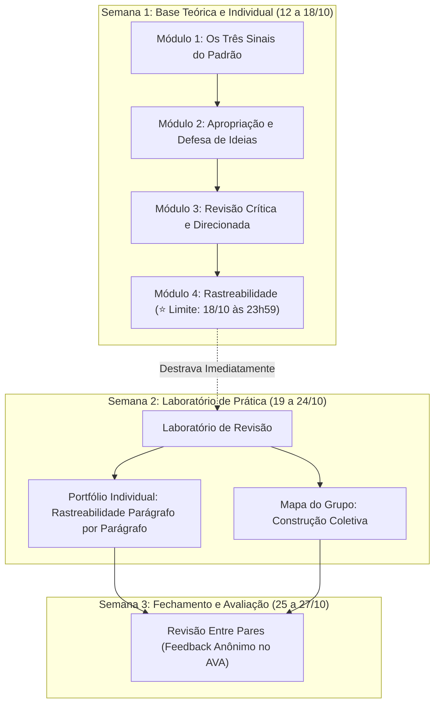

# Quinzena 07 - Introdução e Orientações de Estudo
### Autoria Assistida: Do Texto Genérico à Rastreabilidade Parágrafo por Parágrafo

> **Disciplina:** COM170 - Inteligência Artificial na Prática Acadêmica e Profissional (Turma COM170-EC-DRP11-2026S2-T001)  
> **Docente Responsável:** Prof. José Avelino Placca  
> **Período da Quinzena:** De 12 a 27 de outubro de 2026  
> **Prazo da Base Individual (Módulos 1 a 4):** **Domingo, 18 de outubro de 2026, às 23h59**  
> 💡 _A conclusão dos Módulos 1 a 4 no prazo abre a parte prática na hora e garante a participação na atividade do grupo._

---

## 📌 1. Boas-vindas e Visão Geral da Quinzena

> *"Pense no último trabalho que você entregou com a ajuda de uma ferramenta de inteligência artificial. Se alguém apontasse um parágrafo e perguntasse quem escreveu aquilo, você saberia responder? E saberia explicar por que aquela frase está ali, e não outra?*  
>  
> *Até aqui, a disciplina tratou do que a ferramenta devolve: se a resposta está certa, de onde veio a informação, quem recebe a decisão. Nesta quinzena, a pergunta passa a ser sobre o seu próprio texto. Você vai aprender a reconhecer o texto que serviria para qualquer situação, a testar se uma ideia que veio da ferramenta já é sua, a conferir um texto que voltou revisado e a dizer, parágrafo por parágrafo, onde a ferramenta entrou.*  
>  
> *Esta é a última quinzena de conteúdo da disciplina. Ela termina com um trabalho escrito para alguém que ainda não chegou: uma pessoa que começa o curso no ano que vem e que precisa do que você sabe hoje.*  
>  
> *Uma sugestão antes de começar. Separe um texto seu, de qualquer disciplina, escrito com ou sem ferramenta. No fim de cada módulo, volte a ele e repare no que você enxerga agora e não enxergava antes."*  
> - **Prof. José Avelino Placca**

---

### 🎯 O Que Você Vai Aprender (Objetivos de Aprendizagem)

Ao final desta quinzena, você vai conseguir:

- [ ] **01. Identificação de Padrões:** Apontar os três sinais do padrão num texto pronto, sabendo que eles não provam quem escreveu o texto.
- [ ] **02. Apropriação Crítica de Ideias:** Explicar, com as suas palavras, por que uma ideia que veio da ferramenta funciona e o que responder a quem discorda dela.
- [ ] **03. Revisão Mediada e Direcionada:** Conferir o que uma ferramenta mudou ao revisar um texto, inclusive em outra língua, e pedir a revisão dizendo onde ela deve olhar.
- [ ] **04. Rastreabilidade Parágrafo por Parágrafo:** Indicar de onde veio cada parágrafo de um texto com as palavras **Meu**, **Aceito**, **Modificado** e **Recusado**, registrando o motivo.
- [ ] **05. Autoria e Defesa Argumentativa:** Escrever um texto com a ferramenta, registrar a origem de cada parágrafo e defender por escrito uma ideia que veio dela.

---

## 🗓️ 2. Calendário, Prazos e Operação

A Quinzena 7 decorre de 12 a 27 de outubro de 2026, organizada nos seguintes marcos temporais:

| Etapa | Período / Data Limite | O que acontece nesta etapa |
| :--- | :---: | :--- |
| **Estudo Individual (M1 a M4)** | 12 a 17 de outubro | Estudo autônomo dos conceitos de autoria e revisão mediada. Concluir um módulo destrava o seguinte. |
| **Prazo Fatal dos Módulos 1 a 4** | **Domingo, 18 de outubro às 23h59** | Prazo limite fixo para concluir a base individual. A conclusão libera a parte prática na hora e garante a vaga no grupo. |
| **Janela de Entrega (M6 e M7)** | **19 a 24 de outubro (Sábado às 23h59)** | Janela de envio simultâneo no Laboratório de Revisão: seu **Portfólio Individual** e o **Mapa do seu Grupo**. |
| **Revisão Entre Colegas** | **25 a 27 de outubro (Terça às 23h59)** | Avaliação por pares às cegas: você lê o portfólio de um colega e seu grupo lê o mapa de outro grupo, devolvendo o feedback. |

> [!NOTE]
> **Atenção ao Início da Quinzena e Feriado de 12 de Outubro:**  
> A quinzena começa na segunda-feira, 12 de outubro (feriado nacional). Nos dois primeiros dias (12 e 13/10), ocorre em paralelo o encerramento da revisão por pares da Quinzena 6. Organize seu tempo para não acumular as leituras finais da Q6 com os primeiros módulos da Q7.

> [!IMPORTANT]
> **Ritmo Individual e Prazo do Módulo 4:**  
> O ritmo de estudo na primeira semana é livre, mas o prazo de **18 de outubro às 23h59** é comum a todos. Quem concluir os Módulos 1 a 4 antes do domingo já destrava o acesso à parte prática imediatamente. Quem perder o prazo individual cumpre o portfólio solo, ficando impedido de participar do trabalho em grupo.

---

## 🔍 3. O Que Muda na Parte Prática Desta Quinzena

A Quinzena 7 marca uma virada de chave fundamental na disciplina COM170:

1. **Do Olhar sobre a Ferramenta para o Olhar sobre o Próprio Texto:**  
   Até a Quinzena 6, investigou-se a precisão das respostas da Inteligência Artificial (IA), vieses, impactos e deliberações éticas. Agora, o foco é a **autoria assistida**: auditar a origem e o propósito de cada sentença do próprio estudante.

2. **As Quatro Classificações de Rastreabilidade:**  
   Em vez de declarações genéricas de uso, você classificará os parágrafos do texto final em quatro categorias obrigatórias:
   * **Meu:** Texto de autoria e concepção inteiramente própria.
   * **Aceito:** Sugestão ou texto devolvido pela IA mantido integralmente.
   * **Modificado:** Ideia ou estrutura sugerida pela IA que foi reescrita e adaptada por você.
   * **Recusado:** Ideia sugerida pela IA que foi descartada criticamente, com o motivo documentado.

3. **Escrita com Propósito Real (Legado para os Calouros):**  
   O produto desta quinzena é um texto utilitário e reflexivo direcionado a quem está ingressando na universidade no próximo ano, consolidando o aprendizado prático acumulado.

4. **Exercício Preparatório Contínuo:**  
   Separe previamente um texto seu já produzido (de qualquer disciplina da UNIVESP). A cada módulo concluído, releia esse texto para diagnosticar o que mudou na sua percepção analítica.

---

## 📦 4. O Que Você Entrega (Janela de 19 a 24 de outubro)

* **Individual - O Seu Portfólio:**  
  Enviado no *Laboratório de Revisão*. Contempla a aplicação dos sinais de padrão, a apropriação das ideias, a conferência de revisões e a rastreabilidade parágrafo por parágrafo com as justificativas.
* **Do Grupo - O Mapa do Grupo:**  
  Enviado em paralelo no *Laboratório de Revisão* pelo representante da equipe, articulando a visão colegiada e o debate construído conjuntamente.
* **Revisão por Pares (25 a 27 de outubro):**  
  Etapa final e obrigatória no Ambiente Virtual de Aprendizagem (AVA). Cada estudante lê e avalia o portfólio de um colega, e cada equipe analisa o mapa elaborado por outro grupo parceiro.

---

## 📢 5. Programação Oficial das Lives Síncronas

Participar ao vivo de uma das transmissões compõe a sua nota de engajamento no AVA. Caso haja conflito de agenda, as gravações ficam disponíveis em seguida no ambiente da disciplina:

| Facilitadores | Data | Horário | Link Direto da Sessão |
| :--- | :---: | :---: | :---: |
| **Cauê e Andréia** | 13/10/2026 | 19h | [Entrar na Live](https://lti.elos.vc/rooms/ab28f4469a3dffcfa11586065c371d7f605997f5/scheduled_meetings/WI4rLo8ZD5SY/external) |
| **Vittoria e Nicolle** | 14/10/2026 | 16h | [Entrar na Live](https://lti.elos.vc/rooms/533c29b514f8da7e8638f0acd2b88c0afe3029a5/scheduled_meetings/kK3kh7RYZvrR/external) |
| **Lyon e Victor** | 14/10/2026 | 18h | [Entrar na Live](https://lti.elos.vc/rooms/1616c2a59d47ab2bf7ff3153bc9c6cdff5c505ca/scheduled_meetings/QMRX5Kewn6YT/external) |
| **Gabrieli e Uebert** | 15/10/2026 | 10h | [Entrar na Live](https://lti.elos.vc/rooms/5bee0e043531ea3544994421b710fac9b2345184/scheduled_meetings/QhspZBKXVX7u/external) |
| **Livia e Hanna** | 16/10/2026 | 10h | [Entrar na Live](https://lti.elos.vc/rooms/ea2800a0fcf5a742eda39933b79ae0544055fd29/scheduled_meetings/KemI6vNgCMAO/external) |
| **Cassia e Vittoria** | 17/10/2026 | 10h | [Entrar na Live](https://lti.elos.vc/rooms/533c29b514f8da7e8638f0acd2b88c0afe3029a5/scheduled_meetings/3v7wtzrXG1GO/external) |

---

## 🧭 6. Dinâmica de Estudo e Fluxo da Quinzena

> [!IMPORTANT]
> **Confirmação Obrigatória de Conclusão de Cada Módulo:**  
> Sempre avance até a tela final de cada atividade no AVA e certifique-se de clicar no botão de conclusão. Verifique se a barra de progresso do módulo atingiu 100% para não travar os módulos seguintes.

> [!TIP]
> **Estudo dos Feedbacks dos Exercícios:**  
> Leia com calma as justificativas de cada alternativa nos testes de fixação do AVA. Compreender por que as opções incorretas foram descartadas consolida os critérios analíticos que serão exigidos nas provas presenciais.
