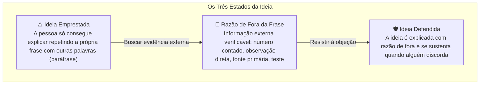

# Q7-M2 - O Argumento que Você Não Tinha

> **Disciplina:** COM170 - Inteligência Artificial na Prática Acadêmica e Profissional  
> **Quinzena 07:** Autoria Assistida: Do Texto Genérico à Rastreabilidade Parágrafo por Parágrafo  
> **Docente Responsável:** Prof. José Avelino Placca  
> **Foco do Módulo 2:** Apropriação de ideias sugeridas por ferramentas de Inteligência Artificial (IA), o teste de duas perguntas para autoria real (*O Teste da Defesa*) e superação da ilusão de profundidade explicativa.

---

## 🧭 1. Visão Geral do Módulo 2

Quando alguém pergunta por que você escreveu uma frase, o que você responde? Às vezes a resposta vem na hora. Às vezes você percebe que a frase está certa, mas não sabe explicar o porquê.

Este módulo trata da **ideia boa que chega pela ferramenta**. Aceitar uma sugestão da IA faz parte do trabalho. O que este módulo investiga é se você consegue **explicar essa ideia com as suas próprias palavras e responder a quem discorda dela**.

Você vai conhecer um teste de duas perguntas para verificar se uma ideia já é sua de fato, compreendendo por que a sensação subjetiva de entender um assunto costuma ser muito maior do que a real capacidade de explicá-lo.

---

## 📺 2. Videoaula e Material-Base

### 🎥 Videoaula 2: O argumento que você não tinha
* **Acesso:** [Assistir no YouTube (10 min)](https://www.youtube.com/watch?v=sOn6TjOhh6g)
* **Tema central:** Uma ideia boa veio da ferramenta para destravar um parágrafo, e o professor tenta defendê-la em cena demonstrando a diferença prática entre repetir a frase e sustentá-la com fatos observáveis em campo (o caso da linha de ônibus do bairro).

### 📚 Material de Apoio Oficial
* **E-book (Versão Visual):** [Q7_M2-E-book.pdf](./Q7_M2-E-book.pdf) *(Produzido com Inteligência Artificial - ChatGPT 5.5)*
* **Apostila (Versão Acessível):** [COM170_apostila_quinzena7_M2.pdf](./COM170_apostila_quinzena7_M2.pdf)

---

## 🔍 3. Atividade Prática: Por Que Isso Funciona? (O Teste da Defesa)

> 🎯 **Cenário:** Joana é da sua turma. Ela trabalha de dia em uma farmácia e estuda à noite. Aos sábados, atua como voluntária na biblioteca comunitária do bairro. Neste ano, os empréstimos de livros caíram, e ela escolheu esse tema para o trabalho da disciplina.  
> Joana pediu à ferramenta de Inteligência Artificial (IA) explicações para a queda e colocou as seis hipóteses geradas no trabalho. No dia seguinte, ela apresentará o texto para a **Dona Célia**, coordenadora da biblioteca, que costuma perguntar o porquê de cada afirmação antes de tomar qualquer decisão.

```text
A MENSAGEM DA JOANA:
"A dona Célia pergunta o porquê de tudo. Você faz o papel dela hoje?
Pergunta 'por que isso funciona?' para cada ideia e me diz se a minha resposta defende a ideia."
```

* **O pedido que a Joana enviou à ferramenta de IA (inteiro):**
  > _"Sou voluntária numa biblioteca comunitária do meu bairro. Neste ano, os empréstimos de livros caíram. Em fevereiro, a biblioteca passou a fechar às 17h; antes, fechava às 19h. Estou fazendo um trabalho da faculdade sobre isso. Me dê seis explicações possíveis para a queda."_

> [!NOTE]
> **A Limitação Estrutural da Resposta:** A ferramenta só sabia o que constava nesse prompt. Por isso, as seis explicações devolvidas não continham nenhum dado numérico local e todas usavam o verbo modal *"pode"*: eram explicações meramente plausíveis no plano abstrato.

---

### 📊 O Caderno de Empréstimos da Biblioteca
Joana registra cada empréstimo com data e horário em um caderno de controle:

| Empréstimos em Março | Até as 17h | Depois das 17h | Total |
| :--- | :---: | :---: | :---: |
| **Ano passado** | 72 | 48 | **120** |
| **Este ano** | 70 | 0 *(fechamento às 17h)* | **70** |

---

### 📐 Três Conceitos Operacionais Fundamentais



1. **Ideia Emprestada:** É a ideia que a pessoa só consegue explicar repetindo a própria frase com outras palavras.
2. **Razão de Fora da Frase:** É uma informação que a frase original não contém e que demonstra por que ela é verdadeira (um número contado, algo observado, o que uma fonte demonstrou, a fala de quem vivencia o problema ou o resultado de um teste prático).
3. **Ideia Defendida:** É a ideia explicada com uma razão de fora da frase e que permanece de pé quando confrontada com uma objeção.

---

## 🧩 4. Resolução da Atividade Passo a Passo

---

### 🔹 Passo 1: Por Que Isso Funciona? (Primeira Pergunta do Teste)

> **Critério de Julgamento:**
> * Se a resposta repete a frase com outras palavras: **Ainda emprestada**.
> * Se a resposta traz dado empírico que não constava na frase: **Defende**.

Abaixo está a avaliação das 6 ideias geradas pela IA e respondidas pela Joana:

#### 1. Ideia 1: O Horário
* **Frase da ferramenta:** _"A mudança de horário pode ter afastado quem só consegue ir à biblioteca depois do trabalho."_
* **Resposta da Joana:** _"No caderno do ano passado, 48 dos 120 empréstimos de março aconteceram depois das 17h. Neste março foram 70, uma queda de 50."_
* [x] **Defende: traz uma razão de fora da frase**
* [ ] Ainda emprestada: não traz razão de fora da frase

> 💡 **Feedback Oficial:**  
> **Defende.** A resposta traz um dado numérico ausente na frase: o caderno comprova que 48 empréstimos ocorriam após as 17h, valor quase idêntico ao total da queda observada (50). O que valida a defesa é a procedência externa do dado, e não a extensão do texto.

---

#### 2. Ideia 2: As Férias
* **Frase da ferramenta:** _"Se muitos leitores forem estudantes, as férias escolares podem reduzir os empréstimos."_
* **Resposta da Joana:** _"Porque nas férias os estudantes não têm aula e, por isso, pegam menos livro."_
* [ ] Defende: traz uma razão de fora da frase
* [x] **Ainda emprestada: não traz razão de fora da frase**

> 💡 **Feedback Oficial:**  
> **Ainda emprestada.** *"Não têm aula"* é a definição de férias, e *"pegam menos livro"* é mera paráfrase de *"reduzir os empréstimos"*. Além de repetir a frase com outras palavras, deixou em aberto a premissa central: os frequentadores dessa biblioteca são de fato estudantes?

---

#### 3. Ideia 3: O Celular
* **Frase da ferramenta:** _"Parte dos leitores pode ter passado a ler no celular e procura menos o livro de papel."_
* **Resposta da Joana:** _"Porque, com a digitalização crescente dos hábitos de leitura, os leitores migraram para as plataformas digitais, o que reduz a procura pelo livro impresso tradicional."_
* [ ] Defende: traz uma razão de fora da frase
* [x] **Ainda emprestada: não traz razão de fora da frase**

> 💡 **Feedback Oficial:**  
> **Ainda emprestada.** A resposta é prolixa e utiliza jargões mais complexos (*"plataformas digitais"*, *"digitalização crescente"*), mas diz estritamente o mesmo que a frase original. Além disso, ampliou o erro ao transformar a possibilidade (*"parte dos leitores pode"*) em uma generalização infundada (*"os leitores migraram"*).

---

#### 4. Ideia 4: Os Livros Novos
* **Frase da ferramenta:** _"Se chegam poucos livros novos, quem já leu os antigos pode deixar de voltar."_
* **Resposta da Joana:** _"Perguntei às oito pessoas que foram à biblioteca no sábado. Cinco disseram que já leram o que interessa na estante de romances e esperam livro novo."_
* [x] **Defende (por enquanto): traz uma razão de fora da frase**
* [ ] Ainda emprestada: não traz razão de fora da frase

> 💡 **Feedback Oficial:**  
> **Defende, por enquanto.** A razão decorre de apuração com quem vivencia o contexto (leitores presentes no sábado). A frase gerada pela IA não continha essa informação.

---

#### 5. Ideia 5: A Divulgação
* **Frase da ferramenta:** _"Se a biblioteca divulga pouco o que chega de novo, os leitores podem esquecer de voltar."_
* **Resposta da Joana:** _"Pedi para a ferramenta explicar e colei: 'a baixa visibilidade das novidades reduz o estímulo ao retorno, pois o leitor não percebe motivo para voltar'."_
* [ ] Defende: traz uma razão de fora da frase
* [x] **Ainda emprestada: não traz razão de fora da frase**

> 💡 **Feedback Oficial:**  
> **Ainda emprestada.** A explicação veio da própria IA. Embora soe formal e sofisticada, limita-se a trocar as palavras: *"baixa visibilidade"* significa divulgar pouco, e *"não percebe motivo para voltar"* significa esquecer de voltar. A IA indica **onde procurar**, mas não substitui a evidência factual.

---

#### 6. Ideia 6: Outros Lugares
* **Frase da ferramenta:** _"A queda pode acompanhar uma redução de leitores de bibliotecas em outros lugares."_
* **Resposta da Joana:** _"Li num site que as bibliotecas estão perdendo leitores."_
* [ ] Defende: traz uma razão de fora da frase
* [x] **Ainda emprestada: não traz razão de fora da frase**

> 💡 **Feedback Oficial:**  
> **Ainda emprestada.** O site pode ser real, mas a resposta não informou o que ele demonstrou: qual volume de leitores, em que localidade, em qual recorte temporal? Uma fonte só atua como razão de fora da frase quando seus dados específicos são articulados ao caso.

---

### 🔹 Passo 2: A Dona Célia Discorda (Segunda Pergunta do Teste)

> **Conceito:** Apenas duas ideias passaram na primeira etapa: a do **horário** (Ideia 1) e a dos **livros novos** (Ideia 4).  
> A segunda pergunta do teste define: *se alguém discordar, o que você responde?* Responder a uma objeção é demonstrar por que a hipótese alternativa explica **menos** fatos do que a sua.

#### 💬 Objeção 1: Dona Célia contra a Ideia do Horário
* **Fala de Dona Célia:** *"Não acredito que seja o horário. Hoje todo mundo lê no celular, e por isso ninguém mais pega livro."*
* **Opções de Resposta:**
  - [ ] *"O horário é o motivo, sim. A ferramenta também deu essa explicação para a queda, e eu confio no que ela diz."*
  - [ ] *"Tem razão, dona Célia. Vou tirar a ideia do horário do trabalho e escrever a do celular no lugar dela."*
  - [x] **"Se fosse o celular, os empréstimos teriam caído o dia todo. Até as 17h, eles ficaram quase iguais."** *(Opção Correta)*
  - [ ] *"Eu conheço muita gente que sai do trabalho depois das cinco e não consegue chegar à biblioteca antes de ela fechar."*

> 💡 **Feedback Oficial:**  
> As duas explicações geram previsões divergentes sobre o caderno: se o celular fosse a causa, a queda se manifestaria uniformemente em todos os períodos; se o horário for a causa, o impacto concentra-se após as 17h. O caderno registra 72 empréstimos até as 17h no ano anterior e 70 no ano atual. Defender é apresentar um dado que a sua explicação sustenta e a outra refuta.

---

#### 💬 Objeção 2: Dona Célia contra a Ideia dos Livros Novos
* **Fala de Dona Célia:** *"Discordo. O acervo é o mesmo de sempre, e as pessoas continuam vindo."*
* **Opções de Resposta:**
  - [ ] *"Cinco das oito pessoas me disseram que esperam livro novo. Então o acervo explica a queda, e isso está comprovado."*
  - [x] **"O pedido de livro novo é real. Mas até as 17h os empréstimos quase não mudaram, então isso não explica a queda."** *(Opção Correta)*
  - [ ] *"Tem razão, dona Célia. Então eu tiro do trabalho tudo o que as pessoas me disseram no sábado sobre os livros."*
  - [ ] *"A ferramenta listou o acervo entre as explicações, e ela conhece muitos casos de bibliotecas parecidas com a nossa."*

> 💡 **Feedback Oficial:**  
> A informação obtida por Joana no sábado é verídica, porém defende uma **afirmação menor** do que a frase original: os leitores do sábado demandam novidades, mas isso não foi o fator causal da queda global, pois a faixa mantida aberta permaneceu constante. Uma resposta pode ser aprovada no primeiro teste e, no segundo, evidenciar que a ideia precisa ser redimensionada.

---

### 🔹 Passo 3: Atrás da Razão que Falta (Investigação Empírica)

Quatro ideias permaneceram em estado de empréstimo. Abaixo estão as estratégias de investigação aplicadas:

```
┌────────────────────────────────────────────────────────────────────────────────────────┐
│                              MATRIZ DE INVESTIGAÇÃO EMPÍRICA                           │
├───────────────────────────────┬────────────────────────────────────────────────────────┤
│ ONDE PROCURAR A RAZÃO         │ APLICAÇÃO PRÁTICA                                      │
├───────────────────────────────┼────────────────────────────────────────────────────────┤
│ 👁️ Observar e contar          │ Fenômenos locais: contagem de fluxos, horários, listas │
│ 📖 Ler a fonte                │ Dados secundários, normas, estatísticas e pesquisas    │
│ 🗣️ Perguntar a quem conhece   │ Percepções, rotinas e motivos dos envolvidos           │
│ 🧪 Testar                     │ Intervenções controladas para mensurar a resposta      │
├───────────────────────────────┼────────────────────────────────────────────────────────┤
│ DESTINO DA IDEIA APÓS A BUSCA │ CONDUTA METODOLÓGICA                                   │
├───────────────────────────────┼────────────────────────────────────────────────────────┤
│ 🧪 Escrever como hipótese     │ Não conferida: declara-se o pressuposto e o teste      │
│ 📐 Escrever afirmação menor   │ A evidência sustenta apenas um recorte restrito        │
│ ❌ Retirar do trabalho        │ O dado empírico contradiz ou invalida a hipótese       │
│ ⚠️ Manter como está           │ Inaceitável: sustentar como fato o que não se provou   │
└───────────────────────────────┴────────────────────────────────────────────────────────┘
```

#### Investigação das 4 Ideias Pendentes:

1. **Ideia 2: As Férias**
   - **Onde procurar:** **Observar e contar** *(conferir o caderno mês a mês e comparar com o histórico anterior).*
   - **O que Joana encontrou:** A queda ocorre em todos os meses após fevereiro (com e sem férias letivas); o calendário de férias foi idêntico nos dois anos.
   - **Destino no trabalho:** **Retirar do trabalho.** O registro factual contradiz a suposição.

2. **Ideia 3: O Celular**
   - **Onde procurar:** **Perguntar a quem conhece** *(ligar para os leitores cadastrados que deixaram de comparecer).*
   - **O que Joana encontrou:** De 10 leitores contatados, 7 trabalham até depois das 17h, 1 migrou para leitura em tela e 2 preferiram não responder.
   - **Destino no trabalho:** **Escrever uma afirmação menor.** A frase passa a ser: *"Uma das dez pessoas ouvidas passou a ler no celular"*. De quebra, o dado reforçou diretamente a Ideia 1.

3. **Ideia 5: A Divulgação**
   - **Onde procurar:** **Testar** *(divulgar novidades no mural e redes por 30 dias e contabilizar as requisições).*
   - **O que Joana encontrou:** O experimento demanda um mês e a reunião ocorre no dia seguinte; não há resultado apurado.
   - **Destino no trabalho:** **Escrever como hipótese.** Redação: *"Uma hipótese ainda não testada é que divulgar os livros novos traga leitores de volta; um mês de divulgação, com a contagem dos pedidos, responde."*

4. **Ideia 6: Outros Lugares**
   - **Onde procurar:** **Ler a fonte** *(abrir o site referenciado e examinar os dados primários).*
   - **O que Joana encontrou:** A página tratava de instituições de outro país, sem indicadores regionais ou marcos temporais claros.
   - **Destino no trabalho:** **Retirar do trabalho.** A fonte não possui qualquer aderência ou aplicabilidade ao caso concreto.

---

### 🔹 Passo 4: A Reunião e a Consolidação Final

A Joana apresentou as seis ideias estruturadas da seguinte forma:

| Ideia Original da IA | Status Final | Sustentação Técnica e Evidência Empírica |
| :--- | :---: | :--- |
| **1. O Horário** | 🛡️ **Defendida** | O caderno aponta 48 empréstimos após as 17h no ano passado; a queda deste ano totalizou 50. |
| **2. As Férias** | ❌ **Retirada** | A queda ocorre continuamente em todos os meses, independente do calendário letivo. |
| **3. O Celular** | 📐 **Afirmação Menor** | Pesquisa direta identificou apenas 1 leitor em 10; os demais 7 saem do trabalho após as 17h. |
| **4. Livros Novos** | 📐 **Afirmação Menor** | O interesse por novidades é real entre frequentadores do sábado, mas não explica a queda no horário mantido aberto. |
| **5. A Divulgação** | 🧪 **Hipótese** | Hipótese mantida com teste controlado agendado para o mês seguinte com medição de pedidos. |
| **6. Outros Lugares** | ❌ **Retirada** | Fonte estrangeira genérica sem correlação ou dados locais auditáveis. |

* **Desfecho de Dona Célia:**
  > _"Então vamos abrir até as 19h às terças e quintas, por dois meses, e contar os empréstimos. E em abril vamos testar a divulgação dos livros novos, do jeito que você escreveu."_
* **Reflexão Final de Joana:**
  > _"Obrigada pelas perguntas de ontem. Metade das ideias eu teria explicado repetindo a frase. **A ideia passa a ser sua quando você consegue defendê-la.**"_

---

## 📋 5. Ficha Prática: O Teste da Defesa

Guarde esta ficha como ferramenta de cabeceira para auditar qualquer parágrafo ou sugestão gerada por ferramentas de IA antes da entrega acadêmica:

```text
========================================================================================
                                FICHA · O TESTE DA DEFESA
      (Para qualquer trecho do seu texto derivado de ferramentas de Inteligência Artificial)
========================================================================================

1. POR QUE ISSO FUNCIONA?
   A resposta precisa apresentar uma razão DE FORA da frase:
   - Um número que você contou;
   - Algo que você observou diretamente em campo;
   - O que uma fonte primária demonstrou de fato;
   - O que alguém que vivencia o problema declarou;
   - O resultado mensurável de um teste empírico.

   ⚠️ Como diagnosticar na hora:
   Compare a sua explicação com a frase original. Se ambas dizem a mesma coisa
   apenas com palavras sinônimas ou jargões formais, a ideia AINDA ESTÁ EMPRESTADA.

2. SE ALGUÉM DISCORDAR, O QUE VOCÊ RESPONDE?
   Apresente um dado que a sua hipótese explica e a explicação contrária NÃO explica.
   Se a evidência cobrir apenas parte do fenômeno, reduza a frase para uma AFIRMAÇÃO MENOR.

----------------------------------------------------------------------------------------
ONDE PROCURAR A RAZÃO:
  • Observar e contar │ • Ler a fonte │ • Perguntar a quem conhece │ • Testar
  (A explicação gerada pela ferramenta indica onde procurar; ela NUNCA é a razão em si).

QUANDO A RAZÃO NÃO APARECE:
  1. Escrever como HIPÓTESE (declarando explicitamente o que ainda precisa ser conferido);
  2. Reduzir para uma AFIRMAÇÃO MENOR (limitada estritamente à evidência apurada);
  3. RETIRAR a ideia do trabalho.
  
  🚨 O único caminho que destrói a autoria é manter a frase como se estivesse comprovada.
========================================================================================
```