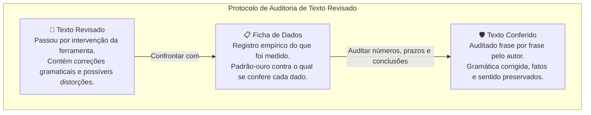

# Q7-M3 - O Texto Voltou Revisado

> **Disciplina:** COM170 - Inteligência Artificial na Prática Acadêmica e Profissional  
> **Quinzena 07:** Autoria Assistida: Do Texto Genérico à Rastreabilidade Parágrafo por Parágrafo  
> **Docente Responsável:** Prof. José Avelino Placca  
> **Foco do Módulo 3:** Auditoria crítica de textos revisados por Inteligência Artificial (IA), identificação de adulterações no grau de certeza, detecção de erros factuais com a ficha de dados e formulação de prompts de revisão estruturados.

---

## 🧭 1. Visão Geral do Módulo 3

Quando uma ferramenta de Inteligência Artificial (IA) revisa um texto seu, o que você faz com as alterações sugeridas? Você lê uma por uma com atenção crítica ou aceita todas em bloco partindo da premissa de que a máquina *"escreve melhor"*? E se a revisão estiver em uma língua estrangeira (como o inglês), na qual você tem menos fluência para perceber sutilezas?

Este módulo investiga três fenômenos essenciais do trabalho com revisão assistida por IA:
1. **O que a ferramenta acerta:** Correções gramaticais, ortográficas e adequações pontuais de vocabulário.
2. **O que ela deixa passar:** Erros numéricos, datas trocadas, prazos e conclusões distorcidas — porque a IA **não possui acesso aos seus dados brutos de pesquisa**.
3. **A alteração mais perigosa:** Aquela que parece um mero refinamento estilístico ("deixar mais acadêmico"), mas que na prática **muda a alegação científica do autor**, transformando hipóteses cautelosas em certezas causais que os dados não sustentam.

> [!IMPORTANT]
> **A Distinção Fundamental do Módulo:**
> * **Revisado:** Alguém (ou um algoritmo) passou pelo texto corrigindo o que encontrou na superfície sintática.
> * **Conferido:** O autor leu o texto do começo ao fim, com a ficha de dados ao lado, para auditar se o documento ainda diz exatamente o que ele pretendia e sustentava dizer.

---

## 📺 2. Videoaula e Material-Base

### 🎥 Videoaula 3: O texto voltou revisado
* **Acesso:** [Assistir no YouTube (10 min)](https://www.youtube.com/watch?v=0phQVPQwBV0)
* **Tema central:** Um resumo científico em inglês volta de uma ferramenta de IA com quatro correções; a aula analisa se *"revisado"* significa *"certo"*, ensina a usar a técnica de tradução de volta (*back-translation*) e desconstrói o perigo da alteração invisível do grau de certeza.

### 📚 Material de Apoio Oficial
* **E-book (Versão Visual):** [Q7_M3-E-book.pdf](./Q7_M3-E-book.pdf) *(Produzido com Inteligência Artificial - ChatGPT 5.5)*
* **Apostila (Versão Acessível):** [COM170_apostila_quinzena7_M3.pdf](./COM170_apostila_quinzena7_M3.pdf)

---

## 🔍 3. Atividade Prática: O Que Ficou Sem Correção

> 🎯 **Cenário:** Caio é da sua turma. Ele trabalha em uma administradora de condomínios e estuda Engenharia. No segundo semestre de 2025, organizou a coleta de óleo de cozinha usado em quatro condomínios do bairro, instalando um galão na portaria de cada prédio para evitar o descarte inadequado na rede de esgoto.  
> Ele vai apresentar o projeto em um evento de iniciação científica que exige submissão do resumo em português e em inglês. Caio redigiu o rascunho em inglês, pediu para uma IA revisar o texto e enviou a seguinte mensagem para você:

```text
A MENSAGEM DO CAIO:
"O resumo voltou revisado, mas eu leio pouco inglês.
Você confere para mim antes de eu enviar? Mando a minha ficha com os dados do projeto."
```

---

### 📋 A Ficha de Dados do Caio (O Ground Truth da Pesquisa)
As anotações e medições empíricas realizadas por Caio durante o projeto:

| Parâmetro Oficial | Registro Empírico de Campo |
| :--- | :--- |
| **Onde** | 4 condomínios do bairro, totalizando 212 apartamentos. |
| **Quando** | De agosto a novembro de 2025 (**4 meses** de intervenção). |
| **Como** | 1 galão coletor instalado na portaria de cada condomínio. |
| **Cartaz Educativo** | Instalado no elevador de **3 condomínios** (o condomínio D não autorizou). |
| **Óleo Recolhido** | **318 litros** no total consolidado. |
| **Evolução Mês a Mês** | A coleta aumentou nos 3 condomínios com cartaz; permaneceu estável no condomínio D. |
| **1º vs. 4º Mês** | No 1º mês, os condomínios com cartaz arrecadaram menos que o D; no 4º mês, arrecadaram mais. |
| **Medição Anterior** | Não houve medição prévia ao início do projeto. |

---

### 📄 O Resumo Original em Inglês Redigido por Caio

> _"Used cooking oil poured in the sink damages pipes and pollutes water. This study describes the **collect** of used oil in four residential buildings with 212 apartments, **over six months** in 2025. Each building received one collection container, and three of them also received a poster in the elevator. The residents **has delivered 381 liters** of oil, and the amount grew every month **in all four buildings**. Buildings with posters had **less liters** in the first month and more in the last. **These informations suggest that posters may be associated with more oil collected.**"_

* **O pedido ingênuo enviado por Caio à ferramenta de IA:**
  > _"Melhore o inglês deste resumo e deixe o texto mais acadêmico."_

> [!WARNING]
> **A Falha de Contexto:** A ferramenta recebeu exclusivamente o pedido genérico e o texto em inglês. A **ficha de dados ficou guardada com o Caio**. Portanto, a ferramenta não tinha qualquer referência factual para avaliar números, prazos ou conclusões de campo.

---

### 📐 Três Conceitos Operacionais da Atividade



1. **Revisado:** O texto que recebeu correções gramaticais ou lexicais da ferramenta.
2. **Conferido:** O texto lido integralmente pelo autor para auditar fidelidade de intenção e exatidão de dados.
3. **Ficha de Dados:** O registro primário das medidas e fatos de campo; instrumento indispensável para conferir datas, números e conclusões.

---

## 🧩 4. Resolução da Atividade Passo a Passo

---

### 🔹 Passo 1: O Que a Ferramenta Corrigiu? (Critério Fica vs. Volta)

> **Critérios de Decisão:**
> * **Fica:** A correção aperfeiçoou a língua inglesa e manteve intacto o que o autor afirmava.
> * **Volta:** A correção alterou o sentido ou o grau de certeza da afirmação do autor (a frase precisa ser revertida ao sentido original).

Abaixo está a auditoria das 4 alterações efetuadas pela IA no texto:

#### 1. Correção 1 de 4: _"the collect of used oil"_ $\rightarrow$ _"the collection of used oil"_
* **Antes:** `the collect of used oil`
* **Depois:** `the collection of used oil`
* [ ] Volta: mudou o que o Caio afirmava
* [x] **Fica: corrigiu o inglês e manteve o que o Caio afirmava**

> 💡 **Feedback Oficial:**  
> **Fica.** Em inglês, *collect* é verbo, enquanto o substantivo adequado é *collection*. Ambas as traduções mantêm o termo *"a coleta"*, e o sentido do autor permaneceu idêntico. A correção puramente idiomática é o aspecto em que a IA mais colabora.

---

#### 2. Correção 2 de 4: _"The residents has delivered"_ $\rightarrow$ _"The residents delivered"_
* **Antes:** `The residents has delivered`
* **Depois:** `The residents delivered`
* [x] **Fica: corrigiu o inglês e manteve o que o Caio afirmava**
* [ ] Volta: mudou o que o Caio afirmava

> 💡 **Feedback Oficial:**  
> **Fica.** O sujeito *residents* está no plural e não aceita a forma singular *has*. A ferramenta ajustou a concordância verbal para o pretérito simples *delivered* sem alterar a mensagem pretendida.

---

#### 3. Correção 3 de 4: _"had less liters"_ $\rightarrow$ _"had fewer liters"_
* **Antes:** `had less liters`
* **Depois:** `had fewer liters`
* [ ] Volta: mudou o que o Caio afirmava
* [x] **Fica: corrigiu o inglês e manteve o que o Caio afirmava**

> 💡 **Feedback Oficial:**  
> **Fica.** Tanto *less* quanto *fewer* significam *"menos"*, mas *fewer* é exigido em inglês para substantivos contáveis plurais (*liters*). A alteração é puramente gramatical; em português, ambas significam *"menos litros"*.

---

#### 4. Correção 4 de 4: Adulteração do Grau de Certeza
* **Antes (Caio):**  
  > `These informations suggest that posters may be associated with more oil collected`  
  > *(Em português: "Essas informações sugerem que cartazes podem estar associados a mais óleo coletado")*
* **Depois (IA):**  
  > `These data demonstrate that posters significantly increase oil collection`  
  > *(Em português: "Esses dados demonstram que cartazes aumentam significativamente a coleta de óleo")*
* [ ] Fica: corrigiu o inglês e manteve o que o Caio afirmava
* [x] **Volta: mudou o que o Caio afirmava**

> 💡 **Feedback Oficial:**  
> **Volta.** Caio utilizou uma formulação prudente: os dados **sugerem** que **pode** haver associação. A revisão substituiu essa prudência científica por uma relação de causa e efeito taxativa: **demonstram que aumenta significativamente**. Com apenas quatro condomínios e sem medições anteriores ao projeto, é metodologicamente insustentável afirmar causalidade estatística.  
> *Correção correta aplicada por Caio:* preserva a correção de *information* (incontável em inglês) e restaura o grau de certeza original:  
> `This information suggests that posters may be associated with more oil collected.`

---

### 🔹 Passo 2: O Que Ela Deixou Passar? (Confronto com a Ficha de Dados)

A ferramenta revisou o texto com fluidez sintática, mas **ignorou 3 erros factuais graves** que constavam no rascunho original:

```
Texto Revisado pela IA com marcação dos 6 trechos analisados:
Used cooking oil poured in the sink damages pipes and pollutes water. This study describes the collection 
of used oil in four residential buildings with [1. 212 apartments], [2. over six months] in 2025. 
Each building received [3. one collection container], and [4. three of them also received a poster] 
in the elevator. The residents delivered [5. 381 liters] of oil, and the amount grew every month 
[6. in all four buildings]. Buildings with posters had fewer liters in the first month and more in the last. 
These data demonstrate that posters significantly increase oil collection.
```

| Trecho Auditado | Tradução | Status na Ficha | Diagnóstico Técnico |
| :--- | :--- | :---: | :--- |
| **1. `212 apartments`** | *"212 apartamentos"* | ✅ **Está certo** | A ficha confirma exatamente 212 apartamentos no total. |
| **2. `over six months`** | *"ao longo de seis meses"* | ❌ **Continua errado** | A ficha aponta o período de agosto a novembro (4 meses). Erro factual negligenciado pela IA. |
| **3. `one collection container`** | *"um galão de coleta"* | ✅ **Está certo** | A ficha registra exatamente 1 galão instalado por portaria. |
| **4. `three of them also received a poster`** | *"três deles também receberam um cartaz"* | ✅ **Está certo** | A ficha confirma cartaz em 3 condomínios (o condomínio D não autorizou). |
| **5. `381 liters`** | *"381 litros"* | ❌ **Continua errado** | A ficha registra **318 litros**. Houve transposição de dígitos no rascunho; a IA corrigiu o verbo vizinho (*has*) e manteve o número errado. |
| **6. `in all four buildings`** | *"nos quatro condomínios"* | ❌ **Continua errado** | A ficha indica que a coleta cresceu nos 3 prédios com cartaz e permaneceu **estável** no prédio D. A frase estava em inglês perfeito, logo a IA não a questionou. |

> [!NOTE]
> **Lição Fundamental:** Nenhum desses três erros é de língua inglesa. São erros de dado e de conclusão empírica que **apenas quem possui a ficha de dados ao lado é capaz de diagnosticar e corrigir**.

---

### 🔹 Passo 3: Três Pedidos para o Mesmo Resumo (Experimento Controlado)

Para demonstrar a influência direta do prompt na qualidade da revisão, foram submetidos três pedidos distintos para o mesmo resumo original:

* **Pedido A (Genérico / Pedido do Caio):**  
  > _"Melhore o inglês deste resumo e deixe o texto mais acadêmico."_
* **Pedido B (Direto):**  
  > _"Corrija os erros de inglês deste resumo."_
* **Pedido C (Estruturado nos 4 Componentes):**  
  > * **Papel:** Revisor de resumos científicos em inglês para estudantes brasileiros.  
  > * **Objetivo:** Encontrar os erros de inglês sem reescrever o texto integral.  
  > * **Restrições:** Procurar concordância sujeito-verbo, substantivos sem plural (*information*), uso de *less/fewer* e falsos cognatos do português. **Manter estritamente os verbos de grau de certeza (*suggest*, *may*) e todos os números originais.**  
  > * **Formato:** Lista numerada com o trecho original, o problema e a correção sugerida.

---

#### 🎲 Apostas Metodológicas da Atividade

* **Aposta 1: Qual pedido encontra mais erros de inglês sem mudar o que o Caio afirmava?**
  - [ ] Pedido A
  - [ ] Pedido B
  - [x] **Pedido C** *(✅ Aposta Correta)*
  > *Resultado:* O Pedido C identificou os 4 erros de inglês e preservou 100% do sentido das conclusões de Caio.

* **Aposta 2: Qual pedido encontra o erro dos 381 litros?**
  - [ ] Pedido A
  - [ ] Pedido B
  - [ ] Pedido C
  - [x] **Nenhum dos três** *(✅ Aposta Correta)*
  > *Resultado:* Nenhum dos pedidos encontrou o erro numérico. A IA operou estritamente sobre o resumo enviado; o número correto estava na **ficha de dados**, que permaneceu offline com o autor.

---

#### 📊 Tabela Comparativa de Desempenho dos Três Pedidos

| Modelo de Pedido | Erros de Inglês Corrigidos (de 4) | Frases com Sentido Adulterado | Erros Factuais de Dado Encontrados (de 3) | Formato da Resposta |
| :--- | :---: | :---: | :---: | :--- |
| **Pedido A (Caio)** | **4** | **1** *(afirmação causal forçada)* | **0** | Texto corrido reescrito em bloco |
| **Pedido B** | 3 *(manteve "less liters")* | 0 | **0** | Texto corrido reescrito em bloco |
| **Pedido C (4 Componentes)** | **4** | **0** | **0** | **Lista numerada item a item** |

---

### 🔹 Passo 4: O Pedido para a Próxima Vez

Para futuras submissões científicas, o prompt estruturado de revisão foi consolidado com os cartões ideais selecionados:

```text
PROMPT ESTRUTURADO DE REVISÃO (MODELO OFICIAL):
Papel: Você é um revisor de resumos científicos escritos em inglês por estudantes brasileiros.
Objetivo: Encontrar os erros de inglês do meu texto sem reescrever o texto.
Restrições: 
  - Procure estes tipos de erro: concordância entre sujeito e verbo; palavras sem plural em inglês; 
    uso de less e fewer; palavras formadas a partir do português.
  - Mantenha os verbos que indicam o grau de certeza, como suggest, may e indicate.
  - Mantenha todos os números exatamente como estão.
Formato: Uma lista numerada contendo o trecho, o problema diagnosticado e a correção proposta.
```

> 💡 **Por que o Formato em Lista é Superior à Reescrita em Bloco?**  
> A lista isola cirurgicamente cada correção com o trecho de origem. Isso obriga o autor a decidir **uma por uma** se a alteração fica ou volta, eliminando o vício de aceitar passivamente o texto inteiro gerado pela máquina.

---

### 📄 O Resumo Final Entregue por Caio (Auditado e Corrigido)

Abaixo está o texto final aprovado para o congresso, consolidando as correções idiomáticas legítimas da IA e as correções factuais da ficha de dados:

> _"Used cooking oil poured in the sink damages pipes and pollutes water. This study describes the **collection** of used oil in four residential buildings with 212 apartments, **over four months** in 2025. Each building received one collection container, and three of them also received a poster in the elevator. The residents **delivered 318 liters** of oil, and the amount grew every month **in the three buildings with posters**. Buildings with posters had **fewer liters** in the first month and more in the last. **This information suggests that posters may be associated with more oil collected.**"_

* **Declaração Final de Caio:**
  > _"Eu ia mandar 'demonstram que aumenta' e 381 litros. Agora a frase diz exatamente o que os meus dados comprovam. **O texto voltou revisado, mas quem confere se ele está certo é você.**"_

---

## 📋 5. Ficha Prática: Conferir um Texto Revisado

Guarde este protocolo como instrumento permanente de auditoria para qualquer texto acadêmico que passe por ferramentas de IA generativa:

```text
========================================================================================
                          FICHA · CONFERIR UM TEXTO REVISADO
        (Protocolo de Auditoria Crítica para Textos Submetidos à Revisão por IA)
========================================================================================

AS TRÊS PERGUNTAS OBRIGATÓRIAS:
1. O QUE A FERRAMENTA CORRIGIU?
   Confira cada correção isoladamente, uma por uma. Nunca aceite alterações em bloco.

2. O QUE ELA DEIXOU PASSAR?
   Leia números, datas, siglas, unidades e conclusões com a SUA FICHA DE DADOS ao lado.
   A ferramenta não viu os seus dados de pesquisa; erros factuais passam batidos.

3. QUAL FRASE MUDOU DE SENTIDO?
   Compare a sua versão original com a revisada, frase por frase.
   Atenção redobrada a:
   - Verbos de grau de certeza: sugerir, indicar, apontar VS. provar, demonstrar, garantir.
   - Termos generalizadores: todos, sempre, nenhum, maioria, significativamente.

----------------------------------------------------------------------------------------
TÉCNICA DE TRADUÇÃO DE VOLTA (BACK-TRANSLATION):
(Para textos em língua estrangeira quando o autor tem pouca fluência)
1. Preserve o arquivo com a sua redação original antes do envio.
2. Em uma conversa limpa e separada, peça a tradução literal para o português:
   - da frase como era originalmente;
   - da frase como voltou após a revisão.
3. Compare as duas traduções contra a sua intenção autoral.
4. A tradução também pode falhar: use-a como pista de auditoria; se a frase for crítica,
   consulte um colega ou orientador fluente no idioma.

----------------------------------------------------------------------------------------
A REGRA DE OURO DA AUDITORIA:
  🚨 A ferramenta não tem os seus dados.
  Erro de número, de data ou de conclusão só aparece com a fonte primária ao lado.
========================================================================================
```