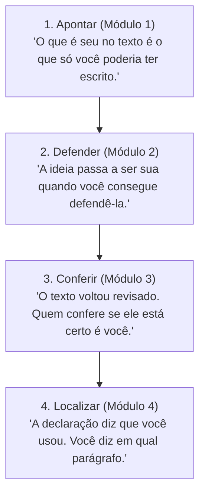

# Q7-M4 - A Linha Diz Que Você Usou

> **Disciplina:** COM170 - Inteligência Artificial na Prática Acadêmica e Profissional  
> **Quinzena 07:** Autoria Assistida: Do Texto Genérico à Rastreabilidade Parágrafo por Parágrafo  
> **Docente Responsável:** Prof. José Avelino Placca  
> **Foco do Módulo 4:** Rastreabilidade de autoria parágrafo por parágrafo, taxonomia de apropriação (*Meu*, *Aceito*, *Modificado*, *Recusado*), prevenção ao plágio involuntário e auditoria prospectiva orientada a impacto (*quem vai agir a partir do documento*).

---

## 🧭 1. Visão Geral do Módulo 4

Escolha um trabalho acadêmico ou profissional que você entregou no semestre passado. Se hoje alguém pedisse para você apontar exatamente o que escreveu sozinho e o que veio de uma ferramenta de Inteligência Artificial (IA), quanto tempo você levaria para responder?

A declaração geral de uso (apresentada na Quinzena 6) informa genericamente que uma ferramenta participou do processo. Este módulo vai além dela ao estabelecer a **rastreabilidade parágrafo por parágrafo**: uma disciplina documental simples que anota quatro palavras-chave ao lado de cada parágrafo, acompanhadas de um registro breve feito no momento da decisão, guardando o motivo factual de cada escolha.

Além da auditoria retrospectiva, o módulo culmina na pergunta essencial que deve anteceder qualquer entrega:
> **"Quem vai ler este texto, e o que essa pessoa vai fazer a partir dele?"**

Como fechamento do conteúdo programático da disciplina, o módulo consolida os quatro módulos da quinzena por meio de um miniquiz de seis situações no formato de prova da UNIVESP.

---

## 📺 2. Videoaula e Material-Base

### 🎥 Videoaula 4: A linha diz que você usou
* **Acesso:** [Assistir no YouTube (10 min)](https://www.youtube.com/watch?v=Zfq9djgDG2s)
* **Tema central:** Semanas após a entrega, alguém pergunta em qual parágrafo a ferramenta entrou. A aula sintetiza o que a quinzena ensinou sobre autoria, apresentando a metodologia de anotação de autoria parágrafo por parágrafo e o fechamento conceitual dos quatro gestos.

### 📚 Material de Apoio Oficial
* **E-book (Versão Visual):** [Q7_M4-E-book.pdf](./Q7_M4-E-book.pdf) *(Produzido com Inteligência Artificial - ChatGPT 5.5)*
* **Apostila (Versão Acessível):** [COM170_apostila_quinzena7_M4.pdf](./COM170_apostila_quinzena7_M4.pdf)

---

## 📐 3. Os Quatro Gestos da Autoria e o Registro por Parágrafo

A autoria assistida por IA exige clareza metodológica entre o que é produção própria e o que decorre de intervenção algorítmica. O registro parágrafo por parágrafo estabelece quatro classificações fundamentais:

| Classificação | Papel da Ferramenta de IA | Papel do Autor | Exemplo de Registro |
| :--- | :--- | :--- | :--- |
| **Meu** | Nenhum (ou apenas consulta preliminar). | Escreveu o parágrafo integralmente com base em dados primários, entrevistas ou raciocínio próprio. | *"Pedido: nenhum. Motivo: dados apurados na entrevista com a gerente."* |
| **Aceito** | Gerou uma estrutura, roteiro ou resumo a partir de instruções claras. | Acolheu o texto sugerido sem alterações substanciais, conferindo sua coerência lógica. | *"Pedido: 'sugira uma estrutura para causas'. Motivo: explico cada causa com a planilha."* |
| **Modificado** | Redigiu ou revisou uma seção do texto. | Alterou o texto gerado para corrigir termos, ajustar precisão conceitual ou restaurar a fidelidade aos dados. | *"Pedido: 'revise a gramática'. Motivo: trocou 'metade' por 'a maioria'; restaurei 'metade'."* |
| **Recusado** | Propôs parágrafos, exemplos ou conclusões. | Identificou inadequação, genericismo ou alucinação e descartou a sugestão integralmente. | *"Pedido: 'sugira um exemplo'. Motivo: o exemplo gerado era vago e servia para qualquer empresa."* |

> [!WARNING]
> ### O Risco do Registro Tardio: Criptomnésia e Plágio Involuntário
> Preencher o registro de autoria semanas após a escrita confiando apenas na memória quase sempre induz ao erro. A pesquisa em psicologia cognitiva demonstra que o cérebro humano retém a ideia, mas apaga rapidamente o registro da fonte (*criptomnésia* ou *plágio involuntário*).  
> **A regra de ouro:** preencha o registro parágrafo por parágrafo **no mesmo dia** em que interagir com a ferramenta.

---

## 🏆 4. Miniquiz de Síntese: Quatro Gestos, Seis Situações

Atividade de consolidação no formato oficial da prova UNIVESP: casos práticos contextualizados, demandando a aplicação integrada dos quatro módulos.

---

### Situação 1: Lara vs. Hugo (Os Limites dos Detectores de IA)

> **Cenário:** Em uma disciplina acadêmica, dois estudantes entregaram uma resenha do mesmo livro:
> * **Lara:** Escreveu a resenha inteiramente sozinha, sem nenhuma ferramenta, concluindo com: *"É fundamental destacar a relevância, a atualidade e a pertinência do tema."*
> * **Hugo:** Solicitou a resenha a uma ferramenta de IA, colando no prompt as anotações detalhadas que fez durante a leitura, incluindo citações, páginas e exemplos concretos da obra.
>
> Um software detector de IA indicou **81% de probabilidade de texto gerado por IA** para a resenha de Lara e apenas **9%** para a de Hugo. Diante dos resultados, a professora comentou:  
> *"Na resenha da Lara, o programa e os sinais do texto apontam na mesma direção. Quando isso acontece, dá para saber quem usou a ferramenta."*

**Pergunta:** Qual crítica aponta a falha mais grave do raciocínio da professora?

- [ ] a) O programa errou nas duas resenhas e precisa ser trocado por um mais preciso.
- [x] **b) Programa e sinais leem o mesmo texto pronto; a concordância não prova nada.**
- [ ] c) Os sinais só aparecem em textos longos, e uma resenha é curta demais para eles.
- [ ] d) Hugo colou os próprios dados no pedido, então a resenha dele conta como autoral.
- [ ] e) A professora devia contar os sinais e usar esse número no lugar da porcentagem.

> [!NOTE]
> **Feedback Oficial da Alternativa (b):**  
> O programa detector e a análise de sinais estilísticos reagem exclusivamente a **traços superficiais do produto pronto** (fórmulas prontas, generalismos, adjetivação vazia). Quando ambos concordam, confirmam apenas a presença do padrão — o qual seres humanos também reproduzem com frequência (como Lara fez).  
> Nenhum detector analisa o **processo**: o histórico de versões do documento, rascunhos, anotações de leitura ou a capacidade de o autor defender o conteúdo oralmente. O caso de Hugo ilustra o inverso: ao alimentar o modelo com dados primários e exemplos ricos, a ferramenta gerou um texto com alta densidade e sem os marcadores típicos do texto genérico.

---

### Situação 2: Paula e as Vendas de Cosméticos (Defender Conclusões nos Dados)

> **Cenário:** Paula gerencia as vendas de uma loja virtual de cosméticos. Uma ferramenta de Inteligência Artificial sugeriu a seguinte premissa comercial:  
> *"Oferecer desconto no primeiro pedido aumenta a fidelidade dos clientes."*  
> Para validar a hipótese, Paula concedeu 10% de desconto no primeiro pedido durante o mês de março e comparou o desempenho com fevereiro (mês sem desconto):
> * **Fevereiro (Sem Desconto):** 120 clientes novos; **36** deles realizaram um segundo pedido em até 60 dias.
> * **Março (Com Desconto):** 200 clientes novos; **36** deles realizaram um segundo pedido em até 60 dias.

**Pergunta:** Considerando apenas os dados apresentados, qual conclusão Paula pode defender com rigor empírico?

- [ ] a) O desconto aumentou a fidelidade, já que o número de clientes novos subiu 80%.
- [ ] b) O desconto reduziu a fidelidade: a taxa de volta caiu de 30% para 18%.
- [ ] c) A ideia está defendida, porque os números vieram das vendas da própria loja.
- [x] **d) Março trouxe mais clientes novos, e o número dos que voltaram não aumentou.**
- [ ] e) A ideia continua emprestada, porque foi sugerida por uma ferramenta de IA.

> [!NOTE]
> **Feedback Oficial da Alternativa (d):**  
> É rigorosamente o que os dados empíricos sustentam sem extrapolações: houve 80 clientes novos adicionais, mas exatamente os mesmos 36 retornaram.  
> Com essa evidência, Paula pode defender com segurança uma **afirmação menor** (o desconto funcionou como estratégia de atração/aquisição de clientes) e manter a alegação de fidelização como uma questão aberta para testes longitudinais futuros. Afirmar redução deliberada da fidelidade (alternativa b) também extrapola o escopo do teste inicial.

---

### Situação 3: Rodrigo e o Relatório em Inglês (Restrições de Prompt vs. Ficha de Dados)

> **Cenário:** Rodrigo precisa submeter à diretoria de uma distribuidora internacional um relatório de vendas redigido em inglês. Antes de solicitar a revisão a uma ferramenta de IA, um colega deu a seguinte recomendação:  
> *"Monte o pedido com Papel, Objetivo, Restrições e Formato. Nas Restrições, liste os tipos de erro de inglês que ela deve procurar e escreva: mantenha todos os números como estão. Assim a ferramenta encontra os erros e não mexe nos dados, e você não precisa conferir o relatório depois."*

**Pergunta:** Qual crítica aponta a falha mais grave do argumento do colega de Rodrigo?

- [x] **a) A restrição impede que os números mudem, e não mostra se estão certos.**
- [ ] b) Pedidos detalhados fazem a ferramenta achar menos erros do que os simples.
- [ ] c) Em geral, a ferramenta ignora as restrições escritas no pedido de revisão.
- [ ] d) Sem exemplos de cada tipo de erro, a lista de tipos não melhora a revisão.
- [ ] e) Conferir depois da revisão só é necessário em textos escritos em português.

> [!NOTE]
> **Feedback Oficial da Alternativa (a):**  
> A instrução de restrição é útil para impedir que a ferramenta altere inadvertidamente dígitos e valores. No entanto, ela **não valida se os números redigidos inicialmente por Rodrigo estavam corretos**, nem se os percentuais calculados batem com os resultados reais do negócio.  
> A ferramenta de IA não tem acesso à planilha de vendas da distribuidora. A estruturação do prompt potencializa a correção linguística, mas a **conferência factual comparativa com a fonte primária** permanece como obrigação intransferível do autor.

---

### Situação 4: Sabrina e a Rotatividade na Farmácia (Classificação do Registro)

> **Cenário:** Sabrina escreveu um relatório técnico de cinco parágrafos investigando a rotatividade de colaboradores em uma rede de farmácias. No mesmo dia em que interagiu com a IA, preencheu o registro por parágrafo:
>
> 1. **Parágrafo 1 - Meu:** *Pedido: nenhum. Motivo: dados da entrevista com a gerente.*
> 2. **Parágrafo 2 - Aceito:** *Pedido: "sugira uma estrutura para a seção de causas". Motivo: explico cada causa com os números da planilha.*
> 3. **Parágrafo 3 - Modificado:** *Pedido: "revise a gramática". Motivo: a revisão trocou "metade" por "a maioria"; devolvi "metade".*
> 4. **Parágrafo 4 - Meu:** *Pedido: "escreva uma conclusão a partir dos parágrafos anteriores". Motivo: mudei três palavras para ficar no meu estilo.*
> 5. **Parágrafo 5 - Recusado:** *Pedido: "sugira um exemplo". Motivo: o exemplo servia para qualquer empresa.*

**Pergunta:** Qual linha do registro de Sabrina precisa ser corrigida, e por quê?

- [ ] a) A do parágrafo 1: sem pedido anotado, não há como saber se a ferramenta entrou.
- [ ] b) A do parágrafo 2: uma estrutura sugerida pela ferramenta deveria virar Modificado.
- [ ] c) A do parágrafo 3: devolver a palavra original faz o parágrafo voltar a ser Meu.
- [x] **d) A do parágrafo 4: a ferramenta redigiu e ela só ajustou termos; é Modificado.**
- [ ] e) A do parágrafo 5: texto recusado não entra no trabalho e sai também do registro.

> [!NOTE]
> **Feedback Oficial da Alternativa (d):**  
> O registro explicita que a ferramenta redigiu a íntegra da conclusão e que Sabrina realizou apenas a substituição cosmética de três vocábulos.  
> A classificação de autoria é determinada **pelo papel que a ferramenta exerceu na concepção do conteúdo e pelo que permaneceu no texto final**, e não por quem digitou a última palavra. Esse parágrafo é, rigorosamente, **Modificado**. Além disso, a justificativa *"ficar no meu estilo"* carece de critério auditável e verificável por terceiros.

---

### Situação 5: Thiago e a Criptomnésia (Preenchimento Tardio de Memória)

> **Cenário:** Thiago redigiu um artigo técnico de seis parágrafos ao longo de três semanas. Na declaração geral ao fim do trabalho, registrou que utilizou uma ferramenta de Inteligência Artificial para redigir e revisar. No dia da entrega final, tentou preencher de memória o registro parágrafo por parágrafo e assinalou **Meu** em cinco dos seis parágrafos.  
> Ao auditar a entrega, o professor solicitou o histórico dos chats com o modelo. O registro de conversas revelou que a IA havia redigido a primeira versão dos **parágrafos 2 e 5**, os quais Thiago posteriormente editou.

**Pergunta:** Considerando a dinâmica descrita, qual é a explicação mais provável para a discrepância entre o registro de Thiago e o histórico real das conversas?

- [ ] a) Thiago quis esconder o uso da ferramenta para não ter a nota reduzida.
- [ ] b) Depois de editados, os parágrafos passaram a ser dele, e Meu está correto.
- [x] **c) Três semanas depois, ele lembrou das ideias e esqueceu de onde elas vieram.**
- [ ] d) O histórico da ferramenta confundiu as conversas e atribuiu parágrafos errados.
- [ ] e) Thiago não sabia que o registro pede uma palavra para cada parágrafo.

> [!NOTE]
> **Feedback Oficial da Alternativa (c):**  
> Trata-se do fenômeno documentado pela psicologia cognitiva como **plágio involuntário** (*criptomnésia*): o indivíduo recorda com vivacidade a ideia conceitual, mas seu cérebro perde o vínculo com a fonte geradora, sem qualquer intenção premeditada de fraude.  
> O transcurso de três semanas aliado a um preenchimento retroativo baseado exclusivamente na memória constituem o ambiente propício para essa distorção. Realizar o registro **no mesmo dia da interação** elimina essa falha cognitiva.

---

### Situação 6: Aline e o Relatório para a Prefeitura (Autoria Orientada ao Impacto)

> **Cenário:** Aline atua em uma associação de catadores de materiais recicláveis e está finalizando um relatório técnico encomendado pela prefeitura municipal. O documento subsidiará a decisão de instalação de dois novos postos de entrega voluntária de recicláveis na cidade. O registro parágrafo por parágrafo de Aline indica:
> * **Parágrafo 1 (Meu):** Censo empírico de moradores realizado por ela presencialmente em seis bairros.
> * **Parágrafo 2 (Aceito):** Síntese elaborada pela IA a partir de um estudo acadêmico sobre raio de caminhada e engajamento na coleta seletiva.
> * **Parágrafo 3 (Modificado):** Revisão textual assistida, com uma sentença restaurada ao sentido original de campo.
> * **Parágrafo 4 (Aceito):** Ordenação prioritária dos seis bairros gerada pelo modelo, cruzando as contagens de Aline com a densidade demográfica de cada região; o texto recomenda a instalação nos dois primeiros bairros ranqueados.
>
> Aline dispõe de apenas **uma hora** antes do prazo final de submissão.

**Pergunta:** Considerando quem vai ler o relatório e qual decisão prática será tomada a partir dele, qual é o uso mais responsável e adequado dessa última hora?

- [ ] a) Rever as contagens do parágrafo 1, já que o relatório inteiro parte delas.
- [ ] b) Conferir no estudo original o resumo do parágrafo 2, que a ferramenta fez.
- [ ] c) Reler o parágrafo 3, porque a revisão já mudou o sentido de uma das frases.
- [ ] d) Trocar Aceito por Modificado nos parágrafos 2 e 4, para mostrar conferência.
- [x] **e) Refazer com os dados dela a ordem dos bairros, que vai guiar a decisão.**

> [!NOTE]
> **Feedback Oficial da Alternativa (e):**  
> A prefeitura utilizará o relatório para **investir recursos públicos e definir a infraestrutura física da cidade**, instalando os pontos de coleta exatamente nos dois primeiros bairros do ranqueamento.  
> Como essa lista ordenada foi gerada pela ferramenta algorítmica e acolhida integralmente (*Aceito*), conferir e refazer o cálculo cruzando as contagens empíricas com os dados populacionais é o procedimento mais crítico. É a ação que **efetivamente protege quem vai agir no mundo real com base no documento**.

---

## 📌 5. Síntese da Quinzena 07: O Que Fica dos Quatro Gestos

Ao longo desta quinzena, consolidamos quatro competências essenciais para exercer autoria crítica diante de ferramentas de Inteligência Artificial:

| Gesto Fundamental | Pergunta Orientadora | Princípio de Ação |
| :--- | :--- | :--- |
| **1. Apontar** | O texto apresenta a densidade da minha experiência ou o padrão genérico da ferramenta? | Eliminar fórmulas vazias, adjetivos de reforço e generalismos automáticos. |
| **2. Defender** | Consigo sustentar esta alegação com evidências e razões externas à frase? | Separar ideias sugeridas daquelas que os dados empíricos realmente comprovam. |
| **3. Conferir** | A revisão estilística alterou números, datas ou o grau de certeza da minha conclusão? | Auditar alterações com a ficha de dados ao lado antes de aceitar sugestões. |
| **4. Localizar** | Consigo indicar, parágrafo por parágrafo, onde e como a ferramenta participou? | Registrar imediatamente o uso (*Meu, Aceito, Modificado, Recusado*) e auditar o impacto na decisão de quem lê. |

> 💬 **Provocação para a Quinzena 08 (Revisão da Disciplina):**  
> *"De tudo o que você aprendeu aqui sobre autoria, prompts e ferramentas de Inteligência Artificial, o que se consolida como o seu padrão profissional de trabalho daqui para frente?"*