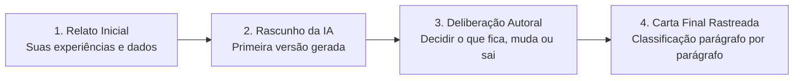

# Q7-M5 - O Trabalho da Quinzena: A Carta Para Quem Começa

> **Disciplina:** COM170 - Inteligência Artificial na Prática Acadêmica e Profissional  
> **Quinzena 07:** Autoria Assistida: Do Texto Genérico à Rastreabilidade Parágrafo por Parágrafo  
> **Docente Responsável:** Prof. José Avelino Placca  
> **Foco do Módulo 5:** Orientações gerais da produção prática da quinzena; definição da ferramenta de Inteligência Artificial (IA) e modelo; metodologia de rastreabilidade parágrafo por parágrafo; articulação do Portfólio Individual ([Módulo 6](./atividades_quinzenal/Portfolio_Individual_Q7_M6.md)) e da produção coletiva no [Módulo 7](./atividades_quinzenal/Portfolio_Grupo_Q7_M7.md).

---

## 🧭 1. Visão Geral: Escrever Para Quem Ainda Vai Chegar

Daqui a um ano, uma nova pessoa abrirá esta disciplina pela primeira vez. Ela encontrará a divisão em módulos, o Laboratório de Revisão no Ambiente Virtual de Aprendizagem (AVA), os grupos de trabalho e as transmissões ao vivo (*lives*), enfrentando as mesmas dúvidas e receios que você vivenciou nas semanas iniciais.

Você detém hoje uma experiência consolidada que o ingressante ainda não possui.

Nos quatro primeiros módulos desta quinzena, você aprendeu e exercitou os quatro gestos essenciais para trabalhar com ferramentas de Inteligência Artificial (IA):
1. **Apontar:** Identificar o padrão genérico em um texto pronto ([Módulo 1](./conteudo_q7_m1.md));
2. **Defender:** Sustentar uma ideia sugerida pela ferramenta com evidências externas à frase ([Módulo 2](./conteudo_q7_m2.md));
3. **Conferir:** Auditar textos revisados conferindo números, prazos e grau de certeza contra a fonte primária ([Módulo 3](./conteudo_q7_m3.md));
4. **Localizar:** Registrar, parágrafo por parágrafo, a exata participação da ferramenta ([Módulo 4](./conteudo_q7_m4.md)).

Agora, na parte prática, você aplicará esses quatro gestos na produção de um texto autoral completo, do rascunho à entrega final.

---

## 🎯 2. A Proposta do Trabalho Prático

Você escreverá, com o suporte da ferramenta de IA de sua preferência, uma **carta de quatro a seis parágrafos** direcionada ao futuro estudante, com orientações fundamentadas para ajudá-lo a se situar e ter sucesso nos estudos.

### O Fluxo da Produção Assistida
* **O Rascunho Inicial:** A ferramenta gera uma primeira versão a partir das instruções, diretrizes e experiências reais que você fornecer a ela.
* **A Intervenção Crítica:** Você avalia cada parágrafo, determinando o que permanece inalterado, o que precisa de ajustes terminológicos e conceituais, o que deve ser completamente descartado e o que **somente você** poderia redigir com base na sua vivência acadêmica.
* **A Entrega Oficial:** Você entrega a carta final acompanhada do registro detalhado de processo: os prompts submetidos, as respostas do modelo e a justificativa da decisão tomada em cada parágrafo.

---

## 🏷️ 3. A Regra Inegociável: Rastreabilidade Parágrafo por Parágrafo

Cada parágrafo da sua carta final deve estampar ao lado uma das quatro classificações introduzidas na videoaula do [Módulo 4](./conteudo_q7_m4.md), acompanhada de seu respectivo motivo:

| Marcador | Significado Operacional | Critério de Decisão |
| :---: | :--- | :--- |
| **MEU** | Escrito exclusivamente por você, sem auxílio da ferramenta. | Contém experiências diretas, dados empíricos e reflexões autorais únicas. |
| **ACEITO** | Redigido pela ferramenta de IA e acolhido integralmente. | O trecho gerado está perfeitamente correto e alinhado aos fatos do curso. |
| **MODIFICADO** | Redigido pela ferramenta de IA, mas substancialmente alterado por você. | Ajustou palavras, corrigiu graus de certeza ou reformulou para garantir precisão factual. |
| **RECUSADO** | Sugerido pela ferramenta de IA e descartado do texto final. | O trecho continha generalismos vazios, alucinações ou conselhos inadequados. |

> [!IMPORTANT]
> **A Linha e a Assinatura:**  
> A ferramenta sugere ou redige, mas **quem assina o trabalho e responde por cada afirmação é você**. O seu portfólio existe para documentar e demonstrar essa capacidade de auditoria e governança autoral.

---

## 🛠️ 4. Parâmetros da Ferramenta e o Destinatário

### Escolha e Registro da Ferramenta
Você pode utilizar qualquer uma das principais ferramentas de mercado:
* **OpenAI ChatGPT**;
* **Google Gemini**;
* **Microsoft Copilot**.

Antes de iniciar as conversas, anote dois metadados técnicos obrigatórios:
1. **Nome da Plataforma** (ex.: ChatGPT, Gemini, Copilot);
2. **Identificador Exato do Modelo** (ex.: GPT-5, Gemini 2.5 Flash, ou similar, conforme exibido na interface ou nas configurações).

Esses dois dados devem constar obrigatoriamente no cabeçalho do seu Portfólio Individual e na Declaração de Uso ao final da carta.

### Escrever Para Alguém Determinado
Na Quinzena 5, foi anunciado que a declaração explícita de uso de IA seria objeto de aprofundamento prático. Esta é a oportunidade em que você não apenas insere a declaração, mas rastreia a gênese de cada frase.

> 💡 **A Pergunta de Ouro da Entrega:**  
> Ao redigir, tenha sempre em mente a pergunta apresentada na videoaula do Módulo 4: *"Quem vai ler este texto e o que essa pessoa vai fazer a partir dele?"*  
> Escrever imaginando um estudante concreto, que precisa agir com base nas suas orientações, é o que imuniza o texto contra clichês e conselhos genéricos que serviriam para qualquer curso.

---

## 🗺️ 5. O Trabalho da Quinzena Módulo a Módulo

A parte prática se desdobra de forma articulada ao longo dos módulos finais:

| Módulo | Ação do Estudante | O Que Entregar e Onde |
| :---: | :--- | :--- |
| **Módulo 5** *(Abertura Prática)* | Leitura criteriosa das instruções, escolha da ferramenta de IA e anotação do modelo em uso. | Nenhuma entrega formal exigida neste módulo. |
| **Módulo 6** *(Portfólio Individual)* | Execução do guia do portfólio: 4 etapas com a IA, preenchimento da ficha de resultados e defesa argumentativa por escrito de um parágrafo da carta. | Documento completo do Portfólio Individual no **Laboratório de Revisão do Módulo 6** do AVA. Posteriormente, realização de avaliação por pares de um colega. |
| **Módulo 7** *(Trabalho em Grupo)* | Reunião com o grupo de trabalho para comparar as fichas individuais, estruturar o mapa consolidado de conselhos e responder a três questões analíticas. | Mapa do grupo e respostas analíticas enviados pelo representante no **Laboratório de Revisão do Módulo 7** do AVA. Posteriormente, avaliação entre grupos parceiros. |

> [!NOTE]
> **Flexibilidade e Formação de Grupos:**  
> Grupos de qualquer tamanho são plenamente válidos para a entrega do Módulo 7. Caso você esteja trabalhando de forma individual, o guia do grupo fornece as instruções específicas para consolidar o trabalho a partir da sua própria carta.  
> As rubricas de avaliação, os critérios de retorno e os prazos operacionais detalhados constam nos respectivos guias dos Módulos 6 e 7.